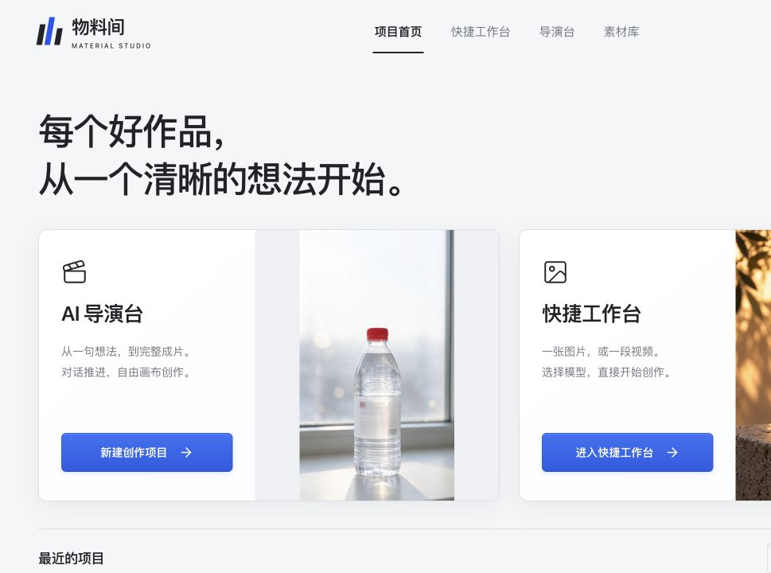
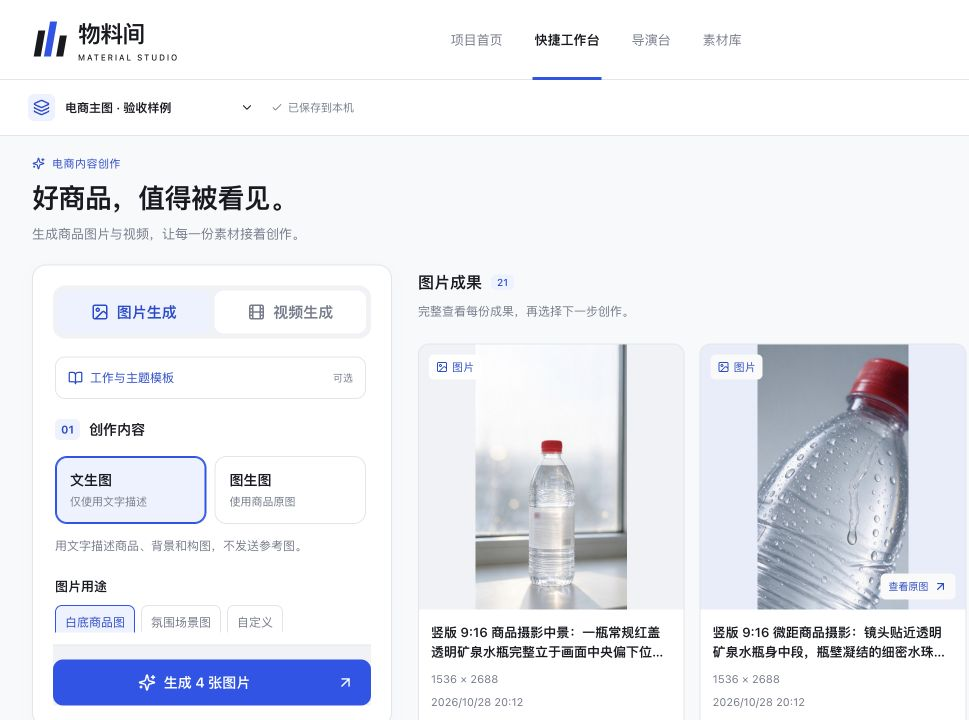
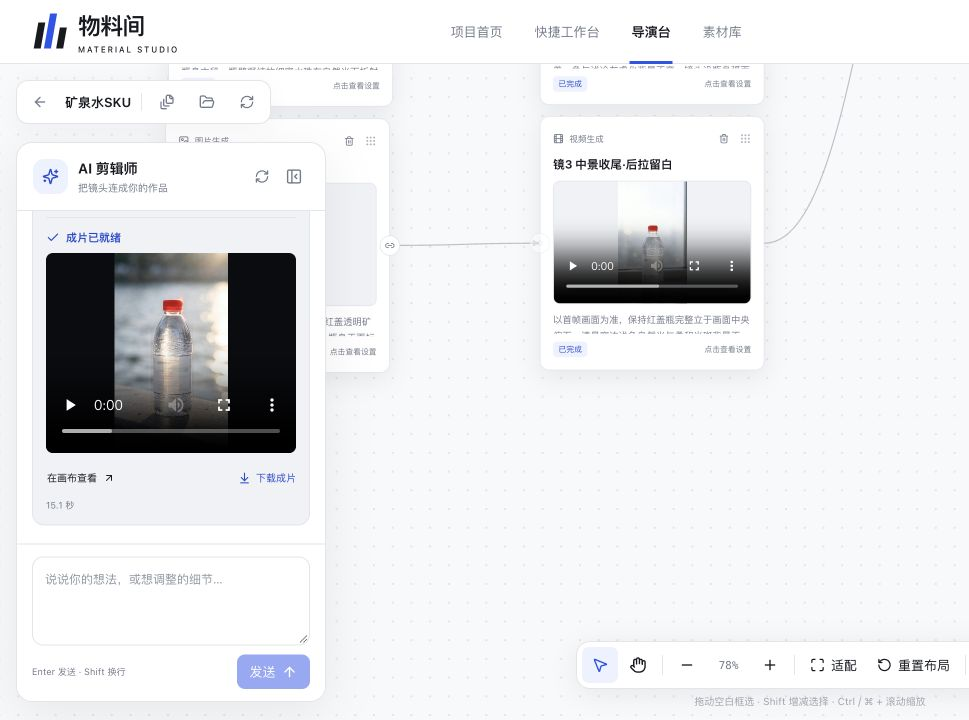
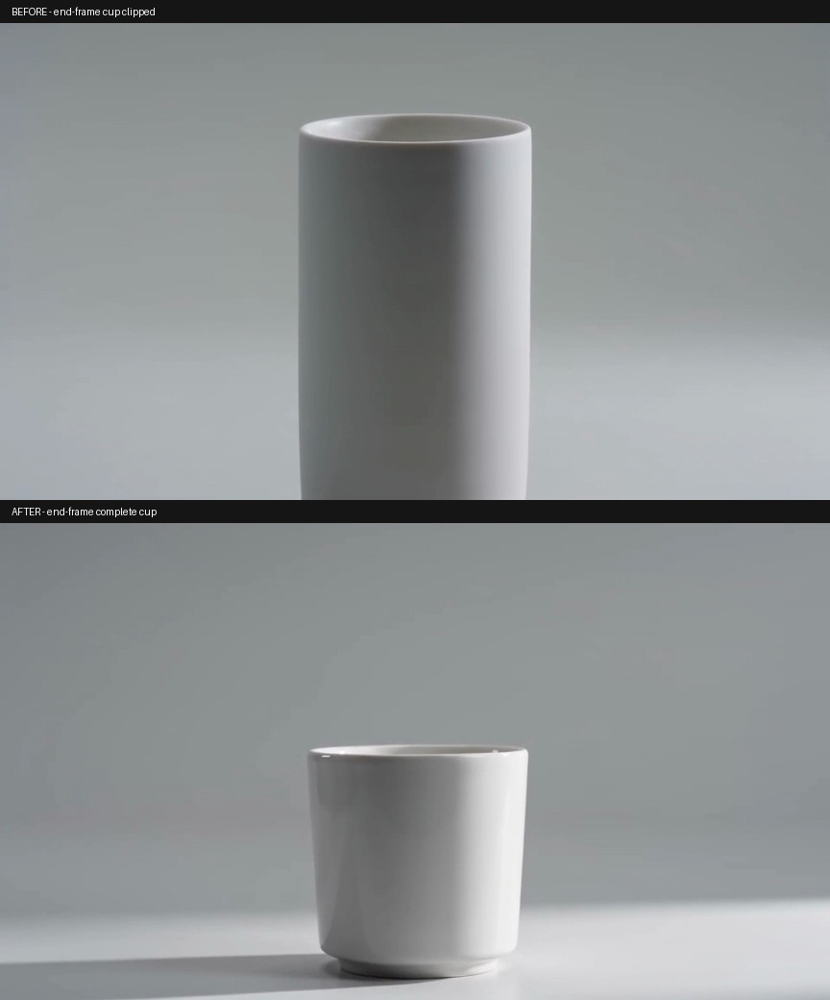
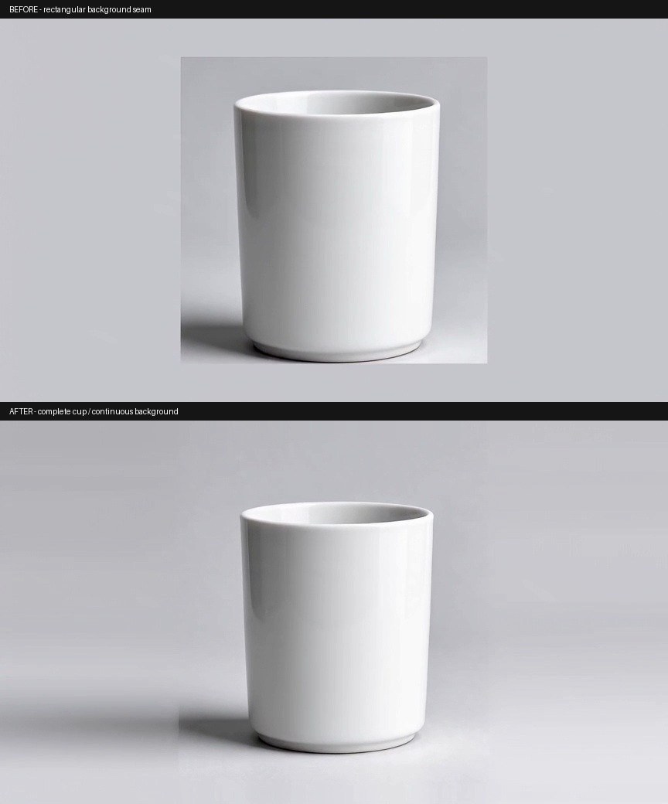

# 物料间 · 电商 AIGC 创作工作台

**把商品与想法，逐步做成图片、分镜和视频。**

面向电商内容创作的 Web 项目：目标明确时，在快捷工作台直接生成素材；需要打磨创意时，在导演台通过对话完成脚本、分镜、视频与成片。

[体验交互原型](https://evenk5838-coder.github.io/ecommerce-aigc-workbench/) · [三类演示附件](docs/showcase/README.md) · [本地运行](#本地运行) · [项目状态](docs/项目状态.md) · [MIT License](LICENSE)



> 当前为单用户本地 Web MVP。在线原型使用固定样例，不连接模型；真实生成需自行配置供应商 Key 和预算。

## 项目演示

### 1. 产品操作演示

[打开可交互原型 →](https://evenk5838-coder.github.io/ecommerce-aigc-workbench/)

体验四种生成模式、编剧→导演→摄影师→剪辑师的阶段推进，以及画布节点添加、拖动、设置、框选、删除与撤销。原型回复和结果为预置内容。以下为实际产品截图。

| 快捷工作台：描述与参数 | 导演台：对话与自由画布 |
| --- | --- |
|  |  |

[图文操作演示与截图来源](docs/showcase/product/README.md)

### 2. 参考图与生成结果

白杯为无品牌虚构商品。左图来自此前文生图实测，作为右侧图生图的输入。

| 输入参考图 | 图生图结果 |
| --- | --- |
|  |  |

**真实视频原片：** [文生视频 MP4](docs/showcase/reference-results/text-to-video.mp4) · [图生视频 MP4](docs/showcase/reference-results/image-to-video.mp4)。两条约5秒，可在[在线原型](https://evenk5838-coder.github.io/ecommerce-aigc-workbench/)的快捷台切换视频模式后播放。

[参考图、实际首帧、抽帧及来源](docs/showcase/reference-results/README.md)

### 3. Bad Case 修正前后对照

直接复用[视频构图v2真实复验材料](docs/evidence/v0.11-视频构图v2真实复验-20261030/当前结果.md)，保留修正前后原片及原有对照图。

**文生视频：杯底裁切 → 新版样例完整展示。**



**图生视频：大方框补边接缝 → 明显改善，阴影仍有局部接痕。**



这些是不同请求的样例，不是同 seed 严格对照，不代表所有商品均能稳定复现。数字化运镜要求未被模型严格遵守，供应商实际账单仍待核对。

[旧视频、修正结果与残余问题](docs/showcase/bad-cases/README.md) · [全部媒体来源与SHA-256](docs/showcase/ASSETS.md)

## 已实现的能力

| 模块 | 当前能力 |
| --- | --- |
| 快捷工作台 | 文生图、图生图、文生视频、图生视频；模型与比例/清晰度/时长联动 |
| 对话式导演台 | 编剧梳理需求与脚本，导演规划分镜，摄影师生成镜头视频，剪辑阶段组织成片；费用确认后执行 |
| 无限画布 | 平移缩放、拖动、单选/框选、删除与撤销、单节点提示词与生成参数设置、素材导入 |
| 项目与素材 | 创建/打开/软删除项目、任务恢复、素材管理、原图/视频/ZIP下载 |
| 模型适配 | 火山方舟、AiHubMix；目录、合同适配、真实样例、正式启用分别管理 |
| 输出策略 | 无可见水印、完整构图、比例预处理和静音后处理；保留失败样例 |
| 首页与主题 | 对称双入口、深浅同布局、浅色蓝色按钮、最近成功作品封面与默认回退 |

AiHubMix实测型号包括 Seedream Flash、Qwen Image、FLUX.2 Pro、Seedance Fast/Mini、MiniMax H3 和 Wan。**仅开放各型号验证过的方式与规格**，Key有效或目录可见不等于开放全部能力。

## 当前进度与边界

- 本地 Web 主链路已跑通，真实图片、镜头视频和成片有记录；最新模型扩充、输出策略与首页更新已包含在仓库。
- 手机完整流程、排版编辑、商业套餐/积分、供应商最终账单仍待推进；排版编辑入口暂时隐藏。
- 当前为单用户本地工作台。多用户鉴权、数据隔离与生产公网部署尚未完成，不应将本地生成接口直接暴露到公网。
- 此次演示整理没有新增付费模型请求。自动化检查、历史真实实测、固定原型和用户验收分别记录。

[完整状态](docs/项目状态.md) · [阶段记录](docs/阶段文档/) · [历史README归档](docs/交付/开发记录-20261104.md)

## 本地运行

技术栈：React / TypeScript / Vite、FastAPI / Python、SQLite、FFmpeg。当前验证环境为 Node 24 与 Python 3.12。跨系统干净环境安装仍待验证，运行数据和模型权重不随仓库分发。

```bash
git clone https://github.com/evenk5838-coder/ecommerce-aigc-workbench.git
cd ecommerce-aigc-workbench
python3.12 -m venv backend/.venv
backend/.venv/bin/python -m pip install -r backend/requirements.txt
npm --prefix frontend ci
cp .env.example .env
./start.command
```

打开 http://127.0.0.1:8100/ 。视频处理需系统提供 FFmpeg / ffprobe。端口已有服务时启动脚本保留原进程；前端开发用 `npm --prefix frontend run dev`。

只体验原型无需后端和Key：打开[在线演示](https://evenk5838-coder.github.io/ecommerce-aigc-workbench/)，或运行 `python3 -m http.server 8090 --directory docs` 后访问 http://127.0.0.1:8090/ 。

### 配置与检查

在本机 `.env` 中填写 `ARK_API_KEY` 或 `AIHUBMIX_API_KEY`，配置经过核验的 `AIHUBMIX_ENABLED_MODELS`、预算换算上界与 `APP_BUDGET_CNY`。默认允许列表为空、预算为0，付费生成关闭。文本Agent还需对应文本模型配置，详见[配置示例](.env.example)与[操作手册](docs/交付/交互操作手册.md)。

```bash
npm --prefix frontend run lint
npm --prefix frontend run test
npm --prefix frontend run build
backend/.venv/bin/python -m unittest discover -s backend/tests
node --check docs/showcase/demo.js
```

真实模型验收脚本需要单独预算授权，不作为默认测试运行。

## 开源与素材

自有代码采用 [MIT License](LICENSE)。依赖、模型权重、服务条款及第三方素材各自遵循原许可；媒体来源见 [ASSETS](docs/showcase/ASSETS.md)，参考与第三方说明见 [THIRD_PARTY_NOTICES](THIRD_PARTY_NOTICES.md)。

欢迎提交Issue，附复现步骤、输入规格与期望结果；请勿上传Key、私人素材或供应商签名链接。
