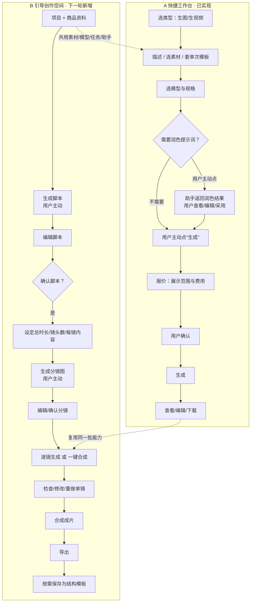
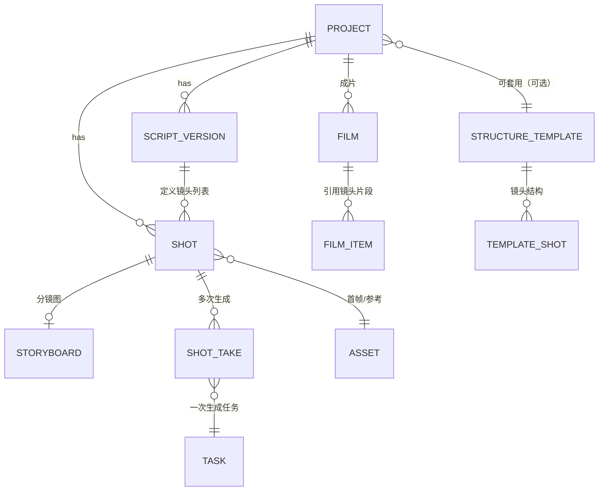

# 电商 AIGC 工作平台 · PRD v0.10（草案）：双入口与引导创作

| 项 | 内容 |
| --- | --- |
| 版本 | **v0.10 草案（增量，未确认）** |
| 日期 | 2026-10-25 |
| 上一版 | v0.9.1 草案（`docs/PRD/PRD.md`，助手阶段一） |
| 本版性质 | **增量草案**：仅新增"双入口 + 引导创作"章节与配套对照；**不替换正式开发基线**，v0.9.1 继续有效直到本草案获确认 |
| 当前交付基线 | 标签 `assistant-stage1-review-20261024`（提交 `bbc20d6`）+ 其后 `2cf9dfd`（助手 v0.3 修复） |
| 形态 | 本地工作台 + 火山方舟（图片/视频）+ DeepSeek（助手文本） |
| 本轮范围 | **只写 PRD**；不改代码、不改配置、不写数据库、不调模型、不产生费用 |

> 阅读约定：**已确认**＝产品经理已定；**待确认**＝本文给推荐，需产品经理裁决；
> **已实现**／**真实验证通过**／**前端待接入**／**下一轮新增** 四类状态严格区分，附证据位置。

---

## 0. 本版要点

### 0.1 已确认方向（不再询问）

1. 平台分**两个平级入口**：A 快捷工作台、B 引导创作空间。
2. 快捷工作台保留现有全部直接操作；AI 仅提供**用户主动触发**的提示词润色；润色结果由用户查看/编辑/采用，**仍由用户主动提交生成**；不在工作台内展开脚本、分镜、多阶段引导。
3. 引导创作空间面向**多镜头电商视频**，独立入口，以**无限画布**承载引导过程与成果；与工作台**共用**素材、模型、任务、助手服务。
4. 引导创作目标流程固定为 8 步（见 §2）。
5. 每个生成阶段**必须用户主动触发**；对话/推荐/编辑/确认方向**不得自动**进入下一阶段生成。
6. 助手**不能替用户确认**；费用必须在执行前展示；**未知费用不得当作 0**。
7. 简单商品图与简单展示视频**仍可直接在工作台完成**，不强制走完整流程。

### 0.2 待确认细节（本文给推荐，见 §5）

| # | 待确认 | 推荐 |
| --- | --- | --- |
| Q1 | 无限画布首版自由度 | 仅"流程节点 + 平移/缩放/查看/整理"；**任意连线/分支/循环不纳入首版** |
| Q2 | "一键成片"含义 | 首版＝**只合成已有片段**；"自动补生成缺失镜头"列为后续 |
| Q3 | 镜头时长与成片时长 | 生成片段 5s/10s 可选，成片按分镜时长**裁切**；镜头可单独重做 |
| Q4 | 多镜头结构模板首版范围 | 先做"结构可复用 + 素材每次重绑"；不做批量套用与跨项目共享 |

---

## 1. 两个入口的职责

| 维度 | A 快捷工作台（已实现，保留） | B 引导创作空间（下一轮新增） |
| --- | --- | --- |
| 面向 | 需求明确、追求效率 | 需要精细制作、多镜头讲述 |
| 核心动作 | 选类型 → 填描述/选素材 → 选模型规格 → 生成 → 查看/编辑/下载 | 需求 → 脚本 → 分镜 → 逐镜生成 → 成片 → 导出 |
| AI 作用 | **仅**：用户主动点"润色提示词"，返回结果由用户决定是否采用 | 贯穿：澄清需求、建议脚本与镜头、推荐模板；**仍不代替确认** |
| 是否必须用 AI | 否，可完全不用 | 可用助手，也可手工编辑脚本/分镜 |
| 产物结构 | 单张图 / 单条视频 | 项目（含脚本、分镜、镜头、成片、版本） |
| 现有实现 | ✅ 已实现并真实跑通（见 §11） | ⬜ **完全未实现**（无表、无接口、无页面） |

### 1.1 完整流程图

> 两个入口**平级**：不互相跳转强制；可从工作台把素材/结果"送入创作空间"，也可在创作空间里退回手工编辑。

---

## 2. 引导创作：逐阶段定义

> 通用规则：每阶段的**生成**都必须由用户点按钮触发；前一阶段的"确认"只解锁下一阶段按钮，**不自动生成**。
> 每阶段产物都有版本；修改上游**不删除**已生成的下游成果，只标记"已过期，可重做"。

### 2.1 阶段①需求与商品资料

| 项 | 内容 |
| --- | --- |
| 输入 | 商品名称与数量（用户填）、商品图（用户选/传）、卖点（用户填）、禁用元素、目标平台/时长偏好 |
| 输出 | **项目 brief**（结构化字段，可编辑） |
| 可编辑 | 全部字段；可从素材库引用，也可上传 |
| 确认动作 | 无独立生成；点"生成脚本"即视为以当前 brief 为准（brief 变更后可重新生成脚本） |
| 失败处理 | 素材无效（非图片/超大）→ 前端拦截 + 后端 400；缺商品名 → 提示但不阻断（脚本会标"待补"） |
| 返回修改 | 随时编辑 brief；已生成脚本保留，标记"brief 已更新" |

### 2.2 阶段②生成简单视频脚本

| 项 | 内容 |
| --- | --- |
| 输入 | brief + 目标时长 + 风格 |
| 输出 | **脚本**：整体叙事 3–6 句 + 建议镜头数 + 每镜一句话描述（**不含**具体提示词参数） |
| 可编辑 | 全文可改；可增删镜头条目 |
| 确认动作 | 按钮"**生成脚本**"（首次）／"**重新生成脚本**"（覆盖前需二次确认，旧版本保留） |
| 费用 | 助手文本生成 → 消耗 LLM 用量（**不产生图片/视频费用**）；须先展示预估或标注"按 token 计" |
| 失败处理 | LLM 不可用 → 明确提示"助手暂不可用"，允许**手工写脚本**继续（不阻断流程） |
| 返回修改 | 编辑 brief 后重生成；或直接手改脚本 |

### 2.3 阶段③确认总时长、镜头数与每镜内容

| 项 | 内容 |
| --- | --- |
| 输入 | 脚本 + 用户设定的总时长/镜头数/每镜时长 |
| 输出 | **分镜计划**：镜头列表（序号、时长、画面描述、是否需要人物/动作、首帧来源） |
| 可编辑 | 增删镜头、调时长、改描述、调顺序 |
| 确认动作 | 按钮"**确认脚本并生成分镜**"（解锁阶段④） |
| 费用 | 无（纯编辑）；若此步调用助手建议，则产生 LLM 用量 |
| 失败处理 | 总时长与镜头数矛盾（如 3 镜×5s ≠ 目标 20s）→ 明确提示差值，禁止静默凑数 |
| 返回修改 | 回阶段②改脚本 |

### 2.4 阶段④生成分镜图

| 项 | 内容 |
| --- | --- |
| 输入 | 每镜的画面描述（+可选商品参考图） |
| 输出 | 每镜**分镜图**（图片素材），与镜头一一对应 |
| 可编辑 | 每镜可单独重生成、替换为已有素材 |
| 确认动作 | 按钮"**生成分镜图**"（可"生成全部"或"生成所选"） |
| 费用 | 按图片张数计价；**执行前展示"将生成 N 张 × 单价 = 预计费用"** |
| 失败处理 | 单张失败不影响其它；失败项标红可单独重试；**重试＝再次计费**，需提示 |
| 返回修改 | 改镜头描述 → 只重生成该镜分镜图 |

> 复用现状：分镜图＝普通图片任务（文生图或图生图），**无需新模型能力**，只是把它挂在"镜头"上。

### 2.5 阶段⑤修改或确认分镜

| 项 | 内容 |
| --- | --- |
| 输入 | 已生成分镜图 + 用户判断 |
| 输出 | 分镜状态：`draft / approved / rejected(原因)` |
| 可编辑 | 备注、替换图、驳回原因 |
| 确认动作 | 每镜"**通过**"或"**驳回并说明**"；全部通过后解锁阶段⑥ |
| 费用 | 无 |
| 失败处理 | 不适用（人工判断） |
| 返回修改 | 驳回 → 回到④只重做该镜 |

### 2.6 阶段⑥逐镜生成视频

| 项 | 内容 |
| --- | --- |
| 输入 | 该镜分镜图（作首帧）+ 镜头描述 + 规格（比例/清晰度/时长） |
| 输出 | 该镜**镜头视频**（mp4） |
| 可编辑 | 提示词、规格、重做 |
| 确认动作 | "**生成所选镜头**"（可多选）；单镜也可单独生成 |
| 费用 | 按 token 计价（5s/10s 不同）；**执行前展示每镜与合计预估**；批量时逐镜可见 |
| 失败处理 | 逐镜独立状态；失败可单独重试（再次计费）；**不自动重试** |
| 返回修改 | 改分镜图或提示词 → 只重做该镜，其它镜头不受影响 |

### 2.7 阶段⑦一键成片 或 逐镜完成

| 项 | 内容 |
| --- | --- |
| 输入 | 已通过/已生成的镜头视频集合 + 分镜时长 |
| 输出 | 成片 mp4（按镜头顺序拼接、按分镜时长裁切） |
| 可编辑 | 镜头顺序、每镜入点/出点、静音/保留原音 |
| 确认动作 | "**合成成片**"（明确列出参与合成的镜头与缺失项） |
| 费用 | **首版合成在本地完成 → 无模型费用**（仅耗时）；若未来接云端合成需另行定价，**不承诺更便宜** |
| 失败处理 | 缺镜头 → 提示缺哪几镜并给两个选项：①先补生成 ②仅合成已有；单个片段损坏 → 指出具体镜头 |
| 返回修改 | 回⑥重做单镜后重新合成（合成可反复执行，不额外计费） |

### 2.8 阶段⑧检查、导出、存为模板

| 项 | 内容 |
| --- | --- |
| 输入 | 成片 + 各镜头 + 分镜图 |
| 输出 | 导出包（成片 + 镜头 + 分镜图 + 清单 JSON）／**结构模板** |
| 可编辑 | 导出范围、命名规则 |
| 确认动作 | "**导出**"；"**保存为模板**"（另需命名与适用范围） |
| 费用 | 无 |
| 失败处理 | 导出失败 → 保留产物，可重试导出（不重新生成） |
| 返回修改 | 任意阶段可回退；**历史版本与素材保留** |

---

## 3. 当前阶段—确认—生成—费用—失败（总表）

| 当前阶段 | 用户确认什么 | 将生成什么 | 费用说明 | 失败后怎么办 |
| --- | --- | --- | --- | --- |
| ① 需求/商品资料 | 无需确认（可点"生成脚本"） | — | 无 | 素材非法→前端拦截；缺商品名→标"待补" |
| ② 脚本 | 点"生成脚本" | 脚本文本（3–6 句 + 建议镜头） | **LLM token 用量**（非图片/视频费），按下限预估 | 助手不可用→允许手工写脚本继续 |
| ③ 分镜计划 | 点"确认脚本并生成分镜" | 分镜计划（镜头数/时长/描述） | 无 | 时长/镜头数矛盾→提示差值，不静默凑 |
| ④ 分镜图 | 点"生成分镜图"（全部或所选 N 张） | N 张分镜图 | **N × 图片单价**，执行前显示 | 单张失败可单独重试（再次计费） |
| ⑤ 分镜审核 | 每镜"通过/驳回" | — | 无 | 驳回→回④只重做该镜 |
| ⑥ 镜头视频 | 点"生成所选镜头" | 每镜一条 mp4 | **逐镜 token 费**，显示每镜+合计 | 逐镜独立失败；不自动重试；重试再计费 |
| ⑦ 成片 | 点"合成成片" | 一条成片 mp4 | **本地合成＝无模型费用**；缺镜先提示 | 缺镜→补生成或仅合成已有；可反复合成 |
| ⑧ 导出/模板 | 点"导出"/"保存为模板" | 导出包／结构模板 | 无 | 导出可重试，不重新生成 |

**费用铁律**
1. 任何生成前必须显示：生成对象、数量、单价/口径、预计总额；**无法报价 → 按钮禁用并显示"费用未知，暂不可提交"**。
2. 未知/未开通模型不得显示 ¥0。
3. 合成与导出不得暗示"免费重做"——重做镜头仍是生成，**再次计费**。
4. 助手不得代替用户点确认；对话里的"好/可以"不等同确认。
5. 报价有时效（现状：报价单/批准 600s 有效），过期需重新报价。

---

## 4. 确认失效规则（改了什么要重新确认）

| 变化 | 已失效 | 仍需保留 |
| --- | --- | --- |
| 改 brief（商品名/卖点/禁用元素） | 脚本确认、分镜计划确认 | 历史脚本版本、已生成分镜图与镜头视频 |
| 改脚本 | 分镜计划确认 | 已生成分镜图（标"与最新脚本不一致"） |
| 改镜头数/时长/顺序 | 分镜计划确认、成片 | 已生成的分镜图/镜头视频（按镜头 ID 关联，不删） |
| 改某镜描述/分镜图 | 该镜分镜确认、该镜视频、成片 | 其它镜头一切 |
| 换模型/规格 | 该阶段报价与确认 | 已生成产物与历史版本 |
| 改镜头顺序 | 成片 | 各镜头视频 |

> 原则：**确认按"阶段 + 对象"绑定**；上游变更只让下游"过期"，不删除下游成果。

---

## 5. 待确认细节（附推荐）

### Q1 无限画布首版自由度 → 推荐：**流程节点 + 平移缩放，不做任意编排**

| 选项 | 说明 | 代价 | 推荐 |
| --- | --- | --- | --- |
| A（推荐） | 把 §2 的 8 个阶段做成**固定节点**，支持平移/缩放/查看/整理/折叠 | 中 | ✅ 首版 |
| B | 允许用户在节点间**任意连线**、分支 | 高（需执行引擎、依赖解析、循环检测） | ❌ 后续 |
| C | 循环/条件/通用工作流 | 很高 | ❌ 非目标 |

理由：引导创作的确定性来自"固定 8 步"，节点只是可视化载体；B/C 会把产品推向通用工作流平台，与"电商多镜头视频"目标偏离。

### Q2 "一键成片"含义 → 推荐：首版只合成已有片段

| 方案 | 行为 | 费用 | 确认范围 | 部分失败 |
| --- | --- | --- | --- | --- |
| **A（推荐）** | 只把已有镜头按顺序拼接+裁切 | 仅本地耗时，无模型费 | 列出参与合成的镜头清单 | 缺镜头→提示缺口，可选"仅合成已有" |
| B | 自动补生成缺失镜头后再合成 | 先按缺镜数报价，再合成 | 需**二次确认**（补生成 N 镜） | 缺镜生成失败→保留已成功项 |

**不承诺**"一键成片更便宜"：它可能包含额外生成；省的是人工操作，不是模型成本。

### Q3 镜头时长 → 推荐：生成时长与成片时长分离

- **生成片段**：模型侧 5s / 10s（现状能力）；2.0 mini 支持 4–15s（未开通）。
- **成片使用时长**：由分镜计划指定，可与生成时长不同（如 3s 分镜用 5s 片段裁切）。
- **裁切规则**：默认取**片段开头 N 秒**；提供"指定入点"能力列为待确认。
- **只重做单镜**：必须支持；重做粒度＝镜头，不触发其它镜头重生成。

### Q4 模板范围 → 推荐：结构模板与单次模板分开

| 类型 | 现状 | 新模板（多镜头结构） |
| --- | --- | --- |
| 现有 | "单次生成模板"（4 个：白底/场景/5s 动态/季节主题），字段+默认参数+版本 | — |
| 新增 | — | 复用**镜头职能、顺序、节奏、运镜、时长结构** |
| 商品事实 | 每次填 | **每次重新绑定**（不得继承上一商品的名称/卖点） |
| 模型规格 | 每次校验 | **每次重新校验**（模型可能下线/未开通） |
| 首版推荐 | 保留 | 支持"从项目另存为结构模板"＋"新建项目套用结构"；**不做**批量套用、跨项目共享、模板市场 |
| 表达纪律 | — | 不得宣称"套用即爆款"；模板只提供结构，不保证效果 |

---

## 6. 规格选项核对（前后端差异）

> 三种状态必须分开说：**模型支持**（官方能力清单）／**账号已开通**（真实调用通过）／**平台已接入并验证**（本项目真实跑通该规格）。

### 6.1 当前实现核对（只读代码得出）

| 维度 | 前端现状 | 后端能力数据 | 差异/风险 |
| --- | --- | --- | --- |
| 图片比例 | `1:1 / 3:4 / 4:3 / 9:16 / 16:9`（5 档） | flash/pro：同 5 档 + `1024x1024` 等尺寸 | 基本一致；前端固定 2K 档 |
| 图片尺寸 | 比例映射到 2K（2048²、1728×2304、2304×1728、1536×2688、2688×1536） | `sizes` 允许 1024 档 | 未暴露 1K 档（低成本/快速草稿场景缺失） |
| **视频比例** | 复用图片的 5 档（含 `3:4`、`4:3`） | `seedance-1.0-pro-fast`：**仅 9:16、16:9、1:1** | ⚠️ **不一致**：选 3:4/4:3 会被后端 `MODEL_CAPABILITY_MISMATCH` 拒绝 |
| 视频清晰度 | 固定 `720p` | 1.0 pro fast：480p/720p/1080p；2.0 mini：480p/720p | 前两档（480p/1080p）**未暴露**，也未验证 |
| 视频时长 | 5 / 10 秒 | 1.0：`duration_s=[5,10]`（模型 2–12s）；mini：4–15s | 前端校验写死 5/10 |
| 生成方式 | 文生图/图生图、首帧 I2V | 同 | 一致 |

### 6.2 三层状态（针对 1.0 pro fast）

| 规格 | 模型支持 | 账号已开通 | 平台已接入并验证 |
| --- | --- | --- | --- |
| 720p · 9:16 · 5s | ✅ | ✅ | ✅ **真实验证**（704×1248、103,818 tokens、¥0.436） |
| 720p · 16:9 / 1:1 · 5s | ✅ | ✅ | ⬜ 未验证 |
| 480p / 1080p | ✅ | ✅ | ⬜ 未验证 |
| 10s | ✅ | ✅ | ⬜ 未验证（仅单价估算） |
| 2.0 mini 全规格 | ✅ | ❌ 未开通 | ❌ |

### 6.3 可直接接入 vs 需后端增量

| 项 | 结论 |
| --- | --- |
| 前端按模型能力渲染比例/清晰度/时长选项 | **可直接接入**：`GET /api/models` 已返回 `capabilities.ratios/resolutions/duration_s` |
| 视频比例去掉 3:4/4:3、增加 16:9 | **可直接接入**（前端过滤即可，无需后端改） |
| 暴露 480p / 1080p / 10s | 前端可加，但**需真实验证后才能标"已验证"**；后端已支持 |
| 图片 1K 档（低成本草稿） | 后端已支持 `sizes`，前端加选项即可 |
| 时长范围校验（如 mini 4–15s） | 后端已支持 `duration_range_s`，**前端需改为按能力校验**（现写死 5/10） |
| 分镜/镜头/脚本/项目实体与接口 | **需后端增量**（当前无表、无接口） |
| 视频拼接（成片） | **需后端增量**（当前 worker 只生成不合成；需 ffmpeg 合成模块） |
| 无限画布（节点可视化） | **需前端新增**（当前只有固定排版编辑器） |
| 多镜头结构模板 | **需后端增量**（现模板是单次生成模板） |

> 本轮**不新增供应商、不更换模型**。

---

## 7. 领域模型：项目 / 脚本 / 镜头 / 分镜 / 模板

> **当前均未实现**（现库仅有 `assets/tasks/batches/drafts/templates` 等）。以下为**下一轮提议模型**，仅概念关系，字段为草案。

| 实体 | 关键字段（草案） | 关系要点 |
| --- | --- | --- |
| **Project**（项目） | id、名称、brief（商品事实/禁用元素）、目标时长、状态、owner | 归属项目；可套用结构模板 |
| **ScriptVersion**（脚本版本） | project_id、version、正文、镜头建议、来源（助手/手工）、创建时间 | **只追加不覆盖**；被镜头引用 |
| **Shot**（镜头） | project_id、script_version_id、序号、目标时长、画面描述、运镜、状态、approved | 属于某脚本版本；上游改变时标"过期" |
| **Storyboard**（分镜图） | shot_id、asset_id、状态、驳回原因、版本 | 一镜一分镜图（可多版本，取 approved） |
| **ShotTake**（镜头产出） | shot_id、task_id、asset_id、规格、时长、费用估算、状态 | 多次生成＝多条 take，**不删旧 take** |
| **Film**（成片） | project_id、包含的 shot/take 列表、裁切点、状态 | 引用而非复制；重合成生成新版本 |
| **StructureTemplate**（结构模板） | 名称、镜头结构（职能/顺序/节奏/运镜/时长）、版本 | **不含**商品事实；套用时重新绑定素材并重校验模型 |

**关键约束**
1. 任务（现有 `tasks`）仍是唯一执行单元；分镜图/镜头视频都是任务产物，**不新建第二套任务系统**。
2. 模板**不存商品事实**；套用后必须重新填 brief 与素材。
3. 所有"重做"产生新 take/版本，不覆盖历史。

---

## 8. 异常流程

| 场景 | 期望行为 |
| --- | --- |
| **修改上游**（brief/脚本/镜头） | 下游标"过期"但不删除；提供"重做受影响项"入口 |
| **取消** | 排队中→立即取消（不计费）；运行中→停止本地等待，**云端可能仍计费**（沿用现状语义） |
| **单镜失败** | 该镜标失败+错误码；其它镜头不受影响；可单独重试（**再计费**） |
| **成片合成失败** | 指出具体镜头/文件；已生成镜头保留；可只重合成 |
| **批量部分失败** | 逐项状态可见；成功项保留；不自动重试全部 |
| **刷新/重启** | 项目、脚本版本、分镜、镜头 take、成片元数据**全部落库**；刷新恢复列表与状态；进行中任务恢复轮询（视频按 `remote_task_id` 续查） |
| **报价过期** | 提示重新报价；不得用旧价提交 |
| **费用未知** | 禁用生成按钮，显示"费用未知"；不得按 0 处理 |
| **模型下线（EOS）** | 该模型不可选；已有产物可查看/导出；**不自动换模型**（现状：1.0 pro fast 于 2026-11-24 14:00 关停） |
| **助手不可用** | 提示"助手暂不可用"；脚本/分镜可手工编辑继续；不阻断流程 |

---

## 9. 前端与后端分别要做什么

### 9.1 前端（Codex）

| # | 工作 | 依赖 | 是否阻塞 |
| --- | --- | --- | --- |
| F1 | 双入口导航（工作台 / 创作空间），保持现有页面不受影响 | 无 | 否 |
| F2 | 工作台：加"润色提示词"按钮（主动触发、结果可编辑、不自动提交） | 助手 contract v0.3 | 否 |
| F3 | 规格选项改为**按模型能力渲染**（比例/清晰度/时长/图片尺寸），去掉 3:4、4:3 视频比例 | `GET /api/models` 现有字段 | 否 |
| F4 | 创作空间：8 阶段流程 UI（步骤条 + 节点画布，平移/缩放/查看/整理） | 后端实体接口 | 是 |
| F5 | 脚本/分镜/镜头编辑与确认按钮（文案按 §2） | 同上 | 是 |
| F6 | 费用确认弹窗（范围+数量+单价+合计；未知费用禁用） | 后端报价接口 | 是 |
| F7 | 成片检查与导出界面；结构模板保存/套用 | 后端合成与模板接口 | 是 |

### 9.2 后端（Pi）

| # | 工作 | 是否需新表 | 复用现有 |
| --- | --- | --- | --- |
| B1 | `project` / `script_version` / `shot` / `storyboard` / `shot_take` / `film` 实体与 CRUD | ✅ 新表 | — |
| B2 | 分镜图生成：复用 `POST /api/tasks`（image），挂 shot_id | ❌ | ✅ 图片任务 |
| B3 | 镜头视频生成：复用 `POST /api/tasks`（video，首帧=分镜图） | ❌ | ✅ 视频任务 |
| B4 | 报价：按"N 张图 / N 镜视频 / 补生成 M 镜"聚合报价（复用 `POST /api/tasks/estimate` 多次 + 聚合） | ❌ | ✅ estimate |
| B5 | 批量提交与逐镜状态聚合（复用 `/api/batches` + batch_id） | ❌ | ✅ 批次 |
| B6 | **成片合成**：ffmpeg 拼接 + 按分镜裁切 + 缺镜检测 | ❌（可能需影视工具链） | 部分（venv 有 imageio-ffmpeg） |
| B7 | 结构模板：存/取/版本（与现有单次模板分开命名空间） | ✅ 新表 | 参考现有模板版本机制 |
| B8 | 规格能力输出（已有）→ 供前端过滤；补 `duration_range_s` 说明 | ❌ | ✅ 已实现 |
| B9 | 项目级刷新恢复（列表 + 状态 + 进行中任务） | ❌ | ✅ 任务恢复机制 |

> 技术方案细化（表结构、接口路径、事务边界、合成实现）**须待本 PRD 确认后**再出，本轮不做。

---

## 10. 分阶段开发建议与验收清单

> 顺序原则：先把**能复用现有能力的部分**做出来（分镜图、镜头视频），再做**必须新增**的部分（成片合成、结构模板、画布）。

| 阶段 | 内容 | 验收清单（可实际操作） |
| --- | --- | --- |
| **S1 入口与规格收敛** | 双入口导航；工作台"润色"按钮；规格按模型能力渲染 | ① 视频比例不再出现 3:4/4:3；② 切模型后选项随之变化；③ 润色结果不自动提交；④ 关闭创作空间后工作台与现在一致 |
| **S2 项目与脚本** | 项目、brief、脚本版本、手工编辑 | ① 新建项目→填 brief→保存；② 手工写脚本；③ 刷新后恢复；④ 脚本改后旧版本仍可查看 |
| **S3 分镜计划与分镜图** | 镜头列表、分镜图生成与审核 | ① 生成 3 张分镜图，费用在确认前显示；② 单张失败可单独重试且其它不受影响；③ 驳回后只重做该镜 |
| **S4 镜头视频** | 逐镜 I2V、逐镜状态、单镜重做 | ① 选 2 镜生成，其余不受影响；② 单镜失败重试再计费提示；③ 刷新后 take 列表与历史都在 |
| **S5 成片合成** | 拼接+裁切+缺镜检测 | ① 缺 1 镜时明确提示并可选"仅合成已有"；② 合成不计模型费；③ 重做单镜后重合成成功 |
| **S6 结构模板** | 另存为结构模板、套用结构 | ① 套用后商品事实为空需重填；② 模型规格重新校验；③ 模板版本可追溯 |
| **S7 画布可视化** | 节点展示 8 阶段、平移缩放整理 | ① 节点与真实数据一致；② 无任意连线功能（首版） |

每阶段完成后：免费测试全绿 + 一次真实小样验证（需单独批准预算）+ 截图/JSON 证据留档。

---

## 11. 能力对照：当前实现 / 本版收尾 / 下一轮新增

### 11.1 已实现且有证据

| 能力 | 状态 | 证据 |
| --- | --- | --- |
| 文生图 / 图生图（Seedream 5.0 flash） | ✅ 真实验证 | 阶段 B：2048×2048、16.4s、¥0.12；阶段 4 证据 |
| 首帧图生视频（Seedance 1.0 pro fast，720p 9:16 5s） | ✅ 真实验证 | 阶段 B：704×1248、103,818 tokens、¥0.436 |
| 素材上传/预览/内容寻址 | ✅ 已实现 | 阶段 2/3 证据 |
| 单次生成模板（4 个，版本不可变） | ✅ 已实现 | `docs/接口/接口契约.md` §2；v0.7.1 证据 |
| 任务/批次/重试/取消/重启续查 | ✅ 已实现（单 worker） | `docs/交付/多任务并发说明.md` |
| 提交前费用预估（`estimate`，无副作用） | ✅ 已实现 | 阶段 A 探针 16/16 |
| 固定排版编辑器（PNG 导出、素材 ZIP） | ✅ 已实现 | 前端验收记录 |
| 助手后端门禁（报价→确认→批准→提交） | ✅ 已实现 + 离线 | v0.3 免费回归 124 项 |
| 助手真实连接 | ✅ 连接级（V1） | 1 次请求、¥0.000028 |
| 助手能力（工具调用/连续对话） | ⏳ 部分；V2-2/V5 未通过 | `能力验证-v0.3-V2V5.json` |

### 11.2 本版收尾（阶段一遗留）

- 助手 V2-2（模板→报价）修复后**待真实复测**；V5 第 2 轮**额度不足未完成**。
- 前端尚未接入助手（Codex 分支 `codex/assistant-frontend-v1` 进行中）。
- 视频规格：480p/1080p/10s/16:9 **未真实验证**。

### 11.3 下一轮新增（本 PRD 范围）

项目/脚本/分镜/镜头/成片/结构模板实体与接口；成片合成；创作空间页面与节点画布；规格选项按能力渲染。

---

## 12. 需要产品经理确认的问题（4 个）

| # | 问题 | 推荐 | 不确认的后果 |
| --- | --- | --- | --- |
| Q1 | 画布首版是否只做"固定节点 + 平移缩放" | ✅ 是（不做任意连线/分支/循环） | 若要求通用编排，工期与复杂度大幅上升，且偏离多镜头视频目标 |
| Q2 | "一键成片"首版是否只合成已有片段 | ✅ 是（自动补生成放后续） | 若首版就要自动补生成，需额外的二次确认与部分失败规则，费用不可控 |
| Q3 | 成片时长 vs 片段时长：默认取片段开头裁切？ | ✅ 是；"指定入点"后续 | 若不裁切，成片时长会与分镜计划不一致 |
| Q4 | 结构模板首版是否只做"结构可复用 + 每次重绑素材/重校验模型" | ✅ 是（不做批量套用/共享/市场） | 若首版要批量套用，需要模板-项目-素材的绑定规则与冲突处理 |

附加确认（非阻塞，但影响 S1 排期）：
- 是否同意 S1 先修"视频比例 3:4/4:3 会被后端拒绝"这个**现存不一致**（前端过滤即可）。

---

## 13. 非目标（本版明确不做）

- 通用工作流编排（条件/循环/任意连线）、多 Agent、自动发布到电商平台。
- 配音/字幕/音乐版权处理、复杂视频剪辑（转场、特效、关键帧）。
- 多镜头模板市场、跨项目共享、团队协作与审批。
- 新增供应商或更换现有模型。
- 保证"套模板即爆款"或任何效果承诺。

---

## 14. 事实来源

| 事实 | 来源 |
| --- | --- |
| 当前 PRD 版本 v0.9.1、助手契约 v0.3 | `docs/PRD/PRD.md`、`docs/接口/助手-前端契约-v0.2.md`（文件内版本 v0.3） |
| 前端比例/尺寸/时长现状 | `frontend/src/generation.ts`、`frontend/src/App.tsx`（只读） |
| 后端模型能力与校验 | `backend/app/config.py`（`MODEL_CAPABILITIES`）、`validate_params_for_model()` |
| 报价/确认/批准语义 | `docs/接口/助手-前端契约-v0.2.md` §4、`backend/app/assistant/approval.py` |
| 真实生成数据（2048²/704×1248/¥0.12/¥0.436） | `docs/evidence/阶段B-20261023/验收记录.md` |
| 助手真实连接（V1） | `docs/evidence/deepseek接入-20261024/真实连接验证.json` |
| 助手能力复测（V2-2/V5） | `docs/evidence/deepseek接入-20261024/能力验证-v0.3-V2V5.json` |
| 1.0 pro fast EOS 2026-11-24 14:00 | 官方《模型下线公告》`docs/82379/1350667`（`docs/evidence/模型核对-20261023/`） |
| 无 project/shot/storyboard 表 | `data/app.db` 表清单（只读核对） |
