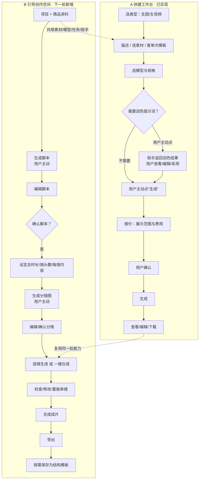
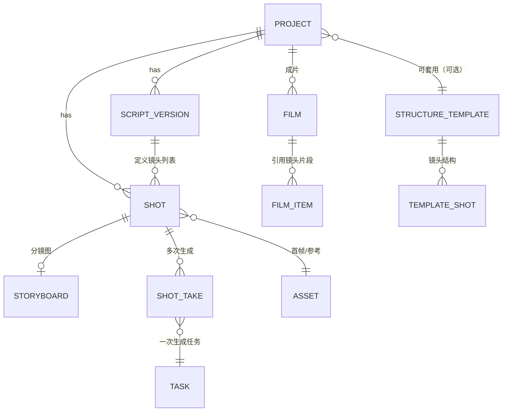

> ⚠️ **过程稿留痕**：本文件为 v0.10 草案（含 Q1/Q4 未定时的表述）。
> 已由 `docs/PRD/PRD.md`（v0.10 定稿）取代，正式依据以定稿为准。

# 电商 AIGC 工作平台 · PRD v0.10（定稿）：双入口与引导创作

| 项 | 内容 |
| --- | --- |
| 版本 | **v0.10（定稿）**：双入口与引导创作 |
| 日期 | 2026-10-25 |
| 上一版 | v0.9.1 草案（`docs/PRD/PRD.md`，助手阶段一） |
| 本版性质 | **增量定稿**：新增"双入口 + 引导创作"章节；Q1–Q4 已全部确认，**本版即日成为正式开发基线** |
| 上一版归档 | v0.9.1 → `docs/PRD/history/PRD-v0.9.1-创作助手（定稿归档）.md`；v0.10 草案过程稿 → `docs/PRD/history/PRD-v0.10-草案（已被定稿取代）.md` |
| 当前交付基线 | 标签 `assistant-stage1-review-20261024`（提交 `bbc20d6`）+ 其后 `2cf9dfd`（助手 v0.3 修复） |
| 形态 | 本地工作台 + 火山方舟（图片/视频）+ DeepSeek（助手文本） |
| 本轮范围 | 文档交付（PRD 定稿 + 技术方案 + 接口设计）；不改代码、不改配置、不写数据库、不调模型、不产生费用 |

## 修订记录（v0.10 草案 → 修订四 = 定稿，2026-10-25）

**Q1、Q4 确认，S1 纳入本轮，B10 约束确认。本版据此定稿。**

| 位置 | 修订 |
| --- | --- |
| §0.1 / §0.2 / §5 | Q1、Q4 由待选项升级为**决定记录**；决策表改为"全部已确认" |
| §5-Q1 | 固定流程画布：平移/缩放/整理 + 镜头独立内容状态 + 增删重排；**不做任意连线/分支/循环**；明确"固定流程 ≠ 固定镜头数量" |
| §5-Q4 | 结构模板：保存/查看/套用；结构=职能/顺序/节奏/运镜/原生时长；**每次重绑素材、重校验模型**；**版本保留、已套用项目不自动跟随**；批量套用/共享/市场列后续 |
| §6.2.1（新增） | **B10 时长校验规则**：元数据 `duration_range_s`+`duration_step_s`；前端只渲染区间内整数秒；后端拒绝小数与越界；**禁止取整/静默改值**；报价与请求同值；历史数据不重解释 |
| §10 | S1 标注**已纳入本轮**；S6/S7 去掉"条件项"改为**确定范围**；S7 验收补"镜头节点独立状态/增删重排/刷新位置恢复/无任意连线" |
| §12 | 改为**决策记录**（Q1–Q4 全已确认 + B10）；后续需求单列不阻塞 |

---

## 修订记录（v0.10 草案 → 修订三，2026-10-25）

**Q3 由待确认升级为已确认：本轮不做裁剪**，并按新结论同步流程、规格与验收：

| 位置 | 修订 |
| --- | --- |
| §0.1 已确认方向 | 新增第 9 条：不做裁剪/入点出点/变速/补帧/补时长；时长按模型原生能力（1.0 pro fast 2–12 整数秒）；不再统一 5/10，也不统一承诺 3–15；未开通不可提交 |
| §0.2 / §5 / §12 | Q3 移入"已确认"，待确认仅剩 **Q1、Q4**；§5-Q3 改为决定记录 |
| §1.1 流程图 | 模式1 由"按时长合成"改为**按顺序拼接完整片段（不裁剪）** |
| §2.3 分镜计划 | 新增"时长规则"：每镜只能选模型原生整数秒；**计划成片时长＝各镜头之和**；目标总时长无法满足→提示调整镜头数/时长，**不静默裁剪** |
| §2.6 / §2.7 | 删除"按已确认顺序与时长合成"，改为**顺序拼接**；**删除"取片段开头裁切"**；新增"**计划时长 vs 实际产物时长分别展示**" |
| §3 / §3.1 | 总表与分动作表按新口径更新（拼接不裁剪；展示实际时长） |
| §4.2 / §4.3 | 改镜头时长→成片失效且**不得裁剪旧片段凑时长**；重排后重新计算并展示实际时长 |
| §6 | 规格表补"2–12 整数秒"行，标明**当前后端仅放行 5/10（缺口）**；更新 `duration_range_s` 说明为"Q3 落地需改区间校验"；新增**时长四处一致**要求 |
| §7 | Shot 字段改为"生成时长（模型原生整数秒）"、Film 去掉裁切点、新增实际时长 |
| §9.1 / §9.2 | F3 时长按模型区间渲染；新增 **B10 时长区间校验**（改 `validate_params_for_model`） |
| §10 | S1 增加"2–12 可选且能进队列"；S3 删除裁切、改为"不静默裁剪"；S4 增加"计划/实际时长分别展示"；S5 增加"纯拼接、展示实际成片时长" |

---

## 修订记录（v0.10 草案 → 修订二，2026-10-25）

**Q2 由待确认升级为已确认**，并按新结论重写受影响章节：

| 位置 | 修订 |
| --- | --- |
| §0.1 已确认方向 | 新增第 8 条：确认分镜后提供**两个平级操作**（生成完整视频 / 生成分镜视频），均属本轮需求 |
| §1.1 流程图 | 确认分镜后进入"选择生成模式"分支；模式1 自动合成、模式2 交付片段并可后续合成 |
| §2.6 / §2.7 | 整节重写为"选择生成模式 + 两模式对照 + 共同规则"；明确确认分镜不自动调用视频模型 |
| §3 / §3.1 | 总表与分动作表按两模式重写（含"一键＝一次操作启动整组、非同时运行"） |
| §4.2 | 新增"改生成模式""改已确认分镜后重新生成"两类失效规则 |
| §8 | 新增"整组部分失败"与"模式1 有失败镜不产出完整视频" |
| §9.1/§9.2 | 前端补两模式入口、逐镜状态面板、定向重试；后端补整组提交、模式1 自动合成、重试作用域 |
| §10 | **S4 重写为"整组生成（两种模式）"**；**S5 重写为"成片（模式差异化）"**，验收含"确认分镜后不自动调模型""只重试勾选失败镜""模式1 有失败镜阻断完整视频" |
| §12 | Q2 移入"已确认"，待确认缩减为 Q1/Q3/Q4 |
| **删除** | 原"一键成片 A 仅合成已有 / B 补生成"二选一表述**全部移除**；不得把模式1 改成"仅合成已有" |

---

## 修订记录（v0.10 草案 → 修订一，2026-10-25）

依据 Codex 审阅意见修订，**仅改草案，不进入开发、不调用模型**：

| # | 意见 | 本版处理 |
| --- | --- | --- |
| 1 | 补齐 AI 脚本生成交付范围 | §9.2 新增 **B0**（brief→脚本、版本化、助手不可用可手工继续）；§10 **S2 验收**明确"生成→查看/编辑→确认"三步，且**仅手工编辑不算完成** |
| 2 | 统一费用规则 | 删除"按下限预估"；新增 **§3.1 分动作展示规则**（润色/脚本/分镜图/镜头视频）；"重试＝再次计费"改为**重试前重新展示费用与计费条件**；合成费用拆为**模型调用费**与**平台收费政策**两层 |
| 3 | 补齐确认失效规则 | **§4 重写**：确认绑定"对象+版本"；变更→受影响对象矩阵；旧批准不能授权新版本；生成中修改归入原版本；"仅合成已有"需重新确认清单与时长；**镜头重排规则统一到 §4.3**（只影响成片） |
| 4 | 待确认不得写成定稿 | §0.2/§5/§12 全部改为**条件方案**；**Q2 保留 A/B 两个方案**并注明"尚未决定排除 B"；S3/S5/S6/S7 标为条件项；**统一"入点/出点"表述**（首版不提供，列为待确认） |
| 5 | 规格章节再核对 | §6.2 分**能力元数据/后端实际校验/真实跑通**三列；明确 `duration_range_s` **只是元数据、当前不放行任意时长**；新增 §6.2.1 **分辨率与费用**（flash 不降费、pro 跨档才降、视频按 token 且须以报价为准） |

---

> 阅读约定：**已确认**＝产品经理已定；**待确认**＝本文给推荐，需产品经理裁决；
> **已实现**／**真实验证通过**／**前端待接入**／**下一轮新增** 四类状态严格区分，附证据位置。

---

## 0. 本版要点

### 0.1 已确认方向（不再询问）

1. 平台分**两个平级入口**：A 快捷工作台、B 引导创作空间。
2. 快捷工作台保留现有全部直接操作；AI 仅提供**用户主动触发**的提示词润色；润色结果由用户查看/编辑/采用，**仍由用户主动提交生成**；不在工作台内展开脚本、分镜、多阶段引导。
3. 引导创作空间面向**多镜头电商视频**，独立入口，以**无限画布**承载引导过程与成果；与工作台**共用**素材、模型、任务、助手服务。
4. 引导创作目标流程固定为 8 步（见 §2）。
5. 每个生成阶段**必须用户主动触发**；对话/推荐/编辑/确认方向**不得自动**进入下一阶段生成。
6. 助手**不能替用户确认**；费用必须在执行前展示；**未知费用不得当作 0**。
7. 简单商品图与简单展示视频**仍可直接在工作台完成**，不强制走完整流程。
8. **（2026-10-25 补充确认）** 确认分镜后提供**两个平级操作**：
   **模式1「生成完整视频」**＝一次确认整组范围与费用 → 生成全部镜头 → 按已确认顺序与时长自动合成完整视频；
   **模式2「生成分镜视频」**＝一次确认整组范围与费用 → 生成全部镜头 → 分别交付独立片段，用户后续可主动合成。
   两者**均属本轮需求**；模式1 **不得**改成"仅合成已有片段"，**不得**默认推迟到后续版本。
9. **（2026-10-25 补充确认，Q3）本轮不做任何视频裁剪/入点出点/变速/补帧/自动补时长**；
   时长按**所选模型的原生能力**提供（Seedance 1.0 Pro Fast：**2–12 秒整数秒**，其他模型按各自真实能力），
   **不再统一限制 5/10 秒**，也**不统一承诺 3–15 秒**；未开通模型不可提交。
   分镜计划中各镜时长之和即成片计划时长；用户要求的总时长无法满足时**提示调整**，**不静默裁剪**。

### 0.2 决策状态（**Q1–Q4 全部已确认**，详见 §5）

| # | 决策 | 结论 | 状态 |
| --- | --- | --- | --- |
| Q1 | 无限画布首版自由度 | **固定流程画布**：平移/缩放/整理节点；镜头独立状态；增删与重排镜头；**不做任意连线/分支/循环** | ✅ 已确认 |
| Q2 | 两种平级生成模式 | **模式1 生成完整视频**（拼接）/ **模式2 生成分镜视频**（独立片段） | ✅ 已确认 |
| Q3 | 时长与裁剪 | **本轮不做裁剪**；时长按模型原生能力（1.0 pro fast 2–12 整数秒）；计划时长＝各镜之和 | ✅ 已确认 |
| Q4 | 多镜头结构模板范围 | **保存/查看/套用**；结构（职能/顺序/节奏/运镜/原生时长）+ 版本；每次重绑素材、重校验模型；批量套用与共享列后续 | ✅ 已确认 |

> §5 保留四项决定记录；§10 各阶段均为**确定范围**（不再有条件项）。

---

## 1. 两个入口的职责

| 维度 | A 快捷工作台（已实现，保留） | B 引导创作空间（下一轮新增） |
| --- | --- | --- |
| 面向 | 需求明确、追求效率 | 需要精细制作、多镜头讲述 |
| 核心动作 | 选类型 → 填描述/选素材 → 选模型规格 → 生成 → 查看/编辑/下载 | 需求 → 脚本 → 分镜 → 逐镜生成 → 成片 → 导出 |
| AI 作用 | **仅**：用户主动点"润色提示词"，返回结果由用户决定是否采用 | 贯穿：澄清需求、建议脚本与镜头、推荐模板；**仍不代替确认** |
| 是否必须用 AI | 否，可完全不用 | 可用助手，也可手工编辑脚本/分镜 |
| 产物结构 | 单张图 / 单条视频 | 项目（含脚本、分镜、镜头、成片、版本） |
| 现有实现 | ✅ 已实现并真实跑通（见 §11） | ⬜ **完全未实现**（无表、无接口、无页面） |

### 1.1 完整流程图

> 两个入口**平级**：不互相跳转强制；可从工作台把素材/结果"送入创作空间"，也可在创作空间里退回手工编辑。

---

## 2. 引导创作：逐阶段定义

> 通用规则：每阶段的**生成**都必须由用户点按钮触发；前一阶段的"确认"只解锁下一阶段按钮，**不自动生成**。
> 每阶段产物都有版本；修改上游**不删除**已生成的下游成果，只标记"已过期，可重做"。

### 2.1 阶段①需求与商品资料

| 项 | 内容 |
| --- | --- |
| 输入 | 商品名称与数量（用户填）、商品图（用户选/传）、卖点（用户填）、禁用元素、目标平台/时长偏好 |
| 输出 | **项目 brief**（结构化字段，可编辑） |
| 可编辑 | 全部字段；可从素材库引用，也可上传 |
| 确认动作 | 无独立生成；点"生成脚本"即视为以当前 brief 为准（brief 变更后可重新生成脚本） |
| 失败处理 | 素材无效（非图片/超大）→ 前端拦截 + 后端 400；缺商品名 → 提示但不阻断（脚本会标"待补"） |
| 返回修改 | 随时编辑 brief；已生成脚本保留，标记"brief 已更新" |

### 2.2 阶段②生成简单视频脚本

| 项 | 内容 |
| --- | --- |
| 输入 | brief + 目标时长 + 风格 |
| 输出 | **脚本**：整体叙事 3–6 句 + 建议镜头数 + 每镜一句话描述（**不含**具体提示词参数） |
| 可编辑 | 全文可改；可增删镜头条目 |
| 确认动作 | 按钮"**生成脚本**"（首次）／"**重新生成脚本**"（覆盖前需二次确认，旧版本保留） |
| 费用 | 消耗 **LLM token**（不产生图片/视频费用）。执行前需展示：发送内容摘要、输出上限（`max_tokens`）、计费口径（按 token）；**不以"最低消耗/下限金额"作为确认依据**——无法给出可靠金额时显示"费用未知（按 token 计）"，由用户决定是否继续 |
| 失败处理 | LLM 不可用 → 明确提示"助手暂不可用"，允许**手工写脚本**继续（不阻断流程） |
| 返回修改 | 编辑 brief 后重生成；或直接手改脚本 |

### 2.3 阶段③确认总时长、镜头数与每镜内容

| 项 | 内容 |
| --- | --- |
| 输入 | 脚本 + 用户设定的总时长/镜头数/每镜时长 |
| 输出 | **分镜计划**：镜头列表（序号、**每镜生成时长**、画面描述、是否需要人物/动作、首帧来源） |
| 可编辑 | 增删镜头、调时长、改描述、调顺序（**重排只影响成片，规则见 §4.3**） |
| 确认动作 | 按钮"**确认脚本并生成分镜**"（解锁阶段④） |
| 费用 | 无（纯编辑）；若此步调用助手建议，则产生 LLM 用量 |
| 时长规则 | ① 每镜时长**只能从所选模型原生支持的整数秒中选**（1.0 pro fast：2–12s；其他模型按各自能力；未开通模型不可选）；② **计划成片时长 = 各镜头时长之和**；③ 用户提出的总时长无法满足时，**提示调整镜头数量或每镜时长**（给出可选组合建议），**禁止静默裁剪**；④ 计划时长与实际产物时长分别展示（见 §2.7） |
| 失败处理 | 无法凑出目标总时长 → 明确提示差值与可选组合，不静默凑数/不裁剪 |
| 返回修改 | 回阶段②改脚本 |

### 2.4 阶段④生成分镜图

| 项 | 内容 |
| --- | --- |
| 输入 | 每镜的画面描述（+可选商品参考图） |
| 输出 | 每镜**分镜图**（图片素材），与镜头一一对应 |
| 可编辑 | 每镜可单独重生成、替换为已有素材 |
| 确认动作 | 按钮"**生成分镜图**"（可"生成全部"或"生成所选"） |
| 费用 | 按图片张数计价；**执行前展示"将生成 N 张 × 单价 = 预计费用"** |
| 失败处理 | 单张失败不影响其它；失败项标红、可单独重试。**重试前重新展示费用与计费条件**（是否扣款取决于是否成功生成及供应商规则，不保证每次失败重试都会扣款） |
| 返回修改 | 改镜头描述 → 只重生成该镜分镜图 |

> 复用现状：分镜图＝普通图片任务（文生图或图生图），**无需新模型能力**，只是把它挂在"镜头"上。

### 2.5 阶段⑤修改或确认分镜

| 项 | 内容 |
| --- | --- |
| 输入 | 已生成分镜图 + 用户判断 |
| 输出 | 分镜状态：`draft / approved / rejected(原因)` |
| 可编辑 | 备注、替换图、驳回原因 |
| 确认动作 | 每镜"**通过**"或"**驳回并说明**"；全部通过后解锁阶段⑥ |
| 费用 | 无 |
| 失败处理 | 不适用（人工判断） |
| 返回修改 | 驳回 → 回到④只重做该镜 |

### 2.6 阶段⑥选择生成模式（确认分镜之后）

> **前置规则**：确认分镜本身**不自动调用视频模型**。用户必须显式选择下面两种模式之一并主动触发。

| 项 | 内容 |
| --- | --- |
| 输入 | 已确认的分镜计划（镜头顺序、**每镜生成时长**、分镜图） |
| 输出 | 一次**生成范围确认**：参与镜头清单 + 每镜规格 + 合计预估费用 |
| 可编辑 | 模式选择、镜头勾选、每镜规格（比例/清晰度/时长） |
| 确认动作 | 二选一按钮：**"生成完整视频"**（模式1）／**"生成分镜视频"**（模式2）；两者都需先确认本次整组范围与费用 |
| 费用 | 按镜头数 × 每镜规格（含时长）计价；**确认前展示每镜与合计预估及其构成**；未知费用不得当 0 |
| 失败处理 | 不适用（尚未调用模型） |
| 返回修改 | 回⑤重新确认分镜 → 已确认范围作废，需重新确认范围与费用 |

**两种模式（本轮均为正式需求，平级，无主次）**

| | **模式1：生成完整视频** | **模式2：生成分镜视频** |
| --- | --- | --- |
| 一次操作做什么 | 生成**全部镜头**，随后**按已确认顺序拼接完整片段**（**不裁剪、不变速、不补帧**） | 生成**全部镜头**，**分别交付独立片段** |
| 交付物 | 一条完整视频（+ 各镜头片段） | N 条独立镜头视频 |
| 是否合成 | ✅ 平台自动合成 | ❌ 不合成；用户后续可主动合成 |
| "一键"含义 | **一次操作启动整组任务**（受当前单 worker 约束，镜头按队列顺序执行，**不要求同时运行**） | 同左 |
| 后续合成 | 已是成片；可用新 take 重新合成（新版本） | 用户主动进入"合成成片" |

**共同规则（两种模式都适用）**
1. **一次确认覆盖整组**：确认的是"本次全部镜头的范围与费用"，不是逐镜确认。
2. **逐镜独立状态**：每个镜头都有自己的任务、状态、错误码与结果；成功片段**始终保留**。
3. **部分失败**：明确列出失败镜头；**只重试用户勾选的失败镜头**；**不自动重做已成功镜头**；重试前重新展示费用与计费条件。
4. **不得静默遗漏**：失败或未生成的镜头不得被悄悄跳过；模式1 在存在失败镜头时**不得输出"完整视频"**（见 2.7）。

### 2.7 阶段⑦结果检查与合成

| 项 | 内容 |
| --- | --- |
| 输入 | 模式1：整组生成结果；模式2：独立片段集合（可含失败项） |
| 输出 | 模式1 → 完整视频（全部镜头成功时，**纯拼接、不裁剪**）；模式2 → 片段列表，用户后续主动合成时产出成片 |
| 可编辑 | 镜头顺序、静音/保留原音。**本轮不做裁剪、入点/出点编辑、变速、补帧、自动补时长**（Q3 已确认） |
| 确认动作 | 模式1：确认"生成完整视频"时已含合成授权；模式2：后续需单独点"**合成成片**"并确认**实际参与镜头清单 + 顺序**（成片时长由各片段实际时长相加得出，不可预设） |
| 费用 | 分两层：①**模型调用费**：合成本身不产生模型调用；②**平台收费政策**：是否对合成单独收费**尚未确定**，不得承诺"免费"或"更便宜" |
| 失败处理 | **模式1 有镜头失败**：①提示缺哪几镜 ②不输出"完整视频" ③提供两条路：重试所选失败镜头后重合成 / 或降级为"部分合成（缺 N 镜）"并要求显式确认；**模式2**：失败镜头单独标记，可只重试所选失败项，不影响成功片段 |
| 时长展示 | **计划时长**（分镜之和）与**实际产物时长**（各片段实测之和）**分别展示**；**不得把计划时长当实测结果**；实际时长以供应商返回的 `usage`/产物元数据为准 |
| 返回修改 | 回⑥重做单镜 → 新 take；重新合成生成**新版本成片**，旧版本保留 |

### 2.8 阶段⑧检查、导出、存为模板

| 项 | 内容 |
| --- | --- |
| 输入 | 成片 + 各镜头 + 分镜图 |
| 输出 | 导出包（成片 + 镜头 + 分镜图 + 清单 JSON）／**结构模板** |
| 可编辑 | 导出范围、命名规则 |
| 确认动作 | "**导出**"；"**保存为模板**"（另需命名与适用范围） |
| 费用 | 无 |
| 失败处理 | 导出失败 → 保留产物，可重试导出（不重新生成） |
| 返回修改 | 任意阶段可回退；**历史版本与素材保留** |

---

## 3. 当前阶段—确认—生成—费用—失败（总表）

| 当前阶段 | 用户确认什么 | 将生成什么 | 费用说明 | 失败后怎么办 |
| --- | --- | --- | --- | --- |
| ① 需求/商品资料 | 无需确认（可点"生成脚本"） | — | 无 | 素材非法→前端拦截；缺商品名→标"待补" |
| ② 脚本 | 点"生成脚本" | 脚本文本（3–6 句 + 建议镜头） | **LLM token**（非图片/视频费）；展示发送摘要+输出上限+计费口径；**不以"下限金额"作为确认依据**，无法估价时显示"费用未知（按 token 计）" | 助手不可用→允许手工写脚本继续 |
| ③ 分镜计划 | 点"确认脚本并生成分镜" | 分镜计划（镜头数/**每镜时长（模型原生）**/描述） | 无 | 目标总时长无法满足→提示调整镜头数或时长，**不静默裁剪** |
| ④ 分镜图 | 点"生成分镜图"（全部或所选 N 张） | N 张分镜图 | **N × 图片单价**，执行前显示构成 | 单张失败可单独重试；重试前重新展示费用与计费条件 |
| ⑤ 分镜审核 | 每镜"通过/驳回" | — | 无 | 驳回→回④只重做该镜 |
| ⑥ 选择生成模式 | 二选一：**"生成完整视频"** / **"生成分镜视频"**；两者都需先确认本次**整组镜头范围与合计费用** | 模式1：全部镜头 + 成片；模式2：全部镜头（独立片段） | **逐镜 token 费**；确认前展示每镜与合计及构成；未知费用不得当 0 | 尚未调用模型；范围/规格变化需重新确认范围与费用 |
| ⑦ 生成与结果 | 模式1 的确认已含"生成+拼接"授权；模式2 后续另需"合成成片"确认（含实际镜头清单与顺序） | 模式1：完整视频（纯拼接，+各镜头片段）；模式2：N 条独立片段 | 合成本身不产生模型调用费；**平台是否对合成收费未定**（不得承诺免费/更便宜） | **逐镜独立状态，成功片段保留**；部分失败→只重试**用户勾选的失败镜头**，不自动重做成功镜头；**模式1 有失败镜时不得输出"完整视频"**（重试后重合成，或显式降级为"部分合成（缺 N 镜）"） |
| ⑧ 导出/模板 | 点"导出"/"保存为模板" | 导出包／结构模板 | 无 | 导出可重试，不重新生成 |

**费用铁律**
1. 任何**产生模型调用**的动作前必须显示：对象、数量、单价或计费口径、预计消耗与构成；**无法可靠估价 → 显示"费用未知"，按钮禁用或要求用户显式承担未知费用**。
2. 未知/未开通模型不得显示 ¥0；"按 token 计"不得写成"约 ¥0"。
3. **不以"最低消耗/下限金额"作为确认依据**：只给可信预估（含构成）或明确"费用未知"。
4. **重试/重做不是自动免费，也不保证一定扣款**：重试前**重新展示费用与计费条件**；是否扣款取决于是否成功生成与供应商规则。
5. **合成费用分两层**：模型调用费（本地合成＝0）与平台收费政策（未定）分别表述，不得对外承诺"免费"或"更便宜"。
6. 助手不得代替用户点确认；对话里的"好/可以"不等同确认。
7. 报价有时效（现状：报价单/批准 600s 有效），过期需重新报价。

### 3.1 分动作的展示与限制（润色 / 脚本 / 分镜图 / 镜头视频）

| 动作 | 是否产生模型调用 | 执行前必须展示 | 明确限制 |
| --- | --- | --- | --- |
| **提示词润色**（工作台，用户主动） | 是（LLM，少量 token） | 发送内容摘要、输出上限、计费口径；"本次为文本调用，不产生图片/视频费" | 单次点击一次调用；不自动重试；结果不自动提交生成 |
| **脚本生成**（创作空间） | 是（LLM） | 同上 + **将发送的 brief 字段清单**（含哪些商品事实被写入） | 单次点击一次调用；**重新生成不删除旧版本**；助手不可用时可手工写 |
| **分镜图生成** | 是（图片） | 镜头数 N、每张规格、图片单价、预计合计 | 只生成所选镜头；单张失败不影响其它；重试前重新展示费用 |
| **镜头视频生成** | 是（视频） | 镜头数 N、每镜规格（比例/清晰度/时长）、逐镜预估、合计 | 只生成所选镜头；不自动重试；重试前重新展示费用与计费条件 |
| **生成完整视频（模式1）** | 是（视频）+ 本地拼接 | 整组镜头清单、每镜规格与时长、逐镜与合计费用、拼接口径（**顺序拼接，不裁剪**） | 一次确认启动整组；单 worker 顺序执行；部分失败不输出"完整视频"；**展示实际产物时长** |
| **生成分镜视频（模式2）** | 是（视频） | 整组镜头清单、每镜规格、逐镜与合计费用；**明确"本次不合成"** | 一次确认启动整组；交付独立片段；后续合成需再次确认清单与时长 |
| **合成成片**（模式2 后续） | **否**（本地拼接） | 参与合成的镜头清单与顺序、是否缺镜、**预计成片时长＝各片段实际时长之和** | 不产生模型调用费；平台是否收费未定；可反复合成；不裁剪 |

---

## 4. 确认失效规则（确认绑定"对象 + 版本"）

### 4.1 三条总原则

1. **确认绑定具体对象及其版本**：例如"分镜计划 `script_v3` 已确认"、"镜头 #2 的 `storyboard_v2` 已通过"、"成片引用 take 列表 [t1,t3,t4] 已确认"。**没有版本号的确认无效**。
2. **旧成果保留、旧批准不作废授权**：修改上游只把下游标记为 `stale（已过期）`，不删除任何已生成分镜图/镜头视频/成片；**旧批准只对旧版本的旧对象有效，不能自动授权新版本**。
3. **生成过程中修改 → 结果归入原版本**：任务在途时用户改了脚本/镜头，返回的产物仍挂在**提交时那个版本**上，并标注"基于旧版本生成"，不回填到新版本。

### 4.2 变更 → 受影响对象（需重新确认的用 ⚠️ 标出）

| 变化 | 需重新确认 | 保留（标 stale 但不删） | 说明 |
| --- | --- | --- | --- |
| 改 **brief**（商品名/卖点/禁用元素） | ⚠️ 脚本确认、分镜计划确认 | 历史脚本版本、已生成分镜图、已生成镜头视频、成片 | brief 变了，脚本与分镜的依据即失效 |
| 改 **脚本正文** | ⚠️ 分镜计划确认（镜头列表可能变化） | 旧脚本版本、已生成分镜图与镜头 take | 已生成分镜图标"与最新脚本不一致" |
| 改 **镜头数 / 每镜时长** | ⚠️ 分镜计划确认、**成片**（成片时长随之变化） | 已有分镜图与镜头视频（按 shot_id 关联） | 新增镜头无产物；删除镜头→其产物变"孤立"，可保留可归档；**不裁剪旧片段来凑新时长** |
| 改 **某镜描述** | ⚠️ 该镜分镜确认、该镜视频、成片 | 其它镜头一切、该镜历史 take | 只影响该镜 |
| 改 **某镜分镜图**（重生成/替换） | ⚠️ 该镜分镜确认、该镜视频、成片 | 该镜旧分镜图版本、旧 take | 分镜图变了，基于旧图的视频即 stale |
| **换模型 / 改规格**（比例/清晰度/时长） | ⚠️ 该阶段报价与确认（引用旧报价无效） | 已生成产物与历史版本 | 价格与能力需重新校验 |
| **调整镜头顺序** | ⚠️ **仅成片**（需重新确认镜头清单与顺序） | 各镜头视频、分镜图、分镜确认 | 统一规则：**顺序只影响成片**，不使镜头产物失效；见 §4.3 |
| **"仅合成已有镜头"** | ⚠️ 成片：需重新确认**实际参与镜头清单**与**成片时长** | 未参与合成的镜头产物 | 不是"沿用上次成片确认" |
| 改 **结构模板** | ⚠️ 该模板版本；已套用的项目**不自动跟随** | 项目内已有产物 | 套用关系记录版本号，升级需显式重新套用 |
| 改 **生成模式**（模式1 ↔ 模式2） | ⚠️ 整组生成范围与费用（须重新确认） | 已生成镜头片段、已产出的成片版本 | 模式只改变"是否自动合成"，不使已有片段失效 |
| 改 **已确认分镜**后重新生成 | ⚠️ 整组范围与费用（§2.6） | 旧 take、旧成片版本 | 旧批准只对旧分镜版本有效；**不能复用旧范围确认提交新版本** |

### 4.3 镜头重排的统一规则（此前两处表述已合并到此处）

- 重排**只改变成片的拼接顺序**；各镜头视频、分镜图、分镜审核结果**不失效**。
- 重排后**成片确认失效**，需重新确认"参与镜头清单 + 顺序"（成片时长随顺序不变，但需重新计算并展示实际值）。
- 重排**不触发任何生成**（不产生模型费用）。
- 若同时改了镜头时长，则同时按 §4.2 第 3 行处理。

## 5. 待确认细节（**条件方案，非定稿**）

> - **Q2 已于 2026-10-25 确认**（见下），不再是待选项。
> - **Q1 / Q3 / Q4 仍未定**。§10 中对应阶段（S3/S5/S6/S7）标为**条件项**，不得按任一选项直接排期或宣称已定。

### Q1 ✅ 已确认（2026-10-25）：固定流程的无限画布

> 本节为**决定记录**。

| 项 | 决定 |
| --- | --- |
| 画布形态 | **固定创作流程的无限画布**（8 阶段＝固定节点） |
| 交互 | 支持**平移、缩放、节点位置整理**；每个镜头有**独立的内容与状态展示** |
| 镜头管理 | 支持**增删镜头、调整镜头顺序** |
| 明确不做 | **任意连线、分支、循环、通用工作流编排**；不做节点执行引擎 |
| 关键区分 | **固定流程 ≠ 固定镜头数量**：流程固定，镜头数量由用户决定 |
| 影响 | S7 按此实现；画布**不是唯一入口**（关闭画布后流程仍可用） |

### Q2 ✅ 已确认（2026-10-25）：两种平级生成模式

> 本节为**决定记录**，不再是待选项。原"仅合成已有片段"方案**已被否决为首版形态**。

| | **模式1：生成完整视频** | **模式2：生成分镜视频** |
| --- | --- | --- |
| 触发 | 用户在【确认分镜之后】主动点"生成完整视频" | 用户在【确认分镜之后】主动点"生成分镜视频" |
| 一次确认内容 | 本次**全部镜头**的生成范围 + 每镜规格 + 合计预估费用 | 同左 |
| 平台动作 | 生成全部镜头 → 按**已确认顺序与时长**合成完整视频 | 生成全部镜头 → 分别交付独立片段 |
| 交付 | 完整视频（+各镜头片段） | N 条独立片段（**不合成**） |
| "一键"含义 | **一次操作启动整组任务**；受单 worker 约束，镜头按队列**顺序执行**，不要求同时运行 | 同左 |
| 后续 | 可用新 take 重新合成，生成新版本成片 | 用户可后续主动"合成成片"（需再次确认清单与时长） |

**共同规则**
1. 确认分镜**不自动**调用视频模型；必须由用户选模式并主动触发。
2. 全部镜头**逐镜记录状态与结果**；成功片段**始终保留**。
3. 部分失败：**明确提示失败镜头**；**只重试用户勾选的失败镜头**；**不自动重做成功镜头**。
4. **不得静默遗漏失败镜头后交付"完整视频"**：模式1 有失败镜时，要么重试后重合成，要么显式降级为"部分合成（缺 N 镜）"并由用户确认。
5. 改动已确认的分镜（镜头数/时长/描述/分镜图/顺序）→ **重新确认受影响的生成范围与费用**（见 §4.2）。

### Q3 ✅ 已确认（2026-10-25）：本轮不做裁剪，时长按模型原生能力

> 本节为**决定记录**。原"默认取片段开头 N 秒"方案**已删除**。

| 项 | 决定 |
| --- | --- |
| 裁剪 / 入点出点 | **本轮不做**（含变速、补帧、自动补时长） |
| 每镜时长来源 | **所选模型的原生能力**，整数秒可选。Seedance 1.0 Pro Fast：**2–12 秒**；其他模型按各自真实能力配置；**未开通模型不可提交** |
| 平台统一限制 | **取消**统一的 5/10 秒限制；**不**统一承诺"所有模型 3–15 秒" |
| 计划成片时长 | **= 各镜头时长之和** |
| 目标总时长无法满足 | **提示调整镜头数量或每镜时长**（给可选组合），**不静默裁剪** |
| 展示口径 | **计划时长**与**实际产物时长**分别展示；不得把计划时长当实测结果 |
| 两种模式 | 继续保留：模式1 生成全部镜头后**按顺序拼接完整片段**；模式2 交付独立片段（后续可主动拼接） |

**开发必须保证四处一致**：前端选项（来自模型能力）→ 后端参数校验 → 报价 → 实际供应商请求。
**并区分三种状态**：模型支持 / 账号已开通 / 平台已验证（见 §6.2）。

### Q4 ✅ 已确认（2026-10-25）：多镜头结构模板（窄范围）

> 本节为**决定记录**。

| 项 | 决定 |
| --- | --- |
| 首版能力 | **保存、查看、套用**多镜头结构模板 |
| 保存内容 | **镜头职能、顺序、节奏、运镜、原生时长配置**（不保存商品事实） |
| 套用范围 | **本人新建项目**可用 |
| 每次重新绑定 | 商品事实、参考素材**每次重新绑定**；模型**重新校验**（未开通/下线不可用） |
| 版本 | 模板**保留版本**；**已套用项目不随模板升级自动变化**（需显式重新套用） |
| 明确后续（本轮不做） | 批量套用、团队共享、模板市场登记 |
| 表达纪律 | 不宣称"套模板即爆款"；模板只提供结构，不保证效果 |

## 6. 规格选项核对（前后端差异）
## 6. 规格选项核对（前后端差异）

> 三种状态必须分开说：**模型支持**（官方能力清单）／**账号已开通**（真实调用通过）／**平台已接入并验证**（本项目真实跑通该规格）。

### 6.1 当前实现核对（只读代码得出）

| 维度 | 前端现状 | 后端能力数据 | 差异/风险 |
| --- | --- | --- | --- |
| 图片比例 | `1:1 / 3:4 / 4:3 / 9:16 / 16:9`（5 档） | flash/pro：同 5 档 + `1024x1024` 等尺寸 | 基本一致；前端固定 2K 档 |
| 图片尺寸 | 比例映射到 2K（2048²、1728×2304、2304×1728、1536×2688、2688×1536） | `sizes` 允许 1024 档 | 未暴露 1K 档（低成本/快速草稿场景缺失） |
| **视频比例** | 复用图片的 5 档（含 `3:4`、`4:3`） | `seedance-1.0-pro-fast`：**仅 9:16、16:9、1:1** | ⚠️ **不一致**：选 3:4/4:3 会被后端 `MODEL_CAPABILITY_MISMATCH` 拒绝 |
| 视频清晰度 | 固定 `720p` | 1.0 pro fast：480p/720p/1080p；2.0 mini：480p/720p | 前两档（480p/1080p）**未暴露**，也未验证 |
| 视频时长 | **现有实现**写死 5/10；**本轮目标**改为按模型原生能力（1.0 pro fast：2–12 整数秒） | 1.0：当前 `duration_s=[5,10]`（**仅 5/10 放行**）；官方能力 2–12s；mini：`duration_range_s=[4,15]`（未开通） | ⚠️ **后端缺口**：需把 1.0 pro fast 校验改为 **2–12 整数秒区间**，否则前端即使列出 3s/6s 也会被拒 |
| 生成方式 | 文生图/图生图、首帧 I2V | 同 | 一致 |

### 6.2 三层状态（**必须分开表述，不得混用**）

> 三层含义：**① 能力元数据**＝官方能力清单/我们的 `MODEL_CAPABILITIES` 字段；
> **② 后端实际校验**＝当前 `validate_params_for_model()` 会不会放行；
> **③ 真实验证结果**＝本项目是否真实跑通过该规格并留证据。

| 规格（1.0 pro fast） | ① 能力元数据 | ② 后端实际校验 | ③ 真实跑通 | 结论 |
| --- | --- | --- | --- | --- |
| 720p · 9:16 · 5s | ✅ 支持 | ✅ 放行 | ✅ **已验证**（704×1248、103,818 tokens、¥0.436） | 可对外标"已验证" |
| 720p · 16:9 / 1:1 · 5s | ✅ 支持 | ✅ 放行 | ⬜ 未验证 | 只能标"支持且可提交，未验证" |
| 480p · 任意比例 · 5s | ✅ 支持 | ✅ 放行 | ⬜ 未验证 | 同上 |
| 1080p | ✅ 支持 | ✅ 放行 | ⬜ 未验证 | 同上 |
| 5s / 10s | ✅ 支持 | ✅ 放行 | 5s ✅ 已验证；10s ⬜ 未验证 | 10s 只能标"可提交未验证" |
| **2–12 整数秒（除 5/10 外，如 3s、6s、8s、12s）** | ✅ 官方支持 | ❌ **当前不放行**（校验只认 `duration_s=[5,10]`） | ⬜ 未验证 | **目标行为需后端增量**：改为区间校验；未改前**不可提交** |
| 2.0 mini 4–15s | ✅ 元数据有 `duration_range_s=[4,15]` | ❌ **不放行**（且模型未开通） | ⬜ 未验证 | **不可提交**（未开通 + 校验未支持区间） |

**关于时长校验的说明（Q3 后口径）**
- **目标行为**：1.0 pro fast 支持 **2–12 整数秒**；其他模型按各自原生能力（如 2.0 mini 元数据为 4–15s）。
- **当前实现**：`duration_s` 是**白名单**（1.0 仅 `[5,10]`），`duration_range_s` 只是元数据、**不参与校验**。
- 因此**要落地 Q3，必须后端增量**：把白名单改为"区间 + 整数步进"，并联动报价与实际请求；**未改前只能提交 5/10**。
- 落地时须同步校验：**前端选项 / 后端校验 / 报价 / 实际供应商请求** 四处使用同一时长值。

### 6.2.1 时长校验规则（B10，**已确认**）

| 规则 | 内容 |
| --- | --- |
| 元数据 | 每个视频模型声明 `duration_range_s = [min, max]` + `duration_step_s`（整数秒）；1.0 pro fast：`[2,12]`、step 1 |
| 前端选项 | 仅渲染 `min..max` 按 `step` 递进的整数秒；**未开通模型不可选** |
| 后端校验 | 必须是**整数**且落在区间内且符合步长；**拒绝小数秒**（如 5.5）与越界值（1、13） |
| 禁止绕过 | **不得**通过四舍五入、向上/向下取整、静默改值"修正"用户输入；非法值一律 400 明确报错 |
| 报价与请求 | 报价与供应商请求使用**同一时长值**；报价后改时长必须重新报价 |
| 历史数据 | **保留历史任务与历史报价原样，不重新解释**旧数据（旧任务按当时参数与费用口径展示） |
| 需要改造 | `validate_params_for_model()` 由白名单改为区间+步长校验；`MODEL_CAPABILITIES` 补 `duration_step_s` |

### 6.2.2 分辨率与费用的关系（不得默认"降分辨率就降费"）

| 类型 | 计费口径 | 降分辨率的影响 |
| --- | --- | --- |
| 图片 · Seedream flash | **按张固定 0.12 元**（不分像素档） | **不降费**（出图从 2K 降到 1K 仍是 0.12/张） |
| 图片 · Seedream pro | 按输出像素档：≤2.61MP 0.30 / >2.61MP 0.60 | 只有**跨档**才降（2K→1K 会从 0.60 降到 0.30）；未开通，未验证 |
| 视频 · Seedance | 按 token：`时长 × 宽 × 高 × 帧率 / 1024` × 单价 | 理论下降分辨率/时长会减少 token → 估算下降；但**必须以下单次报价为准**，且 480p/1080p 均未验证 |

> 因此：**不得在文档或 UI 中承诺"调低分辨率更省钱"**；只能展示当次报价的计算结果（并标注"估算，非账单"）。

### 6.3 可直接接入 vs 需后端增量

| 项 | 结论 |
| --- | --- |
| 前端按模型能力渲染比例/清晰度/时长选项 | **可直接接入**：`GET /api/models` 已返回 `capabilities.ratios/resolutions/duration_s` |
| 视频比例去掉 3:4/4:3、增加 16:9 | **可直接接入**（前端过滤即可，无需后端改） |
| 暴露 480p / 1080p | 前端可加，但**需真实验证后才能标"已验证"**；后端已支持 |
| 图片 1K 档（低成本草稿） | 后端已支持 `sizes`，前端加选项即可 |
| **时长按模型原生区间（1.0 pro fast 2–12 整数秒）** | **需后端增量**：把 `duration_s` 白名单改为**区间 + 整数步进**校验，并保证 **前端选项 / 后端校验 / 报价 / 实际请求** 四处一致；未改前前端只能渲染"可提交集合"（当前仅 5/10） |
| 时长区间与报价一致性 | 报价（`estimate`）与实际请求必须使用**同一时长值**；报价后改时长需重新报价 |
| 分镜/镜头/脚本/项目实体与接口 | **需后端增量**（当前无表、无接口） |
| 视频拼接（成片） | **需后端增量**（当前 worker 只生成不合成；需 ffmpeg 合成模块） |
| 无限画布（节点可视化） | **需前端新增**（当前只有固定排版编辑器） |
| 多镜头结构模板 | **需后端增量**（现模板是单次生成模板） |

> 本轮**不新增供应商、不更换模型**。

---

## 7. 领域模型：项目 / 脚本 / 镜头 / 分镜 / 模板

> **当前均未实现**（现库仅有 `assets/tasks/batches/drafts/templates` 等）。以下为**下一轮提议模型**，仅概念关系，字段为草案。

| 实体 | 关键字段（草案） | 关系要点 |
| --- | --- | --- |
| **Project**（项目） | id、名称、brief（商品事实/禁用元素）、目标时长、状态、owner | 归属项目；可套用结构模板 |
| **ScriptVersion**（脚本版本） | project_id、version、正文、镜头建议、来源（助手/手工）、创建时间 | **只追加不覆盖**；被镜头引用 |
| **Shot**（镜头） | project_id、script_version_id、序号、**生成时长（模型原生区间内的整数秒）**、画面描述、运镜、状态、approved | 属于某脚本版本；上游改变时标"过期"；**无裁剪字段**（本轮不做入点/出点） |
| **Storyboard**（分镜图） | shot_id、asset_id、状态、驳回原因、版本 | 一镜一分镜图（可多版本，取 approved） |
| **ShotTake**（镜头产出） | shot_id、task_id、asset_id、规格、时长、费用估算、状态 | 多次生成＝多条 take，**不删旧 take** |
| **Film**（成片） | project_id、包含的 shot/take 列表与顺序、**实际时长（各片段实测之和）**、状态 | 引用而非复制；**纯拼接、无裁切点**；重合成生成新版本 |
| **StructureTemplate**（结构模板） | 名称、镜头结构（职能/顺序/节奏/运镜/时长）、版本 | **不含**商品事实；套用时重新绑定素材并重校验模型 |

**关键约束**
1. 任务（现有 `tasks`）仍是唯一执行单元；分镜图/镜头视频都是任务产物，**不新建第二套任务系统**。
2. 模板**不存商品事实**；套用后必须重新填 brief 与素材。
3. 所有"重做"产生新 take/版本，不覆盖历史。

---

## 8. 异常流程

| 场景 | 期望行为 |
| --- | --- |
| **修改上游**（brief/脚本/镜头） | 下游标"过期"但不删除；提供"重做受影响项"入口 |
| **取消** | 排队中→立即取消（不计费）；运行中→停止本地等待，**云端可能仍计费**（沿用现状语义） |
| **单镜失败** | 该镜标失败+错误码；其它镜头不受影响；可单独重试（**再计费**） |
| **整组部分失败**（模式1/2 通用） | 逐镜列出失败项与错误码；**成功片段保留**；只重试**用户勾选的失败镜头**；不自动重做成功镜头 |
| **模式1 存在失败镜** | **不产出"完整视频"**；提示缺哪几镜；提供"重试所选失败镜后重合成"或"显式降级为部分合成（缺 N 镜）"两条路，不静默交付 |
| **成片合成失败** | 指出具体镜头/文件；已生成镜头保留；可只重合成 |
| **批量部分失败** | 逐项状态可见；成功项保留；不自动重试全部 |
| **刷新/重启** | 项目、脚本版本、分镜、镜头 take、成片元数据**全部落库**；刷新恢复列表与状态；进行中任务恢复轮询（视频按 `remote_task_id` 续查） |
| **报价过期** | 提示重新报价；不得用旧价提交 |
| **费用未知** | 禁用生成按钮，显示"费用未知"；不得按 0 处理 |
| **模型下线（EOS）** | 该模型不可选；已有产物可查看/导出；**不自动换模型**（现状：1.0 pro fast 于 2026-11-24 14:00 关停） |
| **助手不可用** | 提示"助手暂不可用"；脚本/分镜可手工编辑继续；不阻断流程 |

---

## 9. 前端与后端分别要做什么

### 9.1 前端（Codex）

| # | 工作 | 依赖 | 是否阻塞 |
| --- | --- | --- | --- |
| F1 | 双入口导航（工作台 / 创作空间），保持现有页面不受影响 | 无 | 否 |
| F2 | 工作台：加"润色提示词"按钮（主动触发、结果可编辑、不自动提交） | 助手 contract v0.3 | 否 |
| F3 | 规格选项改为**按模型能力渲染**（比例/清晰度/**时长按模型原生区间**/图片尺寸），去掉 3:4、4:3 视频比例；**未开通模型不可选** | `GET /api/models` 能力字段（时长需后端补区间元数据） | 否 |
| F4 | 创作空间：8 阶段流程 UI（步骤条 + 节点画布，平移/缩放/查看/整理） | 后端实体接口 | 是 |
| F5 | 脚本/分镜/镜头编辑与确认按钮（文案按 §2） | 同上 | 是 |
| F6 | 费用确认弹窗（范围+数量+单价+合计；未知费用禁用） | 后端报价接口 | 是 |
| F7 | **两种生成模式的入口与确认弹窗**：确认分镜后并列"生成完整视频"/"生成分镜视频"，各自展示整组范围与合计费用 | 后端批量报价 | 是 |
| F7b | 逐镜状态面板：独立状态/错误码/成功片段；**只勾选失败镜头重试**；模式1 有失败镜时阻断"完整视频"并给出两条路 | 后端逐镜状态 | 是 |
| F7c | 成片检查与导出界面；结构模板保存/套用 | 后端合成与模板接口 | 是 |

### 9.2 后端（Pi）

| # | 工作 | 是否需新表 | 复用现有 |
| --- | --- | --- | --- |
| **B0** | **AI 脚本生成（brief → 脚本）**：用户主动触发；返回脚本文本 + 建议镜头；**版本化保存**（重新生成不覆盖旧版本）；助手不可用时接口明确返回不可用、前端允许手工继续 | ✅ 复用现有 `script_version`（无需新表） | ✅ 助手服务（DeepSeek 通道）+ 现有会话/用量记录 |
| B1 | `project` / `script_version` / `shot` / `storyboard` / `shot_take` / `film` 实体与 CRUD | ✅ 新表 | — |
| B2 | 分镜图生成：复用 `POST /api/tasks`（image），挂 shot_id | ❌ | ✅ 图片任务 |
| B3 | 镜头视频生成：复用 `POST /api/tasks`（video，首帧=分镜图） | ❌ | ✅ 视频任务 |
| B4 | 报价：按"N 张图 / N 镜视频 / 补生成 M 镜"聚合报价（复用 `POST /api/tasks/estimate` 多次 + 聚合） | ❌ | ✅ estimate |
| B5 | **整组提交与逐镜状态聚合**：一次确认提交 N 个镜头任务（复用 `/api/batches` + batch_id），逐镜状态/错误码/成功片段可查 | ❌ | ✅ 批次 + 任务表 |
| B5b | **模式1 的"生成后自动合成"**：整组任务完成后按已确认顺序与时长合成；**存在失败镜时不得产出"完整视频"**，须报缺口并由用户选择重试或显式降级 | ❌ | 与 B6 共用合成模块 |
| B6 | **合成模块**：ffmpeg 拼接 + 按分镜时长裁切 + 缺镜检测（模式1 自动调用；模式2 由用户主动调用） | ❌（可能需影视工具链） | 部分（venv 有 imageio-ffmpeg） |
| B6b | **失败镜头重试作用域**：只对用户勾选的失败镜头重新提交；不重做成功镜头；重试前重新报价 | ❌ | ✅ 重试接口 + 报价 |
| B7 | 结构模板：存/取/版本（与现有单次模板分开命名空间） | ✅ 新表 | 参考现有模板版本机制 |
| B8 | 规格能力输出（已有）→ 供前端过滤 | ❌ | ✅ 已实现 |
| **B10** | **时长区间校验（Q3 落地）**：把 `duration_s` 白名单改为区间+整数步进（1.0 pro fast 2–12s），并与前端选项、报价、实际请求保持一致；未开通模型直接拒绝 | ❌ | ✅ 现有 `validate_params_for_model` 改造点 |
| B9 | 项目级刷新恢复（列表 + 状态 + 进行中任务） | ❌ | ✅ 任务恢复机制 |

> 技术方案细化（表结构、接口路径、事务边界、合成实现）**须待本 PRD 确认后**再出，本轮不做。

---

## 10. 分阶段开发建议与验收清单

> 顺序原则：先把**能复用现有能力的部分**做出来（分镜图、镜头视频），再做**必须新增**的部分（成片合成、结构模板、画布）。

| 阶段 | 内容 | 验收清单（可实际操作） |
| --- | --- | --- |
| **S1 入口与规格收敛**（**已确认纳入本轮**） | 双入口导航；工作台"润色"按钮；规格按模型能力渲染；**时长按模型原生区间** | ① 视频比例不再出现 3:4/4:3；② 切模型后比例/清晰度/时长选项随之变化；③ **1.0 pro fast 时长可选 2–12 整数秒，且提交 3s/6s/12s 能成功进入队列（后端已放行）**；④ 未开通模型不可选；⑤ 润色结果不自动提交；⑥ 关闭创作空间后工作台与现在一致 |
| **S2 项目与脚本**（含 AI 脚本生成） | 项目、brief、**brief → AI 生成脚本**、脚本编辑与确认、版本化、手工兜底 | ① 新建项目→填 brief→保存；② **用户主动点"生成脚本"→ 查看 → 编辑 → 确认**（三步都可在 UI 完成）；③ **重新生成脚本后旧版本仍可查看/回滚**（版本号递增，不覆盖）；④ **助手不可用时**：明确提示"助手暂不可用"，且允许**手工写脚本并继续**后续阶段；⑤ 刷新后 brief/脚本/版本恢复；⑥ **确认绑定 `script_version`**；改 brief 后该确认变为 `stale`。**仅"能手工编辑/保存/恢复"不算 S2 完成** |
| **S3 分镜计划与分镜图** | 镜头列表、分镜图生成与审核 | ① 生成 3 张分镜图，费用在确认前显示（含数量×单价构成）；② 单张失败可单独重试、其它不受影响，且重试前重新展示费用；③ 驳回后只重做该镜；④ 每镜时长只能从模型原生区间选，**无裁剪/入点选项**；⑤ 目标总时长无法满足时提示调整镜头数或时长，**不静默裁剪** |
| **S4 整组生成（两种模式）** | 确认分镜后二选一：**生成完整视频** / **生成分镜视频**；一次确认整组范围与费用；逐镜状态；失败镜头定向重试 | ① 确认分镜后**不会**自动调用视频模型（无任务产生）；② 选模式1/模式2 各触发一次"整组确认"，弹窗列出全部镜头清单与合计费用；③ 提交后逐镜状态可见（排队/运行/成功/失败），**成功片段保留**；④ 单镜失败后**只勾选失败镜重试**，成功镜头不重跑（任务数不增加）；⑤ 重试前重新展示费用与计费条件；⑥ 刷新后逐镜 take 与历史都在；⑦ **计划时长与实际产物时长分别展示**（实际以供应商返回为准） |
| **S5 成片（模式差异化）** | 模式1：整组成功后自动合成完整视频；模式2：交付独立片段，用户后续主动合成 | **模式1**：① 全部成功→产出完整视频，**按顺序纯拼接、不裁剪**，**展示实际成片时长（各片段实测之和）**；② **存在失败镜时不产出"完整视频"**，提示缺哪几镜；③ 提供两条路：重试所选失败镜后重合成 / 显式降级为"部分合成（缺 N 镜）"并需确认。**模式2**：④ 只交付 N 条独立片段，不自动合成；⑤ 用户点"合成成片"时重新确认**实际镜头清单 + 成片时长**；⑥ 合成本身不产生模型调用费，且**不承诺平台不收费**；⑦ 重做单镜后可重新合成，生成新版本、旧版本保留 |
| **S6 结构模板**（已确认范围） | 另存为结构模板、套用结构 | ① 套用后商品事实为空需重填；② 模型规格重新校验；③ 模板版本可追溯；④ 模板升级后已套用项目**不自动跟随**（需显式重新套用） |
| **S7 画布**（已确认范围） | 固定流程无限画布：8 阶段节点 + 平移/缩放/整理；**镜头节点显示独立内容与状态**；**增删镜头、调整顺序** | ① 节点与真实数据一致；② 可平移/缩放/整理位置，刷新后位置恢复；③ **无任意连线/分支/循环**；④ 每个镜头节点显示自己的状态（排队/生成中/成功/失败）；⑤ 增删镜头与重排后流程数据一致（重排只影响成片顺序）；⑥ 关闭画布后流程仍可完成 |

每阶段完成后：免费测试全绿 + 一次真实小样验证（需单独批准预算）+ 截图/JSON 证据留档。

---

## 11. 能力对照：当前实现 / 本版收尾 / 下一轮新增

### 11.1 已实现且有证据

| 能力 | 状态 | 证据 |
| --- | --- | --- |
| 文生图 / 图生图（Seedream 5.0 flash） | ✅ 真实验证 | 阶段 B：2048×2048、16.4s、¥0.12；阶段 4 证据 |
| 首帧图生视频（Seedance 1.0 pro fast，720p 9:16 5s） | ✅ 真实验证 | 阶段 B：704×1248、103,818 tokens、¥0.436 |
| 素材上传/预览/内容寻址 | ✅ 已实现 | 阶段 2/3 证据 |
| 单次生成模板（4 个，版本不可变） | ✅ 已实现 | `docs/接口/接口契约.md` §2；v0.7.1 证据 |
| 任务/批次/重试/取消/重启续查 | ✅ 已实现（单 worker） | `docs/交付/多任务并发说明.md` |
| 提交前费用预估（`estimate`，无副作用） | ✅ 已实现 | 阶段 A 探针 16/16 |
| 固定排版编辑器（PNG 导出、素材 ZIP） | ✅ 已实现 | 前端验收记录 |
| 助手后端门禁（报价→确认→批准→提交） | ✅ 已实现 + 离线 | v0.3 免费回归 124 项 |
| 助手真实连接 | ✅ 连接级（V1） | 1 次请求、¥0.000028 |
| 助手能力（工具调用/连续对话） | ⏳ 部分；V2-2/V5 未通过 | `能力验证-v0.3-V2V5.json` |

### 11.2 本版收尾（阶段一遗留）

- 助手 V2-2（模板→报价）修复后**待真实复测**；V5 第 2 轮**额度不足未完成**。
- 前端尚未接入助手（Codex 分支 `codex/assistant-frontend-v1` 进行中）。
- 视频规格：480p/1080p/10s/16:9 **未真实验证**。

### 11.3 下一轮新增（本 PRD 范围）

项目/脚本/分镜/镜头/成片/结构模板实体与接口；**两种平级生成模式**（生成完整视频 / 生成分镜视频）与整组提交—逐镜状态—定向重试；成片合成；创作空间页面与节点画布；规格选项按能力渲染。

---

## 12. 决策记录（**Q1–Q4 均已确认**）

| # | 结论 | 详见 |
| --- | --- | --- |
| Q1 | **固定流程的无限画布**：平移/缩放/整理节点；镜头独立内容与状态；增删与重排镜头；**不做任意连线/分支/循环** | §5-Q1、§10-S7 |
| Q2 | **两种平级生成模式**：模式1 生成完整视频（拼接）/ 模式2 生成分镜视频（独立片段）；一次确认整组范围与费用 | §0.1-8、§2.6 |
| Q3 | **本轮不做裁剪**；时长按模型原生能力（1.0 pro fast 2–12 整数秒）；计划时长＝各镜之和；不静默裁剪 | §0.1-9、§5-Q3 |
| Q4 | **结构模板**：保存/查看/套用（职能/顺序/节奏/运镜/原生时长）+ 版本；每次重绑素材、重校验模型；批量套用与共享列后续 | §5-Q4、§10-S6 |

**另有已确认的技术约束（B10）**：时长范围、整数步长、前端选项、后端校验、报价与供应商请求**四处一致**；
拒绝小数秒与越界值，**不通过取整或静默改值绕过**；**保留历史任务与历史报价，不重新解释旧数据**。见 §6.2.1。

**仍待产品决定的只剩后续需求**（不阻塞本轮开发）：批量套用结构模板、团队共享、模板市场、画布任意编排。

## 13. 非目标（本版明确不做）

- 通用工作流编排（条件/循环/任意连线）、多 Agent、自动发布到电商平台。
- 配音/字幕/音乐版权处理、复杂视频剪辑（转场、特效、关键帧）。
- 多镜头模板市场、跨项目共享、团队协作与审批。
- 新增供应商或更换现有模型。
- 保证"套模板即爆款"或任何效果承诺。

---

## 14. 事实来源

| 事实 | 来源 |
| --- | --- |
| 当前 PRD 版本 v0.9.1、助手契约 v0.3 | `docs/PRD/PRD.md`、`docs/接口/助手-前端契约-v0.2.md`（文件内版本 v0.3） |
| 前端比例/尺寸/时长现状 | `frontend/src/generation.ts`、`frontend/src/App.tsx`（只读） |
| 后端模型能力与校验 | `backend/app/config.py`（`MODEL_CAPABILITIES`）、`validate_params_for_model()` |
| 报价/确认/批准语义 | `docs/接口/助手-前端契约-v0.2.md` §4、`backend/app/assistant/approval.py` |
| 真实生成数据（2048²/704×1248/¥0.12/¥0.436） | `docs/evidence/阶段B-20261023/验收记录.md` |
| 助手真实连接（V1） | `docs/evidence/deepseek接入-20261024/真实连接验证.json` |
| 助手能力复测（V2-2/V5） | `docs/evidence/deepseek接入-20261024/能力验证-v0.3-V2V5.json` |
| 1.0 pro fast EOS 2026-11-24 14:00 | 官方《模型下线公告》`docs/82379/1350667`（`docs/evidence/模型核对-20261023/`） |
| 无 project/shot/storyboard 表 | `data/app.db` 表清单（只读核对） |
| 1.0 pro fast 时长 2–12s | 火山方舟《模型列表》该模型条目（`docs/evidence/模型核对-20261023/官方价格与EOS核对.json` 已记录 specs） |
