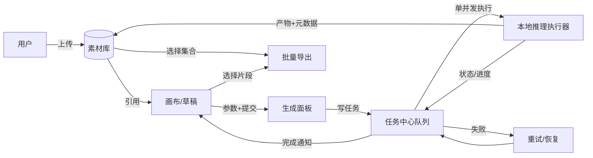

# 电商 AIGC 工作平台 · PRD

| 项 | 内容 |
| --- | --- |
| 版本 | v0.2（Q1–Q5 已裁决，待你确认后进入 PRD 体检与技术适配） |
| 日期 | 2026-10-22 |
| 裁决时间 | 2026-10-22 13:00（北京时间） |
| 作者 | Pi Agent（产品/架构/后端支持方） |
| 验收时间 | 2026-10-22 17:00（北京时间）；范围按 Q1=B 执行，见 §7.1 |
| 运行设备 | Mac M1，16GB 统一内存（本机实测，见 §8.1） |
| 文档定位 | 这是研发与验收的唯一需求依据；架构方案、接口契约、评测记录为配套内部资料 |
| 事实标注 | 【已确认】需求方确认；【建议】本稿提出、待你确认；【待确认】必须由你决定；【待验证】技术事实未经本机实测，不得当作结论 |

---

## 0. 阅读说明：本稿如何处理不确定性

本文严格区分四类内容，不允许混用：

1. **【已确认】**：来自你本次提供的需求，直接写成需求条款。
2. **【建议】**：为填补空缺由本稿提出的方案，已写成可执行条款，但需要你确认后才生效。
3. **【待确认】**：会改变目标用户、核心流程、交付范围或验收标准的缺口，必须由你回答（§14 汇总）。
4. **【待验证】**：模型能力、速度、成功率等技术事实。本机尚未跑过任何模型，一律不写具体数值，只写验证方法与判定标准（§8.4、§9）。

本稿**不含任何编造的用户调研、测试数据、生成速度或完成率**。凡出现数字的地方，要么是需求方给定，要么是**本机命令实测**（标注来源），要么明确写"待实测"。

---

## 1. 产品目标与定位

### 1.1 一句话定位【已确认】

> 在画布中生成、编辑、组合素材的**电商 AIGC 视觉工作台**，全部推理在**本机（Mac M1 / 16GB）本地完成**，无云端模型兜底。

### 1.2 产品目标【已确认】

| 编号 | 目标 | 怎样算做成（可判断） |
| --- | --- | --- |
| G1 | 把"一个商品 → 一套可投放素材"的重复劳动压缩为一次性编排 | 同一商品从上传到产出「多尺寸图片 + 视频」，在平台内完成，不需要切到其它工具做基础处理 |
| G2 | 图片与视频两条生产线共用同一套素材、画布与任务体系 | 画布中的同一素材可直接进入图片批次或视频批次，素材只维护一份 |
| G3 | 批量生产可无人值守地跑完，且过程中可继续编辑 | 提交 ≥5 个任务后，能继续在画布编辑而不阻塞；任务中心可见排队/运行/失败/完成 |
| G4 | 全本地、可离线复现 | 断网状态下仍能完成已有模型的一次生成（模型与权重已就位时） |
| G5 | 结果可评测、可追责 | 每次生成记录模型、参数、耗时、种子与产出文件，评测报告只填实测数据 |

### 1.3 不做什么（红线）【已确认】

| 编号 | 红线 | 说明 |
| --- | --- | --- |
| N1 | 不做短剧 | 视频只围绕**商品素材**做电商用途，不做剧情/角色叙事 |
| N2 | 不接入任何云端推理 API | 产品运行时无云模型兜底；DeepSeek API 仅用于开发期 Pi Agent，**不进入产品运行时** |
| N3 | 不用模板合成冒充"模型视频生成" | 生成式视频、运镜动效、模板合成是三种不同能力，必须在 UI 与文档中分开命名（§3） |
| N4 | 不编造评测结论 | 评测报告只写实测；未跑的项目写"未执行" |
| N5 | 不静默降标准 | 时间/硬件与需求冲突时，写清冲突并交你裁决，不自行删功能 |

---

## 2. 目标用户与使用场景

### 2.1 用户画像

| 项 | 内容 | 状态 |
| --- | --- | --- |
| 使用者 | 需要为商品批量产出图片/视频素材的个人（即需求方本人） | 【已确认 Q3=A】 |
| 使用频率 | 每上新品或大促前集中使用；单次会话提交数十个生成任务 | 【建议】 |
| 使用方式 | 桌面单机、浏览器访问本机服务；同步操作 + 异步等待 | 【建议】 |
| 技术能力 | 不需要懂模型；只需要"上传商品图 → 选风格/尺寸 → 点点点 → 导出" | 【已确认】隐含于产品定位 |
| 是否多用户 | **单机单用户、无登录**；数据模型预留 owner 字段，便于将来扩展 | 【已确认 Q3=A】 |

### 2.2 两个使用场景【已确认】

**场景 A · 电商图片生产**
商品图、主图、场景图；批量尺寸与风格适配；多 SKU 一致性。

**场景 B · 电商视频批量生产**
围绕商品素材完成电商视频的**批量生成与导出**，不做短剧。
视频的具体形式、输入和成片标准在 §5 中定义；已确认：视频为**生成式视频（I2V + T2V）**，由本地模型根据图片与文字生成。

### 2.3 要解决的问题（需求方陈述，非调研结论）

以下为需求方陈述的问题，本稿**不声称做过用户调研**：

| 编号 | 问题 | 说明 |
| --- | --- | --- |
| P1 | 素材生产碎片化 | 出图、改尺寸、做视频分散在多个工具，素材反复导入导出，版本对不上 |
| P2 | 多 SKU 一致性难 | 同一批商品图的风格/构图飘，需要人工反复挑图 |
| P3 | 批量任务不可控 | 批量生成时看不到进度，改一处要重跑全部，任务失败后要重新配置 |
| P4 | 云端成本与数据外流顾虑 | 商品图属于未发布素材，倾向本地处理 |

---

## 3. 能力边界：三种"电商视频"必须分开命名【已确认】

这是本项目最容易出错的地方。三者实现方式、算力消耗、验收标准完全不同，UI、文档、任务类型中**不得混称**：

| 维度 | ① 生成式视频（模型生成） | ② 运镜动效（图片动画） | ③ 模板合成（剪辑） |
| --- | --- | --- | --- |
| 技术实现 | 图生视频/文生视频扩散模型推理 | 对静态图做缩放/平移/视差（Ken Burns 等），确定性代码 | FFmpeg/合成器拼接素材、字幕、转场、音乐 |
| 输入 | 商品图 + 运动提示词/时长参数 | 静态图 + 运镜参数 | 多段素材 + 模板 + 文案 |
| 算力 | 高（视频扩散，显存/内存密集） | 极低 | 低（CPU 编解码） |
| 是否能叫"AI 视频生成" | 是 | **否**，应叫"图片动效" | **否**，应叫"模板合成/剪辑" |
| 本产品用途 | 场景 B 主能力【已确认 Q2：**图生视频 I2V + 文生视频 T2V**，输入为上传图片 + 文字描述】 | 场景 B 的**补充**能力，不得替代 ① | 场景 B 的**后处理**能力（片头片尾/字幕/音乐），后置 |

**产品约束**：若最终因硬件或时间限制只能交付 ②/③，必须在 UI 与文档中标注为"动效"或"模板合成"，并在 PRD 与评测报告中明确写出"模型视频生成未实现"，**不得用 ②/③ 替代 ① 的验收**。

---

## 4. 场景 A：电商图片生产

### 4.1 输入

| 项 | 内容 | 状态 |
| --- | --- | --- |
| 商品原图 | PNG/JPG/WebP，单张 ≤ 20MB，建议白底或干净背景 | 【建议】 |
| 商品信息 | 品名、类目、卖点文案、禁用词（可选） | 【建议】 |
| 风格 | 预设风格（白底/场景/平铺/模特感/节日氛围）+ 自定义提示词 | 【已确认】"风格适配" |
| 尺寸 | 1:1 / 3:4 / 4:3 / 9:16 / 16:9，常用电商尺寸预设 | 【已确认】"批量尺寸" |
| SKU 组 | 同一商品的多 SKU 图（颜色/款式），可标记"同组" | 【已确认】"多 SKU 一致性" |
| 参考图（可选） | 用于锁定风格/构图的参考 | 【建议】 |

### 4.2 处理流程与人工确认点

```
上传商品图 ─→ ① 抠图/主体提取(可选) ─→ ② 风格+尺寸参数确认【人工确认点 C1】
   ─→ ③ 提交生成任务(可批量) ─→ ④ 任务中心排队执行(单并发)
   ─→ ⑤ 结果回填画布【人工确认点 C2：保留/淘汰/重生成】
   ─→ ⑥ 二次编辑(局部重绘/扩图/文字/组合)【人工确认点 C3】
   ─→ ⑦ 批量导出(多尺寸/命名规则/打包)
```

| 确认点 | 位置 | 必须由人做的判断 | 系统不得自动决定 |
| --- | --- | --- | --- |
| C1 | 提交前 | 风格、尺寸组合、SKU 分组、张数 | 是否花算力跑一批（默认不自动开跑） |
| C2 | 结果回填后 | 哪张可用、哪张重跑 | 不得自动淘汰/自动重跑（可提供"全部重跑"按钮，需点击） |
| C3 | 编辑后 | 是否覆盖原版本 | 覆盖历史版本必须显式选择（默认新增版本，不删旧版本） |
| C4 | 导出前 | 目标平台、尺寸集合、命名规则 | 不做"猜平台"的默认导出 |

### 4.3 输出【已确认 + 建议】

| 项 | 内容 | 状态 |
| --- | --- | --- |
| 单图文件 | PNG（透明底可用）/ JPG，分辨率按尺寸预设 | 【建议】 |
| 批量产物 | 按 SKU × 尺寸矩阵产出，目录结构 `商品/SKU/尺寸/` | 【建议】 |
| 附带信息 | 每张图记录：模型、提示词、种子、步数、耗时、尺寸、版本号 | 【建议】必备（可追溯） |
| 长期保留 | 素材原件、生成结果、画布工程文件、任务记录 | 【已确认】"编辑内容不丢失" |

### 4.4 多 SKU 一致性的实现路线【建议，需实测】

优先级由弱到强（逐级验证，不承诺全部可用）：

1. **提示词模板 + 固定种子 + 固定参数**（最轻，先做）。
2. **参考图 / IP-Adapter 类条件控制**（中等，依赖模型生态与 MPS 兼容性）。
3. **商品级 LoRA 微调**（最重，M1 16GB 上训练可行性与耗时【待验证】）。

**一致性判定标准**（人工，见 §9.2）：同一 SKU 组内，主体占比、背景风格、色调、构图重心是否在可接受区间内一致；具体阈值在第一次真实批次后按 5–10 个样例打分确定（台账 D2）。

### 4.5 批量尺寸与风格适配

- 一个批次 = `SKU 集合 × 尺寸集合 × 风格`，笛卡尔积生成子任务。
- 子任务独立排队、独立失败重试；一个失败不阻塞整批【已确认，多任务必做项】。
- 尺寸适配策略：优先"目标尺寸直接生成"，次选"生成后等比缩放 + 智能补边/扩图"（后者依赖扩图能力，【待验证】）。

---

## 5. 场景 B：电商视频批量生产

### 5.1 技术含义【已确认 Q2】

| 选项 | 含义 | 本稿推荐 |
| --- | --- | --- |
| A | **真实图生视频（I2V）模型**在本地推理，3–5 秒、无声短片；画布可拼接多段后导出 | ✅ **推荐作为场景 B 的目标能力** |
| B | A + **模板合成**后处理（片头、字幕、音乐、转场） | 推荐作为 A 之后的增强迭代 |
| C | 仅静态图片**运镜动效** | 只能作为"A 未通过硬件验证"时的**兜底交付**，且必须改名标注 |

**裁决（Q2）**：本产品的"电商视频生成"指 **① 生成式视频**，具体为**图生视频（I2V）与文生视频（T2V）**——根据上传的图片和文字描述，由本地视频扩散模型生成视频。

由此产生的硬性要求：

1. 视频任务输入 = **图片（首帧/参考）+ 文字描述**；I2V 与 T2V 都属场景 B 合法形式，具体用哪个由用户在提交时选择。
2. ② 运镜动效、③ 模板合成**只能作为附加能力**，不得用于替代 ① 的验收，UI 与文档中必须分开命名。
3. 若 ① 在 16GB 上验证不通过，按【未通过】记录并上报，由你裁决，不得用 ②/③ 顶上。
4. ②/③ 仍列入后续迭代（v1.4+），因为它们能提升成片完整度，但不承担"视频生成"的定义。

### 5.2 输入 / 流程 / 输出 / 人工确认点（按选项 A）

**输入**

| 项 | 内容 | 状态 |
| --- | --- | --- |
| 首帧图 | 上传的图片，或画布中已确认的商品图（场景 A 的产物可直接复用）；T2V 模式下可省略 | 【已确认 Q2】 |
| 文字描述 | 场景/镜头/运动描述文字（**T2V 必需；I2V 可选**）+ 预设运动（推近/环绕/展示/开箱感） | 【已确认 Q2】 |
| 规格 | 画幅 9:16 / 1:1 / 16:9；时长 **3–10s**；分辨率目标 720p（不足降 480p 并标注） | 【已确认 Q4】 |
| 批量 | 每商品 1–N 条；多商品批次 | 【已确认】"批量生成" |

**流程**

```
选择已确认素材 ─→ ① 设定运动+规格【人工确认点 V1】
   ─→ ② 提交视频任务(进入同一个任务中心) ─→ ③ 单并发排队执行
   ─→ ④ 预览片段【人工确认点 V2：保留/重跑/淘汰】
   ─→ ⑤ 拼接/排序（画布时间序列）【人工确认点 V3】
   ─→ ⑥ 导出 MP4（可选：字幕/音乐，属模板合成能力）
```

**输出**

| 项 | 内容 | 状态 |
| --- | --- | --- |
| 片段 | MP4 / H.264，无音轨（模型直出） | 【建议】 |
| 成片 | 多片段拼接后成片；可选音轨 | 【已确认范围；音轨属模板合成能力，后置】 |
| 元数据 | 模型、提示词、时长、帧率、耗时、种子 | 【建议】必备 |
| 失败样本 | 失败原因与 stderr 摘要入库，便于恢复 | 【建议】必备 |

### 5.3 成片标准【已确认 Q4，含一处放宽】

| 项 | 建议值 | 说明 |
| --- | --- | --- |
| 画幅 | 9:16 竖版为主，1:1 次之 | 电商投放主战场 |
| 时长 | 单片段 **3–10s**（Q4 裁决：由 3–5s 放宽为 3–10s）；成片按片段拼接 | 10s 在 16GB 上的可行性【待验证 V3】；若 10s 不可达，必须在探针记录中写明**实际可达上限**并上报，不得静默截断成短片当 10s 交付 |
| 分辨率 | 目标 720p（720×1280）；不足时降级到 480p 并明确记录 | 降级必须写在产出元数据与 UI |
| 音轨 | MVP 无音轨；音乐/配音后置 | 避免与"生成式视频"能力混淆 |
| 主体稳定性 | 商品不发生形变/闪烁/穿模；文字不变形 | 人工评分项（§9.2） |

### 5.4 关键风险（写在需求里，不藏在实现里）

| 风险 | 影响 | 应对 |
| --- | --- | --- |
| 16GB 统一内存可能无法承载可用质量的 I2V 模型 | 场景 B 可能无法按 §5.3 交付 | §8.4 先做可行性探针；不通过则按 C 兜底并如实标注 |
| MPS 后端对视频扩散的支持不完整 | 可能只能 CPU 推理（不可接受的速度） | 探针先测；失败即上报，不硬撑 |
| 视频生成单条耗时长 | 批量任务等待时间超过预期 | 用任务中心异步 + 排队；不承诺"实时" |
| 权重下载体积大 | 磁盘与网络占用 | 本机剩余磁盘 96GiB（实测）；下载前确认体积 |

---

## 6. 工作台协作关系：画布 / 素材 / 生成 / 编辑 / 导出 / 任务中心

### 6.1 模块职责

| 模块 | 职责 | 不负责 |
| --- | --- | --- |
| **素材库** | 原件与产物的唯一来源（内容寻址 + 元数据 + 版本），支持分组/SKU 标记/标签 | 不做编辑，不做生成 |
| **画布** | 空间编排：图片、文字、形状、多片段序列；保存为"工程/草稿" | 不直接跑模型（只提交任务） |
| **生成** | 参数面板 → 生成请求（图片/视频）；模板化参数复用 | 不保存编辑态（交给画布/草稿） |
| **编辑** | 局部重绘、扩图、调色、文字、组合（能力逐项启用，未验证不放入 UI） | 不绕过任务中心直接占用模型 |
| **任务中心** | 统一队列：提交、排队、运行、取消、失败重试、历史、日志；跨图片/视频共用 | 不决定"什么算好"（那是人工确认） |
| **批量导出** | 选择素材集合 + 尺寸/格式/命名规则 → 打包 | 不自动上传到任何外部平台（第一版） |

### 6.2 数据流（协作关系）



### 6.3 关键协作规则【已确认】

| 规则 | 说明 |
| --- | --- |
| R1 | 生成过程中的编辑不被阻塞：任务在后台执行，画布可继续编辑并保存草稿 |
| R2 | 画布编辑态与任务解耦：任务是"一次生成请求的快照"，画布后续改动不影响已提交任务 |
| R3 | 产物回填不覆盖用户编辑：产物进素材库 + 画布新增图层/片段，用户手动选择采用 |
| R4 | 一切模型调用必经任务中心，禁止旁路直接推理（保证可取消、可恢复、可观测） |
| R5 | 素材只有一份：画布引用素材 ID，复制画布不复制大文件 |

---

## 7. 今天验收的 MVP 范围与迭代边界

### 7.1 时间冲突与裁决结果【已裁决 Q1 = B】

**裁决（2026-10-22 13:00，由产品经理确定）**：验收日不变，按**选项 B** 执行——图片与视频**各跑通一条真实模型最小链路**，画布与批量/恢复降为**单条演示路径**。

**B 的执行含义（写清，避免验收时扯皮）**

1. 今日 17:00 前必须有**真实视频产出文件**（本地模型推理，不是模板合成）；否则场景 B 当日记为【未通过】，不临时改标准、不用 ②/③ 顶替。
2. 画布只做**最小验收页面**（FastAPI 挂载单页 HTML：上传、提交、看状态、预览/下载产出），不做正式画布；正式画布交 Codex 前端阶段。
3. 批量、重启恢复、草稿持久化保留**后端能力 + 单条演示路径**，不做全量交互。
4. 四份文档照交付；评测报告中未执行项写"未执行"。

**B 的主要风险（按你的选择执行，但有义务说明）**：视频模型在 16GB M1 上的可行性本身是【待验证】。若探针不过，时间会被视频挤占，图片链路也会受损。因此执行顺序固定：**先图片链路保底 → 再视频探针（时间盒 90 分钟）→ 再接入最小页面 → 最后文档**；任何一步失败立即如实上报，不占文档时间。

**事实**：本稿起草于 **2026-10-22 12:40 北京时间**（本机 `date` 实测），验收时间为 **2026-10-22 17:00**（起草时剩余约 4h20m）。

**冲突**：在 4h20m 内无法同时完成——真实本地图片模型跑通 + 真实本地视频模型跑通 + 画布交互 + 批量任务调度 + 重启恢复 + 四份文档 + 真实评测。任何声称都能做到的方案，必然要靠 mock 或降标准，这违反 §1.3 N4/N5。

**选项**

| 选项 | 内容 | 优点 | 风险 |
| --- | --- | --- | --- |
| **A（推荐）** | 验收日不变。今日交付：①真实本地图片模型单条链路跑通（含实测耗时与产出图）②任务中心串行队列（提交/排队/取消/失败重试/持久化）③后端接口契约 + 启动方式 + 错误结构 + 验证记录 ④四份文档（视频部分写明"设计完成、未实现、有评测方案"） | 每一条都有真实证据，无 mock 冒充 | 视频生成今日不可演示；画布 UI 由 Codex 后续做 |
| B | 验收日不变。图片+视频各跑通一条最小链路，画布/批量/恢复降为单条演示路径 | 场景 B 有真东西 | 视频模型下载+调试在 4h 内极可能失败，反而拖垮图片链路交付 |
| C | 验收顺延至 10/23–10/25，交付完整 MVP（图片+视频 I2V+批量+重启恢复+最小画布） | 范围完整 | 与你给定的 17:00 验收冲突，需你明确改期 |

> 以上选项表保留为决策记录（A/C 未被采纳）。

### 7.2 今日 MVP 范围（按裁决 B 展开）

| 优先级 | 范围项 | 今日是否必须 | 证据形式 |
| --- | --- | --- | --- |
| P0 | 本地服务启动（一条命令）、健康检查、仅监听 127.0.0.1 | ✅ | 启动日志 + 健康接口返回 |
| P0 | **图片**：单条真实模型链路（本地权重、MPS），产出图 + 元数据 | ✅ | 图片文件 + 实测耗时 + 参数记录 |
| P0 | **视频**：单条真实模型链路（I2V 或 T2V，3s 起、上限 10s 如实记录），产出 MP4 | ✅ | 视频文件 + 实际时长/分辨率 + 实测耗时 |
| P0 | 任务中心（后端）：提交/排队/单并发/取消/失败重试/持久化 | ✅ | 任务记录 + 状态时间线 |
| P0 | 最小验收页面（单 HTML，FastAPI 静态挂载，非正式前端） | ✅ | 页面截图 + 你能亲手操作的步骤 |
| P0 | 素材落盘与元数据（内容寻址，不重名覆盖） | ✅ | 目录清单 + 元数据 JSON |
| P0 | 接口契约（请求/响应/错误结构/长任务查询或 SSE 收尾） | ✅ | `docs/接口/` 文档 |
| P0 | 四份交付文档（PRD / 评测报告 / 交互操作手册 / 多任务并发说明） | ✅ | 文档文件本身 |
| P1 | 批量提交（API 层）+ 单条演示路径；草稿持久化演示 | ✅ 演示级 | 批次记录 + 刷新/重启截图 |
| P1 | 重启恢复实测（排队中杀进程重启） | ✅ 演示级 | 重启前后数据对比 |
| P2 | 正式画布（空间编排、视频时间序列、拼接、导出打包） | ❌ 交 Codex 前端阶段 | — |
| P2 | 局部重绘/扩图/参考图一致性、模板合成、多用户、平台直发 | ❌ 后续迭代 | — |

### 7.3 迭代边界（第一版之后）

| 迭代 | 内容 |
| --- | --- |
| v1.1 | 正式画布（Codex 前端）：空间编排 + 视频片段序列 + 批量导出打包 |
| v1.2 | 视频批量生产进任务中心（多商品多片段）+ 10s 上限的稳定性与速度优化 |
| v1.3 | 多 SKU 一致性增强（参考图控制 / LoRA 路线，按实测取舍） |
| v1.4 | 编辑能力扩展（局部重绘、扩图）、导出预设（各平台尺寸） |
| v2.0 | 多用户/账号隔离（Q3 已定第一版单机单用户，此项仅在将来确有需要时启动） |

---

## 8. 本地模型选型所需能力、硬件约束与待验证项

### 8.1 本机实测事实（来源：本机命令，2026-10-22 12:37）

| 项 | 实测值 | 影响 |
| --- | --- | --- |
| 系统 | macOS 14.6（23G80），arm64 | MPS 可用路径；版本较旧，部分新库要求更高系统版本【待验证】 |
| 内存 | 16GB（17179869184 bytes）统一内存 | CPU 与 GPU 共享；大模型需量化/分片/顺序加载 |
| CPU 核数 | 8 | 视频编码/图像后处理可用 |
| 磁盘剩余 | 96GiB（`/` 分区） | 权重总占用需 < ~60GB 留余量；FLUX 级别（约 12B 参数）单模型 fp16 约 24GB |
| Python | 3.9.6（系统自带） | 低于工具包默认基线 3.12，需要独立环境（阶段 2 处理） |
| Node | v24.18.0；npm 11.16.0 | 前端阶段可用 |
| Git | 2.39.5 | 可用 |
| FFmpeg | **未安装** | 视频拼接/编码/导出需要，阶段 2 安装 |

### 8.2 模型能力要求（选型门槛，不含具体厂商）

**图片模型**

| 要求 | 门槛 |
| --- | --- |
| 分辨率 | 能出 1024×1024 级别可用图（不足则 768 起步并记录） |
| 可控性 | 支持提示词 + 尺寸；最好支持参考图条件控制（用于 SKU 一致性） |
| 显存/内存占用 | 以 16GB 统一内存为上限，需量化或 fp16 + 注意力切片可跑通 |
| 速度 | 单图可接受上限【待确认：建议 1024 分辨率 ≤ 60s/张，未实测】 |
| 许可 | 允许商用；门控（gated）模型需能本地登录授权 |
| 生态 | 有 Apple Silicon（MPS/MLX）可用的成熟推理路径 |

**视频模型**

| 要求 | 门槛 |
| --- | --- |
| 形态 | 图生视频（I2V）优先 |
| 时长/分辨率 | 3–5s @ 480p 可跑通为下限，720p 为期望 |
| 内存占用 | 16GB 统一内存内可跑（含文本编码器与 VAE 峰值） |
| 许可 | 允许商用 |
| 生态 | 有可用的 MPS/CPU 推理实现，不依赖 CUDA 专用算子 |

### 8.3 候选模型（事实来自 Hugging Face 官方模型 API 元数据，2026-10-22 核对）

> 下表只列**客观元数据**（参数量、许可、是否门控）。**不表示能在 M1 16GB 上跑通**，可行性按 §8.4 验证。
> 视频侧按 Q2 同时列出 I2V（图生视频）与 T2V（文生视频）候选；今日只选 1 个跑通，不并行试错。

**图片候选**

| 模型 | 参数量 | 许可 | 门控 | 备注 |
| --- | --- | --- | --- | --- |
| stabilityai/stable-diffusion-xl-base-1.0 | 2.57B | openrail++ | 否 | 生态成熟，条件控制方案多 |
| black-forest-labs/FLUX.1-schnell | 11.89B | apache-2.0 | 是（auto，需接受条款） | 质量强但体积大；另有 MLX 原生实现（mflux 0.23.0，PyPI 核对） |
| black-forest-labs/FLUX.1-dev | 11.9B | 其他（非标准开源许可，需核对条款） | 是（auto） | 许可需人工核对商用条件 |
| Qwen/Qwen-Image | 20.43B | apache-2.0 | 否 | 体积远超 16GB 舒适区，仅列为对照 |
| madebyollin/sdxl-vae-fp16-fix | 0.08B | mit | 否 | SDXL fp16 解码兼容补丁（工程细节） |

**视频候选（I2V / T2V）**

| 模型 | 参数量 | 许可 | 门控 | 备注 |
| --- | --- | --- | --- | --- |
| Lightricks/LTX-Video | 1.92B | 其他（需核对商用条款） | 否 | 参数小，是 16GB 上的首要探针对象 |
| THUDM(CogVideoX)-2b（现 zai-org/CogVideoX-2b） | 1.69B | apache-2.0 | 否 | 参数小、许可清晰 |
| ali-vilab/i2vgen-xl | 1.42B | mit | 否 | I2V 专用，许可宽松 |
| stabilityai/stable-video-diffusion-img2vid-xt | 1.52B | 其他（Stability 社区许可，商用需核对） | 否 | I2V 经典基线 |
| Wan-AI/Wan2.1-T2V-1.3B | 1.42B | apache-2.0 | 否 | 文生视频，非 I2V |
| Wan-AI/Wan2.1-I2V-14B-480P | 16.39B | apache-2.0 | 否 | 参数远超 16GB 内存，仅列为"不可行对照" |

**工具链事实**：`diffusers` 0.41.0、`torch` 2.14.1、`mlx` 0.32.4、`mflux` 0.23.0 在 PyPI 上存在（2026-10-22 核对）；diffusers 官方 MPS 文档说明支持 Apple Silicon，并给出两条与本项目直接相关的约束：**内存压力敏感、建议开启注意力切片（<64GB 内存时）**；**一次多个提示词的批量推理可能崩溃或不可靠，建议改为逐条迭代**。

### 8.4 待验证项（阶段 1/2 执行，结论不得预填）

| 编号 | 待验证问题 | 验证方法 | 通过标准 |
| --- | --- | --- | --- |
| V1 | SDXL 级模型能否在 M1 16GB 上以可接受速度出 1024 图 | 单条真实推理，记录峰值内存与耗时 | 不 OOM；耗时上限待首次实测后由你确认（不预填） |
| V2 | FLUX.1-schnell（11.89B，含门控授权）能否在 16GB 上跑（含 MLX 路线） | mflux / diffusers 两条路径各跑一次 | 同上；失败则记录失败阶段与原因 |
| V3 | 视频扩散模型（LTX-Video / CogVideoX-2b / i2vgen-xl / Wan2.1-T2V-1.3B）能否在 16GB 上跑出 3–10s 片段 | 按时间盒逐个探针，记录是否 OOM / 是否只能 CPU / 耗时 / **实际可达时长与分辨率** | 至少 1 个模型在可接受耗时内出 3s 可看片段；10s 为期望上限，不可达须记录实际上限并上报 |
| V4 | attention slicing / 量化（int8/int4）对质量的损失 | 同提示词同种子对比 | 质量下降在人工评分容差内 |
| V5 | 参考图条件控制（IP-Adapter 类）在 MPS 上是否可用 | 跑官方示例 | 可用且不 OOM |
| V6 | 后台任务 + 模型常驻内存是否可控（模型常驻 vs 每任务加载） | 连续 5 个任务观察内存 | 无内存持续增长/无 swap 失控 |
| V7 | 进程重启后任务与草稿能否恢复 | 杀进程重启实测 | 状态一致、无数据丢失 |

**记录要求**：每条验证都要写「设备 / 模型与版本 / 命令 / 实测耗时 / 峰值内存 / 结果 / 失败原因」，存入 `docs/evidence/`。**未跑=未执行，不得写"预计"当结论。**

---

## 9. 模型评测方案（本次只制定方案，不填结果）

### 9.1 可客观测量的指标（机器采集）

| 指标 | 定义 | 采集方式 | 目标值 |
| --- | --- | --- | --- |
| 成功率 | 成功产出文件 / 提交任务数 | 任务表统计 | 待实测后设定 |
| 单张/单条耗时 | 从执行开始到文件落盘（s） | 任务记录时间戳 | 待实测；分分辨率/步数分段统计 |
| 首任务冷启动耗时 | 进程启动到可执行（含模型加载） | 日志时间戳 | 待实测 |
| 峰值内存 | 推理期统一内存峰值（GB） | 采样 `ps`/`vm_stat` | 不得触发系统级 swap 抖动 |
| 产出规格合规率 | 尺寸/时长/编码合规的比例 | 用 `ffprobe`/图像库检查 | 100% |
| 元数据完整率 | 含模型/提示词/种子/参数的产出比例 | 元数据校验 | 100% |
| 稳定性（连续跑） | 连续 N 次任务无崩溃的比例 | 压测记录 | 待实测 |

### 9.2 需要人工判断的维度（评分卡，1–5 分）

| 维度 | 判断内容 | 适用 |
| --- | --- | --- |
| 主体保真 | 商品是否变形、缺件、错色、文字错乱 | 图片/视频 |
| 电商可用性 | 是否能直接用于投放（无明显违和） | 图片/视频 |
| 风格一致性 | 同批次/同 SKU 组的风格是否统一 | 图片/视频 |
| 构图与留白 | 是否留出主图卖点/角标位置 | 图片 |
| 运动合理性 | 运镜/形变是否物理自然、无闪烁穿模 | 视频 |
| 整体偏好 | 与备选方案对比的主观偏好 | 全部 |

**评分流程**：每个模型/参数组合出 5–10 条真实样例，由你盲评打分；评分结果写入台账 D2/D3，作为验收阈值来源。**本稿不预填任何分数。**

### 9.3 质量与速度冲突时的取舍规则

层级递减，前一层不达标不进入下一层：

1. **可用性底线（不可让）**：商品主体不得变形/错色/文字错乱；规格必须合规。不达标→换模型或换参数，而不是"接受瑕疵"。
2. **效果优先（质量 vs 速度冲突时的默认偏向）**：在底线之上，默认优先质量，允许更慢；速度只作为第二排序。
3. **吞吐兜底**：若质量达标但速度导致批量不可用（例如 1 张 > 3 分钟），允许**降低分辨率/步数**换取吞吐，但必须：① UI 与元数据标注降级参数 ② 保留"高质量模式"开关 ③ 在评测报告中分档记录质量差异。
4. **禁止项**：不得为提速而悄悄改参数、不得用低质量结果冒充高质量档、不得删掉高质量档。

### 9.4 评测数据集

需要你提供 **5–10 张真实商品图**（覆盖：白底商品、复杂背景商品、带文字包装、多 SKU 同款不同色）。在拿到前，评测报告只写"数据集未就绪"。

### 9.5 评测报告记录规范

- 每条记录：数据集编号 / 模型与版本 / 参数 / 耗时 / 峰值内存 / 产出文件路径 / 人工评分 / 备注。
- 区分三类证据：**模拟接口测试**、**真实模型运行**、**人工验收**，互不替代。
- 未执行的项写"未执行"，不写"预计通过"。

---

## 10. 多任务、中断、恢复与草稿持久化（PRD 视角）

> 详细机制与状态机在《多任务并发说明》中展开；此处定义需求与边界。

### 10.1 核心区分（需求层，不可混淆）【已确认】

| 概念 | 定义 | 本产品做法 |
| --- | --- | --- |
| **多任务提交** | 用户可同时提交多个生成任务 | ✅ 必须支持，任务进持久化队列 |
| **多任务排队** | 任务按顺序/优先级等待执行 | ✅ 必须支持，可见位置与预计等待 |
| **同时推理** | 多个模型推理并行占用内存 | ⚠️ **默认单并发**。依据：16GB 统一内存 + diffusers 官方 MPS 文档指出批量推理可能崩溃/不可靠；并发度做成可配置项，默认 1 |
| **中断/取消** | 用户主动停止排队中或运行中的任务 | ✅ 排队中可立即取消；运行中为"协作式取消"（在安全点停止），语义在文档中写清 |
| **失败恢复** | 单任务失败后重试，不影响其它任务 | ✅ 有限次自动重试（默认 1 次可配置）+ 手动重试 |
| **重启恢复** | 进程重启后任务与草稿状态一致 | ✅ 持久化到本地数据库；重启后排队任务继续、运行中任务标记为"已中断待恢复/需重试" |
| **草稿持久化** | 编辑内容不因关闭/刷新/重启丢失 | ✅ 画布草稿自动保存（本地持久化），生成过程中编辑不受影响 |

### 10.2 任务状态机（需求定义）

```
queued（排队）
  ├─→ running（执行中）─→ succeeded（成功）
  │        ├─→ canceling ─→ canceled（已取消）
  │        └─→ failed（失败）─→ retrying ─→ queued
  ├─→ canceled（排队中直接取消）
  └─→ paused（资源不足/用户暂停）─→ queued
进程崩溃：running → interrupted（中断）─→ queued（重启后恢复）或 failed（超限）
```

**规则**

| 编号 | 规则 |
| --- | --- |
| T1 | 每个任务必须记录：类型（图片/视频）、参数快照、模型版本、创建/开始/结束时间、错误码、产物 ID、重试次数 |
| T2 | 任务一旦提交，参数即快照；之后修改画布不影响已提交任务 |
| T3 | 单任务失败不阻塞队列后续任务 |
| T4 | 取消语义必须明确：排队中立即生效；运行中在下一个安全点生效（不承诺毫秒级） |
| T5 | 重启恢复：重启后 running→interrupted，排队任务继续；已中断任务不自动无限重试 |
| T6 | 同一素材/同一参数重复提交时，允许"复用已有产物"提示，但不静默复用（避免误用旧结果） |
| T7 | 资源守卫：内存/磁盘低于阈值时暂停取新任务并提示原因，不静默失败 |
| T8 | 所有任务必须可查询历史（含失败），失败原因可读（错误码 + 人话说明） |

### 10.3 重启恢复与草稿持久化的需求

| 编号 | 要求 |
| --- | --- |
| D1 | 任务、批次、素材元数据、画布草稿均落本地持久化存储，进程重启不丢 |
| D2 | 画布草稿自动保存（建议：变更后短延时自动保存 + 手动保存兜底），保存冲突策略为"最后写入 + 版本快照" |
| D3 | 生成中途重启：产物文件若已完整落盘则登记为成功；半成品必须清理或标记为无效，不得当作可用产物 |
| D4 | 恢复过程必须有可见提示（"检测到上次异常退出，已恢复 N 个任务"） |

---

## 11. 验收用例与证据要求

### 11.1 验收用例（按选项 A 的范围）

| 编号 | 用例 | 步骤 | 期望 | 证据 |
| --- | --- | --- | --- | --- |
| AC-01 | 服务启动 | 执行启动命令 | 一条命令起服务，健康检查返回 ok | 启动日志 + 接口返回截图 |
| AC-02 | 单图真实生成 | 提交 1 个图片任务 | 真实模型产出图片文件，元数据含模型/参数/耗时/种子 | 产出文件 + 元数据 + 实测耗时 |
| AC-02V | 单条真实视频生成 | 在最小页面提交 1 个视频任务（图片 + 文字描述） | 真实模型产出 MP4，记录实际时长/分辨率/耗时，且不是模板合成 | 视频文件 + 元数据 + 你的现场播放确认 |
| AC-03 | 批量提交 | 提交 5 个任务 | 全部入队，任务中心可见顺序 | 任务列表截图 |
| AC-04 | 排队不并发 | 观察执行过程 | 同一时刻只有 1 个 running（默认配置下） | 并发度证据（日志/时间线） |
| AC-05 | 排队取消 | 取消 1 个 queued 任务 | 立即变为 canceled，不产出文件 | 状态变化记录 |
| AC-06 | 运行中取消 | 取消 1 个 running 任务 | 在安全点停止，标记 canceled，无半成品登记 | 状态 + 产物目录核对 |
| AC-07 | 失败与重试 | 注入失败（临时改错模型路径/参数） | 任务转 failed，错误码可读；重试后成功 | 失败记录 + 重试记录 |
| AC-08 | 重启恢复 | 排队中杀进程并重启 | 排队任务继续；running 转 interrupted 并可恢复；无数据丢失 | 重启前后数据对比 |
| AC-09 | 草稿持久化（B 范围=演示路径） | 在最小页面保存草稿 → 刷新并重启服务 → 重开 | 草稿内容完整保留 | 前后截图对比 |
| AC-10 | 编辑不阻塞生成（B 范围=演示路径） | 生成进行中在同一页面保存草稿 | 保存成功，任务状态不受影响 | 截图 + 时间线 |
| AC-11 | 元数据完整性 | 检查所有产物 | 100% 含必需元数据 | 校验脚本输出 |
| AC-12 | 视频可行性探针 | 跑 §8.4 V3 | 输出"通过/不通过 + 原因 + 实测数据" | 探针记录文件 |
| AC-13 | 错误结构统一 | 构造非法请求 | 返回 `{"error":{"code","message"}}`，无堆栈泄漏 | 接口响应 |
| AC-14 | 断网运行 | 断网后执行生成（权重就位） | 生成正常完成，无任何云调用 | 网络监控/断网截图 |
| AC-15 | 错误码与日志 | 查看日志 | 不含密钥、不含图片内容；错误可定位 | 日志片段 |

### 11.2 证据要求

- 三类证据分别标注：**模拟测试**（自动化用例）、**真实模型运行**（真实权重实测）、**人工验收**（你本人操作/评分）。
- 证据存放：`docs/evidence/阶段N/`，含截图、产出文件路径清单、阶段闸门是否表。
- 命令输出与日志不进正式证据包，你追问时再给。

---

## 12. 前后端职责边界与协作方式

| 角色 | 负责 | 交付物 |
| --- | --- | --- |
| 我（Pi Agent） | PRD、架构方案、后端实现与核心链路真实验证 | PRD、架构方案、后端代码、接口契约、启动方式、错误结构、验证记录、四份文档 |
| Codex | 正式前端开发（画布/素材/任务中心界面） | 前端代码，按接口契约接入 |
| Codex | 前后端集成与联调 | 联调后的可运行产品 + 联调记录 |
| 你 | 需求与验收裁决 | 确认 PRD/架构、提供评测样例、人工评分、验收 |

**接口契约交付要求**（后端阶段）：

1. 每个接口：方法与路径、请求体、响应体、错误码表、幂等性说明。
2. 统一错误结构：`{"error": {"code": "...", "message": "..."}}`，不泄露堆栈。
3. 长任务：提供"提交 + 查询状态"接口；如用 SSE，必须以 `done` 或 `error` 事件收尾。
4. 启动方式：一条命令 + 环境变量清单（不含真实密钥）+ 健康检查。
5. 验证记录：每个接口至少一条真实调用记录（真实模型或明确标注的模拟）。

---

## 13. 非功能要求

| 类别 | 要求 |
| --- | --- |
| 性能 | 图片：单张耗时目标【待实测后定】；视频：单条耗时目标【待实测后定】。UI 不得因后台任务卡死 |
| 可靠性 | 任务与草稿持久化；进程重启可恢复；单任务失败不影响队列 |
| 可观测 | 结构化日志（任务 ID、阶段、耗时、错误码）、任务轨迹、内存采样；不记录密钥与图片内容 |
| 安全 | 仅监听本机回环地址（默认）；上传校验真实类型/大小/文件名；路径穿越防护；删除/覆盖需确认 |
| 隐私 | 商品图不出本机；不接入云端推理；日志不记图片内容；`.env` 不入库 |
| 磁盘 | 96GiB 可用；模型权重目录与产物目录分离，产物可清理但需显式操作 |
| 可移植 | 模型/参数/路径可配置，不硬编码在本机路径 |
| 可测试 | 核心链路有自动化测试；失败路径可注入（用于 AC-07） |

---

## 14. 本轮待确认项：已全部关闭

> 2026-10-22 13:00 收到你的裁决：Q1=B、Q2=图生视频或文生视频（根据上传图片与文字生成视频）、Q3=A、Q4=其余按推荐且视频时长放宽为 3–10s、Q5=A。以下保留原始问题与「不选的后果」作为决策记录（审计用），裁决结果已写回正文对应章节。

**仍未关闭的物料项（不阻塞 PRD 定稿，但影响评测报告）**：评测样例图 5–10 张。

### 裁决汇总（v0.2 生效）

| 编号 | 问题 | 你的裁决 | 写回位置 |
| --- | --- | --- | --- |
| Q1 | 验收时间与范围 | **B**：今日本地图片 + 视频各跑一条真实最小链路；画布/批量/恢复降为单条演示路径 | §7.1、§7.2 |
| Q2 | 视频技术含义 | **生成式视频：I2V 与 T2V**，根据上传图片与文字生成视频；运镜/模板合成不得替代 | §3、§5.1 |
| Q3 | 用户与登录 | **A**：单机单用户、无登录，数据模型预留 owner | §2.1 |
| Q4 | 规格优先级 | 按推荐；**视频时长 3–10s**（原 3–5s 放宽） | §5.3 |
| Q5 | 验收形式 | **A**：你在本机按验收用例走一遍 + 四份文档 | §11 |

### Q1 验收时间与范围冲突如何裁决？
- 事实：距 2026-10-22 17:00 仅约 4 小时 20 分（本机时间实测）。
- 选项：A 验收日不变，今日交付"图片真实链路 + 任务中心 + 接口契约 + 四份文档"，视频只交探针结论 / B 图片+视频都做最小链路，画布与批量化降级 / C 验收顺延至 10/23–10/25 交付完整 MVP。
- 推荐：**A**。
- 不选的后果：选 B 极可能两边都不达标（视频模型下载+调试挤占图片链路时间）；选 C 需你改期。

### Q2「电商视频生成」的技术含义选哪个？
- 选项：A 真实图生视频（I2V）模型，3–5s 无声 / B A + 模板合成后处理 / C 仅静态图运镜动效（须改名，不叫视频生成）。
- 推荐：**A 为能力目标，B 为后续迭代，C 仅作不可行时的兜底并改名标注**。
- 不选的后果：若默认按 A 但你要的其实是 C，会白做可行性探针；若把 C 当 A 验收，等于用模板冒充模型生成（红线 N3）。

### Q3 目标用户与登录形态？
- 选项：A 仅你本人单机使用，无登录（数据模型预留 owner 字段）/ B 未来给 2–5 个商家用，第一版就要账号隔离。
- 推荐：**A**。
- 不选的后果：选 B 会显著增加后端与前端工作量（登录、隔离、越权防护），4h 内不可能。

### Q4 视频成片规格与图片分辨率优先级？
- 推荐：视频单段 3–5s、9:16、目标 720p（不足降 480p 并标注）、无音轨；图片 1:1 1024 为主，3:4 / 9:16 次之。
- 不选的后果：规格不定则无法定验收标准，也无法判断 16GB 是否够用。

### Q5 今日验收的形式？
- 选项：A 你在本机打开服务、按验收用例走一遍（后端 + 最小可视页面/接口文档）+ 四份文档 / B 只要文档与证据包，产品稍后再验。
- 推荐：**A**。
- 不选的后果：选 B 会让"真实可运行"这条无法当场核验，风险留到前端阶段才暴露。

### 另有 1 项需要你后续提供（不阻塞 PRD 定稿）
- 评测样例图 5–10 张（覆盖白底/复杂背景/带文字包装/多 SKU 同色系不同色），用于 §9.2 人工评分定标准。

---

## 15. 附录：事实来源

| 事实 | 来源 | 核对时间 |
| --- | --- | --- |
| 本机系统/macOS 14.6/arm64/16GB/8 核/96GiB 可用/Python 3.9.6/Node 24.18.0/Git 2.39.5/FFmpeg 未安装 | 本机命令实测（`sw_vers`、`uname -m`、`sysctl`、`df`、`--version`） | 2026-10-22 12:37 CST |
| 各模型参数量 / 许可证 / 是否门控 | Hugging Face 官方模型 API（`https://huggingface.co/api/models/<repo>`） | 2026-10-22 |
| diffusers 支持 Apple Silicon（MPS）；<64GB 内存建议注意力切片；批量多提示词推理可能崩溃、建议逐条迭代 | Hugging Face Diffusers 官方文档 *Metal Performance Shaders (MPS)*（`https://huggingface.co/docs/diffusers/optimization/mps`） | 2026-10-22 |
| torch 2.14.1 / diffusers 0.41.0 / mlx 0.32.4 / mflux 0.23.0 版本存在 | PyPI 官方 JSON API | 2026-10-22 |
| MPS 内存水位环境变量（`PYTORCH_MPS_HIGH_WATERMARK_RATIO`）等细节 | **未能从官方页面提取到正文**，标【待验证】，阶段 2 核对 | 2026-10-22 |

**未核对/不采信的项**：本机尚未安装任何模型、未跑过任何推理，因此本文**不包含任何生成速度、显存占用、成功率数字**。所有速度与可行性结论必须在阶段 2 由 §8.4 探针实测产生。
