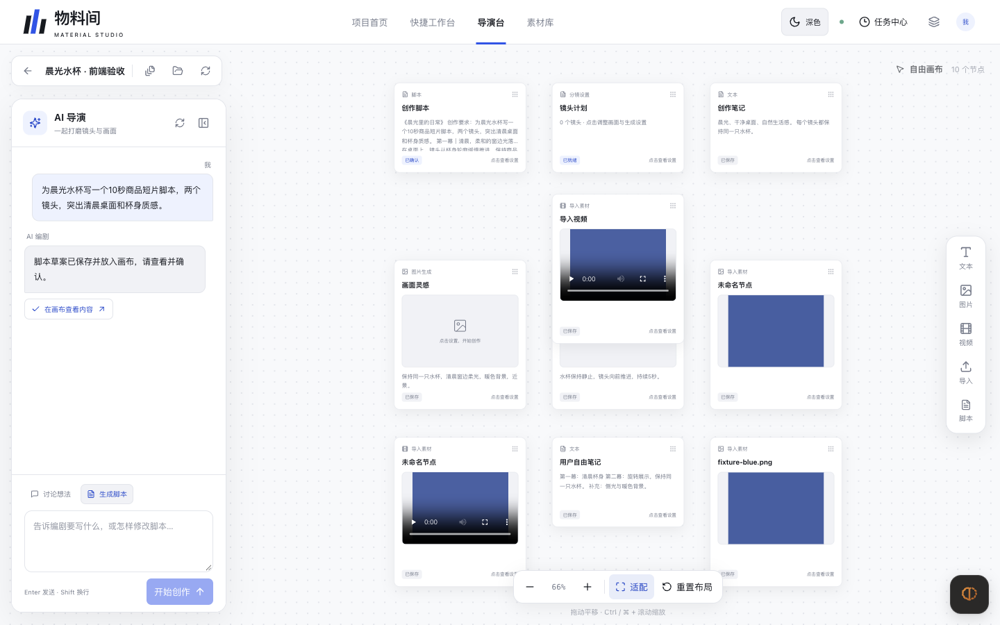
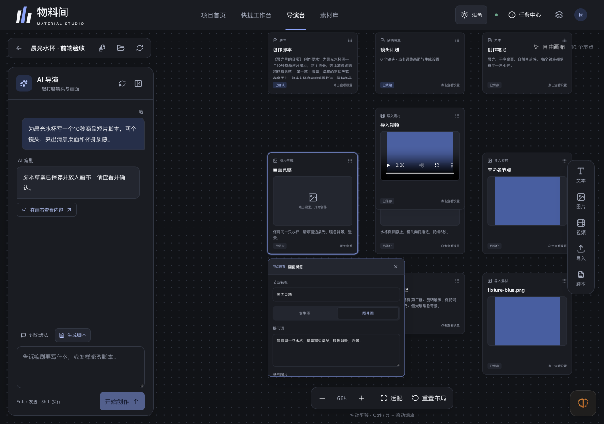
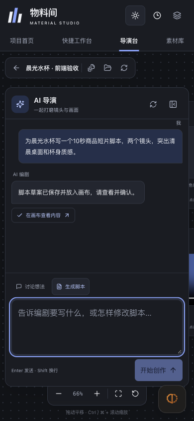

# v0.11 切片 1 前端浏览器验收

日期：2026-10-27，Asia/Shanghai。对象：本批 C 版 UI、全工作区自由画布、对话脚本与独立节点。完整需求及后续范围见 [41 条需求追踪](../../阶段文档/阶段3-v0.11-切片1前端.md)。

## 验证边界

- 隔离地址：`http://127.0.0.1:62467/`；实际 FastAPI、SQLite、上传、工具校验、脚本和节点持久化，LLM 为固定测试供应商。
- 使用临时测试项目和蓝色 PNG／MP4 文件；图像和视频不是模型生成效果样本。测试脚本禁止外部模型网络和新媒体任务。
- 最终只读 `/__preview__/status`：`real_model_calls=0`、`task_count=0`。此次没有产生真实模型费用，也没有验证真实模型的理解、质量或自主决策。
- 构建为 `index-Bezz5PMy.js` / `index-CG8CatQg.css`，仅服务 `/private/tmp/ecom-v011-frontend-preview/dist`。原 `frontend/dist` 指纹保持。
- 本轮检查 8100 连接拒绝，未启动或重启它；5184 未操作。测试不清空用户项目、素材、草稿或 localStorage。

## 已执行的场景

| 场景 | 操作及观察 |
| --- | --- |
| 项目入口 | 导演台显示创建／选择项目；创建后进入画布，返回按钮回到导演台。首页与导演台分别创建并软删除测试项目 A／B。 |
| 首页 | `.editor-main` 可实际滚动：高度 820、scrollHeight 1177，滚动后 scrollTop 288。双入口介绍保留，指定说明文案移除。 |
| 对话创建脚本 | 固定模型调用真实 `propose_script` 工具，实际脚本节点自动出现；不是前端伪造成功节点。 |
| 编辑与确认 | 编辑脚本正文后一次确认到 v2；读取节点绑定为 `scr_5028068c78f44ffe9a4e` / version 2，角色进入 AI 导演。 |
| 失败与澄清 | 无效工具参数得到失败 outcome，不产生脚本节点；普通讨论的澄清回复不造节点。明确起稿却无脚本时正确显示未完成。 |
| 停止等待与恢复 | `[慢速测试]` 请求停止等待后恢复会话，找回原请求生成的脚本；浏览器记录该请求仅一次 POST，未重新触发生成。 |
| 自由节点 | 新建文本节点并连续两次保存完整正文；图片和视频节点的模式、模型、提示词、引用及适用参数独立保存。配置对象键顺序不同不再误报冲突。 |
| 拖动与缩放 | 节点移动 50 × 30，设置面板相同位移；缩放 .70→.84，面板宽 308→369.6、节点宽 201.6→241.92，均为 1.2 倍。 |
| 布局恢复 | 旧本地缓存提示经“保留当前布局”→真实 PATCH→适配→返回并重开项目后，reviewCount=0。未用清空缓存消除问题。 |
| 上传图片／视频 | 实际 PNG／MP4 multipart 上传后生成绑定素材的节点；视频 readyState=4，duration=0.8 秒，尺寸 320×240，可播放。 |
| 素材库引用 | 从素材库点击已有视频，节点数 9→10；新节点 `asset-b2f5dbf0-c3d3-492a-a8ba-f4a86b393eb1` 绑定 `asset_a621982b0e9c4b948868`，设置显示实际尺寸和时长。 |
| 删除节点 | 删除一次上传得到的视频节点后节点数减少，原视频资产仍存在，可再次从素材库引用。 |
| 结构模板 | 创建模板、关闭弹层并重开后保留内容。套用 apply 本轮未浏览器手测。 |
| 快捷工作台 | 文生图、图生图、文生视频、图生视频四模式可见；视频生成页脚正文仅“生成 1 条视频”，无旧每日估算与开发解释。 |
| 窄屏聊天 | 390px 宽度展开／收起／再次展开后草稿内容相同；测试草稿随后通过输入框清空，未提交。 |
| 错误观察 | 已安装监听的浏览器检查中 pageerror=0，API HTTP ≥400=0；业务 failed／clarify 通过正常响应内 outcome 表达。 |

素材库测试第一次返回汇总时，验收脚本误把 PATCH 回执当作完整快照读取，导致脚本自身 TypeError。随即仅做只读核对，未重复导入；UI 10 个节点、选中导入视频以及后续 GET 绑定均正确。此错误不属于产品页面异常。浏览器重开测试遇到未结束读取时的离开确认，测试仅接受了隔离页面的“确定离开吗”提示。

## 窗口尺寸实测

均为桌面浏览器调整视口，不能当作手机真机验收。画布的可平移内容可超出屏幕，但页面本身没有横向溢出。

| 视口 | document.scrollWidth | 画布 x / y | 画布宽 / 高 |
| --- | --- | --- | --- |
| 1440 × 900 | 1440 | 0 / 64 | 1440 / 836 |
| 1280 × 900 | 1280 | 0 / 64 | 1280 / 836 |
| 768 × 900 | 768 | 0 / 64 | 768 / 836 |
| 704 × 684 | 704 | 0 / 64 | 704 / 620 |
| 390 × 844 | 390 | 0 / 103 | 390 / 741 |

390px 下聊天内部区域为 x=11、y=176、width=368、height=598，处于视口内；聊天面板可以收起。主导航在窄屏采用两行，画布占据下方全部工作区。

## 最终截图

以下截图均已逐张打开检查，来自同一隔离服务。蓝色块是测试素材，不是 AI 画面。

截图文件和构建 SHA-256 见 [verification.json](verification.json)。

## 已修复的本轮问题与保留范围

- 修复窄屏画布高度变为零的百分比高度链；重新测量五档尺寸通过。
- 修复配置键顺序导致的误冲突、保存成功后 revision 未推进，以及旧画布脚本绑定覆盖新确认版本的问题。
- 布局使用已知服务端基线做三方合并；同一页面的适配／确认不会误判为另一份布局。跨页面没有共同基线且内容不同时仍保留选择，避免覆盖用户改动。
- 结构模板弹层关闭时保持挂载，避免丢失草稿或未知结果；导入恢复增加重复绑定核对。
- 空项目没有预铺一整条未来生产流程；确认脚本后仍保留旧“镜头计划（0 镜头）”配置入口。此项在 A8 标为部分已验。

**未以本轮通过结论覆盖的内容：**真实 LLM 工具往返、创作质量、完整 partial 分支浏览器操作、权限／项目读取故障注入、拖放入口、模板 apply、全部键盘及辅助技术组合、手机真机、历史排版导出全回归。新的对话生图／生视频、自由节点生成与定向重做属切片 2，完整合成／导出新对话链属切片 3。

自动检查另有 [完整日志](verify-20261027T160004-67552.txt)：27 个测试文件、595 个测试、lint、类型、隔离构建、凭据模式扫描及独立临时 HTTP 服务重启恢复均通过。独立服务重启检查与本页浏览器项目验收是两组证据，不混称同一次服务重启。
