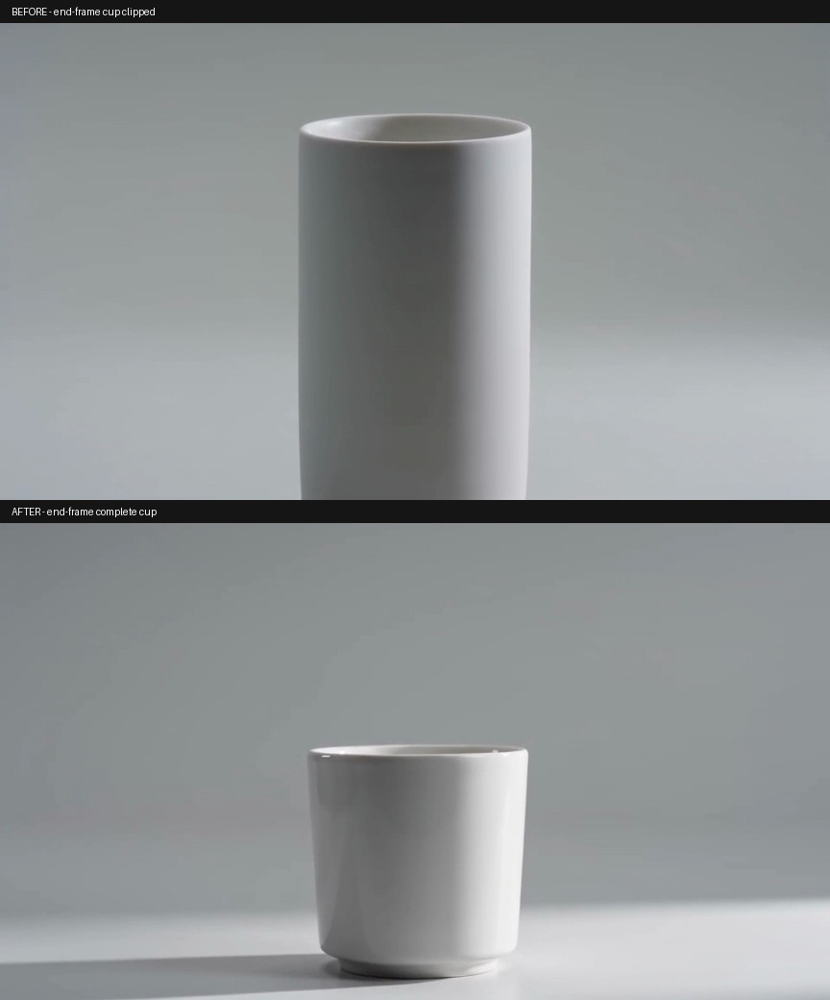
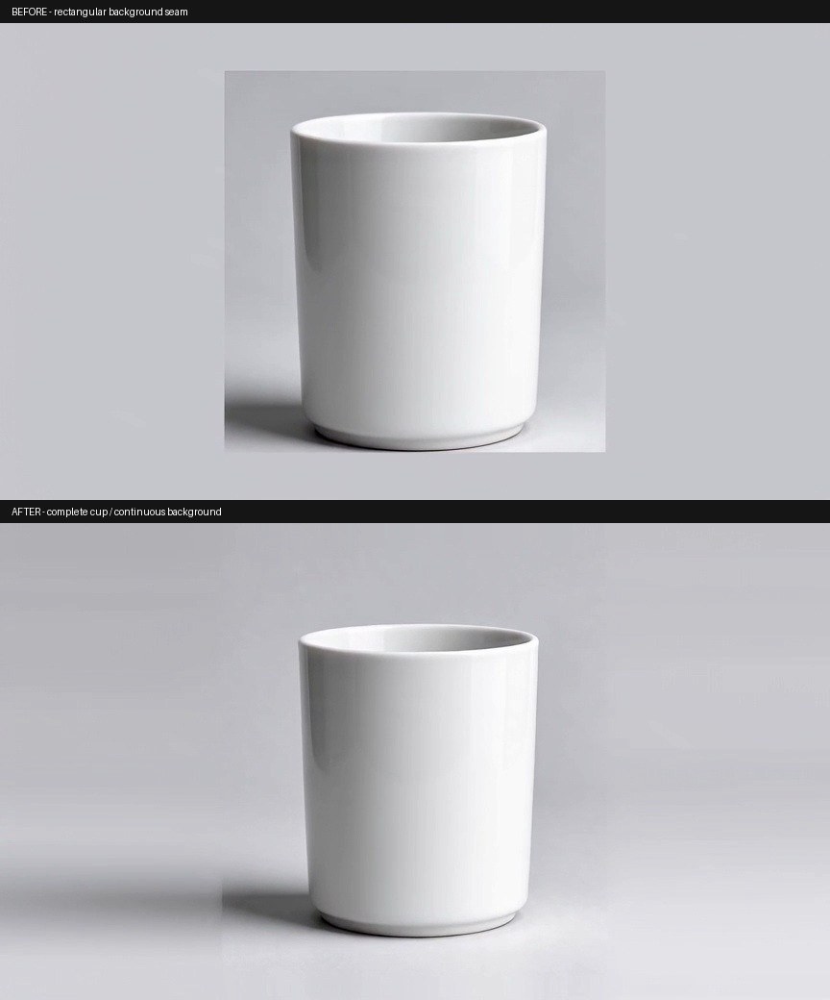
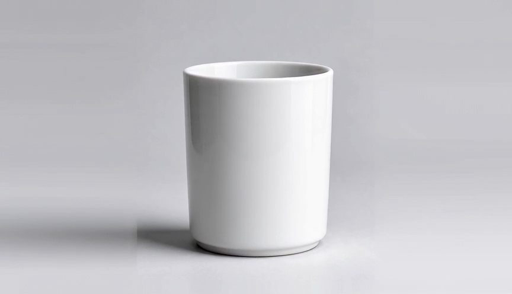

# Bad Case 修正前后对照

直接复用 [视频构图 v2 真实复验材料](../../evidence/v0.11-视频构图v2真实复验-20261030/当前结果.md) 中的现有对照，不另造测试结论。上方为旧版失败样例，下方为新版真实生成样例；两次生成不是相同随机种子的严格控制实验。

## 文生视频：末段杯底裁切

[修正前原片](text-to-video-before.mp4) · [修正后原片](../reference-results/text-to-video.mp4)

旧例推进后裁掉杯底；新版样例的白杯完整，但末段仍靠近下沿，提示词中的精确推进百分比和留白百分比没有被严格遵守。

## 图生视频：方形补边接缝

[修正前原片](image-to-video-before.mp4) · [修正后原片](../reference-results/image-to-video.mp4)

新版采用生成前的边缘延展输入，旧大方框接缝明显改善；图生视频左下阴影仍有局部短竖接痕，不能写成完全解决。

所有文件都是既有证据的原字节副本。来源、SHA-256 和使用边界见 [附件清单](../ASSETS.md)。
