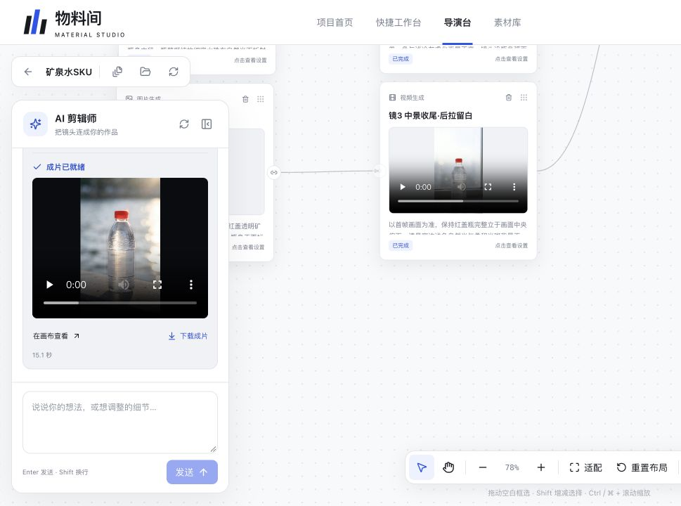

# 产品操作演示

[在线原型](https://evenk5838-coder.github.io/ecommerce-aigc-workbench/)使用固定示例，不会请求模型。实际应用需在本机配置启动，原型体验不代表实时AI生成。

## 实际界面

以下于2026-11-04从本地产品截图；没有发送对话或点击生成。项目与任务是历史操作记录。

[深色首页](home-dark.jpg)来自2026-11-02实际截图；[历史导演台](director.png)来自2026-10-29 Web收尾记录，仅用于界面演进对照。

## 操作路线

1. 首页进入快捷台，切换四种模式，点击「展示生成示例」查看已有图片/视频。
2. 返回首页，新建创作项目进入原型导演台。
3. 按阶段确认需求、脚本、分镜、视频、剪辑，查看节点出现。
4. 点击节点调整示例提示词，拖动标题移动；空白框选、抓手、缩放、删除与撤销均可操作。
5. 深浅切换仅改颜色。原型不保存个人信息。

剪辑阶段仅为方案占位，不执行真实合成。真实原片见[参考与结果](../reference-results/README.md)，质量局限见[Bad Case](../bad-cases/README.md)。
