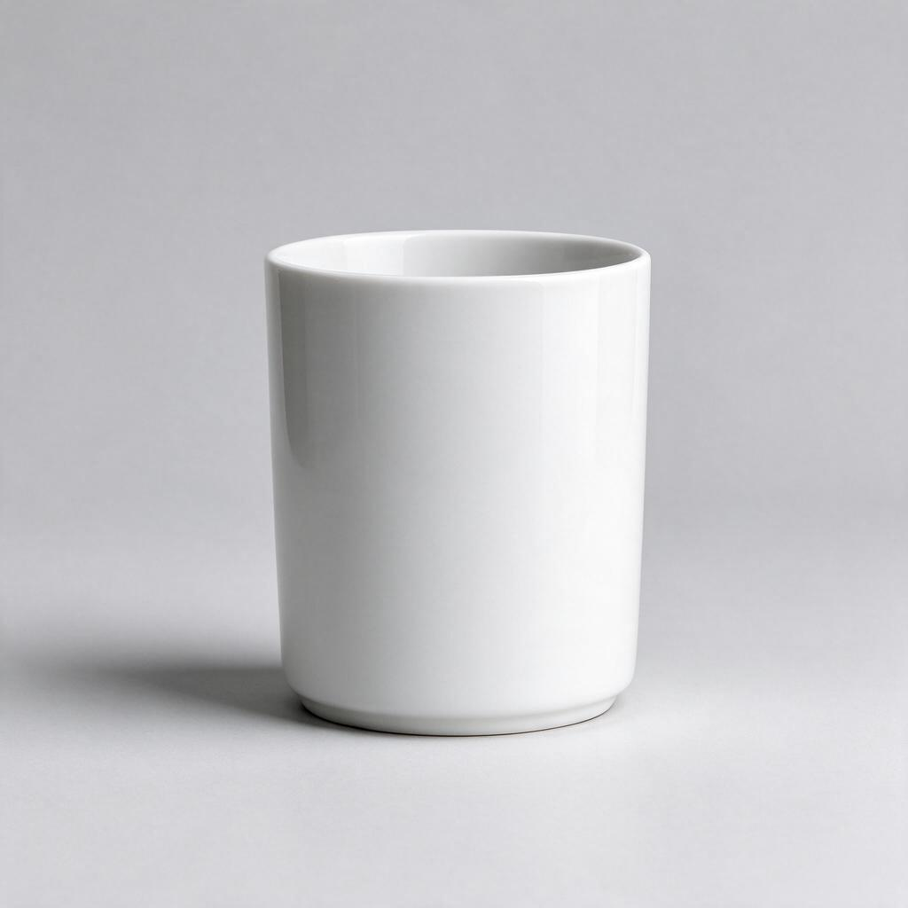
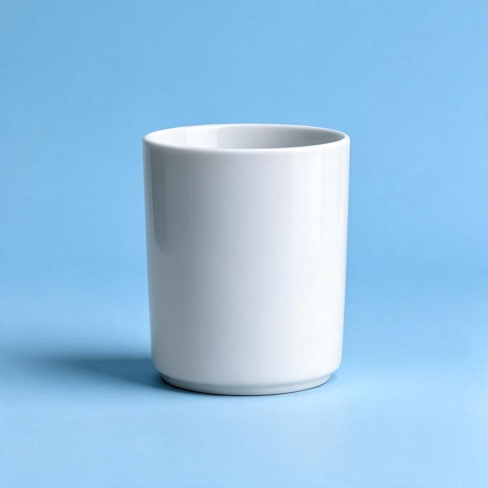
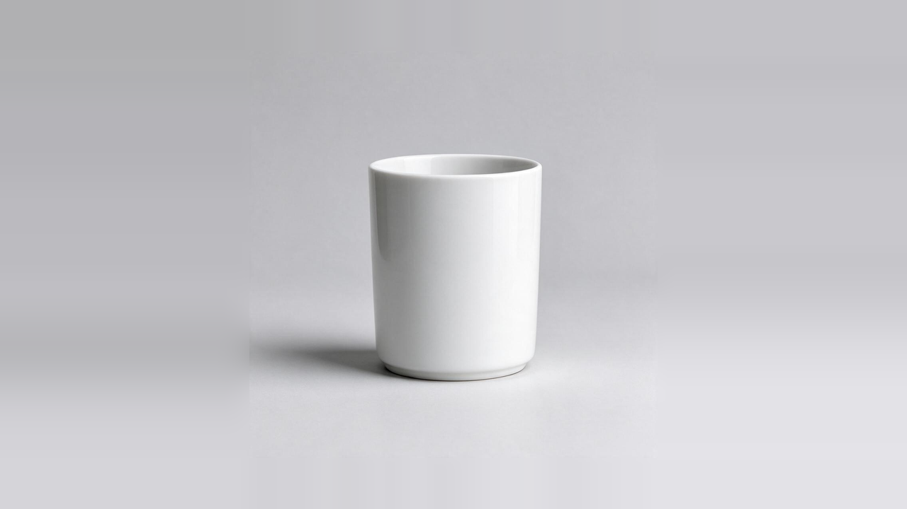

# 参考图与真实生成结果

本组直接复用项目的白杯真实测试，未追加付费调用。原始报告：[图片及旧视频](../../evidence/v0.11-AiHubMix无水印复验-20261030/当前结果.md)、[新版视频复验](../../evidence/v0.11-视频构图v2真实复验-20261030/当前结果.md)。

| 参考原图：Seedream Flash 文生图 | 结果：Seedream Flash 图生图 |
| --- | --- |
|  |  |

图生图指令是在保留同一只白色陶瓷水杯的形状、颜色、数量与位置的前提下，把浅灰背景改为浅蓝色。两张均为 1024×1024 的真实生成结果。

| 视频方式 | 原片 | 抽帧核查 |
| --- | --- | --- |
| Seedance Fast 文生视频 | [查看或下载 MP4](text-to-video.mp4) | [20 帧联系表](text-to-video-contact-sheet.jpg) |
| Seedance Fast 图生视频 | [查看或下载 MP4](image-to-video.mp4) | [20 帧联系表](image-to-video-contact-sheet.jpg) |

两条视频均为 5.04 秒、864×496、24 fps、无音轨。本轮样例白杯完整，抽帧未发现可见水印。图生视频仍有局部阴影接痕，详见 [Bad Case 与保留问题](../bad-cases/README.md)。

上图是从同一白杯参考原图进行生成前本地边缘延展后的实际输入，不是事后修补视频。完整来源和 SHA-256 见 [附件清单](../ASSETS.md)。
