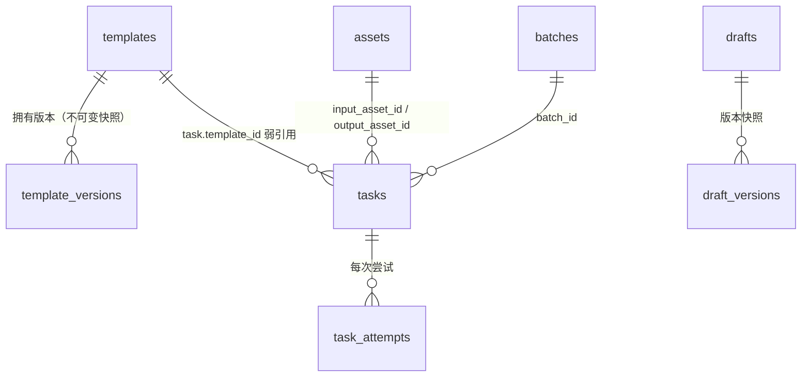

# 数据模型 v0.7（模板 / 任务追溯 / 跨项目预留）

日期：2026-10-23。对应 PRD v0.7 与接口契约 v4。实现文件：`backend/app/db.py`、`backend/app/templates.py`。

> 说明：当前仍为 SQLite 单机库（`data/app.db`），无用户/组织表。跨项目相关字段为**预留**，未做校验与隔离。

## 1. 实体关系（现状）



## 2. 新增表：`templates`（模板元数据 + 最新版本指针）

| 字段 | 类型 | 说明 |
| --- | --- | --- |
| `id` | TEXT PK | 内部行 ID（`tpl_...`） |
| `template_id` | TEXT UNIQUE | **语义稳定 ID**（`tpl_white_bg` 等），对外标识 |
| `category` | TEXT | `work` / `hot` |
| `kind` | TEXT | `image` / `video` |
| `name` | TEXT | 展示名 |
| `latest_version` | INTEGER | 最新激活版本号（指向 `template_versions.version`） |
| `status` | TEXT | `active` / `deprecated` |
| `created_at` / `updated_at` | REAL | 时间戳（epoch 秒） |

## 3. 新增表：`template_versions`（不可变版本快照）

> v0.7.1 现状：`tpl_product_motion_5s` 有 **v1、v2** 两行；v1 内容未改动，v2 新增 `field_params`。
> `templates.latest_version = 2`。

| 字段 | 类型 | 说明 |
| --- | --- | --- |
| `id` | TEXT PK | `tplv_...` |
| `template_id` | TEXT | 关联模板 |
| `version` | INTEGER | 递增整数 |
| `snapshot_json` | TEXT | **该版本完整内容快照**，写入后不再修改 |
| `status` | TEXT | `active` / `deprecated`（仅状态可变） |
| `created_at` | REAL | 发布时间 |

约束：`UNIQUE(template_id, version)`；索引 `idx_template_versions(template_id, version)`。

**不可变规则（已实现）**：播种逻辑 `templates.seed()` 对已存在的 `(template_id, version)` 直接跳过，不覆盖。

`snapshot_json` 结构：

```json
{
  "template_id":"tpl_scene_bg","version":1,"category":"work","kind":"image",
  "name":"商品场景换背景","description":"…",
  "effect_sample":{"asset_id":null,"note":"发布时补真实样例"},
  "required_assets":[{"role":"product_reference","kind":"image","required":true,"max_count":1,"label":"商品图"}],
  "fields":[{"key":"scene","label":"目标场景","type":"select","required":true,
             "options":["大理石台面","木质桌面","简约居家","户外自然","自定义"],
             "allow_custom":true,"custom_key":"scene_custom"}],
  "default_params":{"generation_mode":"image_to_image","size":"2048x2048","purpose":"scene"},
  "compatible_models":{"kind":"image","input_modes":["image_to_image"]},
  "prompt":{"preset":"以参考图中实际出现的商品为准…将背景替换为{scene}…",
            "scene_field":"scene","scene_custom_key":"scene_custom",
            "field_order":["keep_features","forbidden_elements","extra"]},
  "field_params":{"duration":"duration","ratio":"ratio"},
  "status":"active"
}
```

### `field_params`（v0.7.1 新增，仅存在于新版本快照）

将**模板字段**映射到**生成参数**：`{字段 key: 参数 key}`。参与优先级链：

```
显式 params  >  field_params 映射  >  default_params
```

当前仅 `tpl_product_motion_5s` **v2** 使用：`{"duration":"duration","ratio":"ratio"}`。
v1 快照**未被修改**（不含 `field_params`），引用 v1 的任务仍按 v1 读取。
详细映射规则不在快照中硬编，由 `templates._field_params()` 统一解释。

## 4. `tasks` 表增量字段（迁移已执行）

| 字段 | 类型 | 说明 |
| --- | --- | --- |
| `template_id` | TEXT | 使用的模板（可空，空=自由创作） |
| `template_version` | INTEGER | 使用的模板版本；与 `template_id` 共同定位快照 |
| `external_request_id` | TEXT | **调用方业务号**（跨项目关联，不做查重） |
| `caller_id` | TEXT | 调用方标识，默认 `local`；**未做鉴权校验** |
| `concept_mode` | INTEGER DEFAULT 0 | 1=创意概念图路径（季节主题无参考图） |

索引：`idx_tasks_external(external_request_id)`、`idx_tasks_template(template_id)`。

保留字段（v0.6 已有）：`input_asset_id`、`output_asset_id`、`params_json`、`model_id`、`model_revision`、
`remote_task_id`、`remote_status`、`usage_json`、`cost_cny`、`batch_id`、`client_request_id`、`retry_of`、`generation_mode`（在 `params_json` 内）。

### 任务—模板追溯链路

```
task.template_id + task.template_version
   → template_versions(template_id, version).snapshot_json   # 当时内容
   → task.params_json.fields                                 # 用户填写的原始字段
   → task.params_json.prompt                                 # 实际发送的提示词
   → task.model_id / task.usage_json / task.cost_cny         # 实际模型与费用口径
   → task.output_asset_id                                    # 产物
```

模板升版后，历史任务的 `template_version` 不变，展示仍按旧快照还原。

## 5. 幂等键语义

| 键 | 归属 | 行为 |
| --- | --- | --- |
| `client_request_id` | 创作平台 | **已实现查重**：命中则返回原任务，不新建 |
| `external_request_id` | 调用方（运营工作台） | 仅落库关联，**不查重**（首版）；后续可加唯一约束 |

## 6. 计价数据（`config.py`，非数据库）

| 常量 | 用途 |
| --- | --- |
| `IMAGE_PRICE_CNY` | 单一价模型（flash 0.12） |
| `IMAGE_PIXEL_TIERS` | 按输出像素档计价（pro：2.61 MP 分界，0.30 / 0.60） |
| `IMAGE_INPUT_PRICE` | 参考图加价（pro 第 2 张起 0.02） |
| `VIDEO_PRICE_PER_MTOKEN` | 视频 token 单价 |
| `VIDEO_OUTPUT_FPS` / `RESOLUTION_WH` | token 估算公式参数 |
| `MODEL_CAPABILITIES` | 能力元数据（输入方式/比例/分辨率/时长/定价/限流） |
| `MODEL_LIFECYCLE` | EOS/EOM 与迁移目标（官方公告核对） |

`config.model_lifecycle_state(model_id, now_ts)` 为**唯一生命周期判定入口**（支持注入时钟）：
`active` / `eos_scheduled` / `eos_expired`（`now >= eos_at` 即到期）。
`config.validate_params_for_model(model_id, kind, params)` 对**最终生效参数**做能力校验。

### 解析与写入分离（v0.7.1）

`main.resolve_task()` 是**纯函数**：不写库、不入队、不调模型、不扣预算。
`POST /api/tasks/estimate` 只调用它；`POST /api/tasks` / `POST /api/batches` / 重试也用它，
因此「预估 / 提交 / 批量」三者的参数完全一致。批量改为**先全批解析再入库**（失败不产生半成品）。

`config.image_cost_cny()` / `config.video_cost_cny()` 为唯一计价入口；`cloud_tasks.estimate_cost()` 调用它们。
视频成功后按 `usage.completion_tokens` 用真实用量重算，覆盖估算值。

## 7. 未建立的表（后续版本，勿误读为已有）

`users`、`organizations`、`members`、`api_keys`/`callers`、`quotas`、`ledger`（费用预占/结算）、
`products`（商品库）、`review_records`（审核）、`deliveries`（交付包）、`webhook_subscriptions`。

## 8. 迁移与兼容

- 迁移方式：`db.init_db()` 内 `MIGRATIONS` 循环 `ALTER TABLE ADD COLUMN`，失败（已存在）即跳过；索引在 ALTER 之后创建。
- 旧任务：新增列为 `NULL`/默认值，历史记录不改写、不重算。
- 回滚：新增表与列不改动既有列，旧版本代码读取不受影响（除索引创建语句外）。
