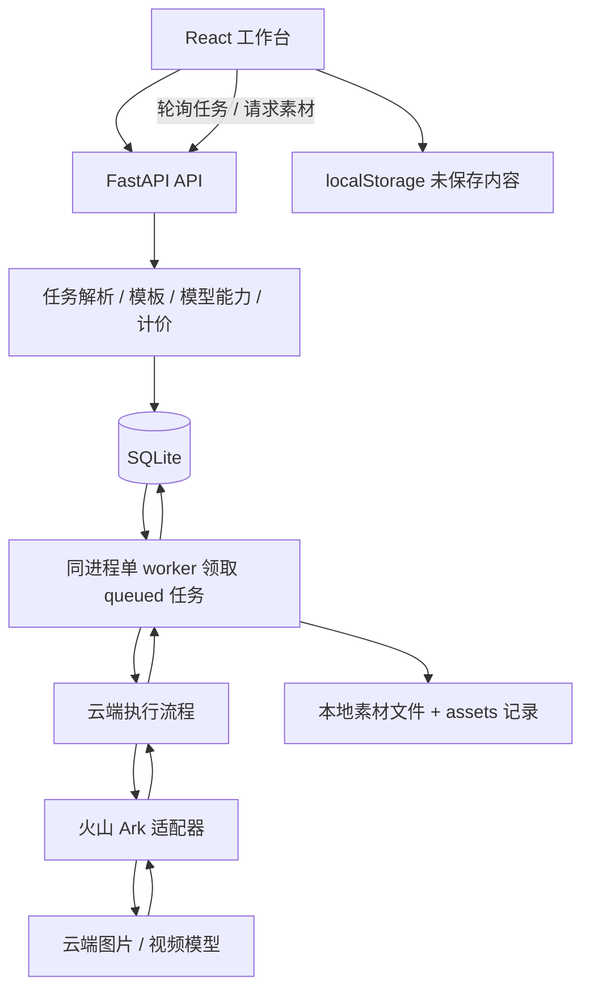

# 当前架构与技术债体检

日期：2026-10-24。范围：当前工作目录中的前端、后端、数据层、启动脚本和已有验证脚本。本文基于源码检查；并发、崩溃、部署故障等风险未在业务环境中注入复现。本轮未修改产品代码、运行数据或配置，未触发模型调用。

## 判断

当前是前后端分离开发、同源部署的单体应用，具有初步模块边界。它可以继续承载本机单人 MVP，但技术债已集中在入口文件、数据库一致性、历史本地推理依赖和任务调度中。

建议增量整理现有工程，保留可用生成链路、素材与草稿；在这一步不引入微服务或另一套任务系统。下一轮模板/多模型接入应同时明确模块归属，避免继续扩大 App.tsx 与 main.py。

## 实际技术架构

| 层 | 当前实现 | 当前作用与边界 |
| --- | --- | --- |
| 页面 | React 19 + TypeScript + Vite，原生 CSS | 单页应用，用组件内 view 状态切换工作台、素材库和固定排版页 |
| 前端数据 | React hooks/ref、api.ts、localStorage | 请求封装、2500ms 轮询、自动保存与未保存内容缓存；尚无独立服务端状态层 |
| API | Python FastAPI + Pydantic | 路由、请求校验、错误处理，正式环境同时提供构建后的前端文件 |
| 任务解析 | main.resolve_task、templates.py、config.py | 模板快照、字段校验、参数合并、模型能力/生命周期校验、价格估算 |
| 后台执行 | worker.py 中一个 daemon 线程 | 从 SQLite 领取任务；与 Web API 同一进程，不是独立队列服务 |
| 云端能力 | cloud_tasks.py + providers_ark.py | 前者控制任务流程/预算/视频轮询，后者封装 Ark HTTP 请求 |
| 本地历史引擎 | engines.py | 仍包含 Torch、MPS、本地推理、取消令牌及采样器；云端 worker 仍引用其中公共设施 |
| 数据 | SQLite WAL + 本机文件 | 任务、尝试记录、模板版本、草稿版本存在数据库；图片/视频存在 data/assets |
| 部署 | start.command + uvicorn | 本机 8100 同源部署；Vite 5173 为开发端口；干净环境复现、部署及数据恢复尚需完善 |

Pi Agent/DeepSeek 与 Codex 是开发工具，不是本产品运行时的服务层。现有生成流程是确定性的任务处理，没有自主规划的 Agent 循环。

## 当前数据流

后端已新增 estimate 接口：表单 → 无副作用预估 → 用户确认 → 创建任务。这条新确认流程尚待正式前端接入；当前前端仍是确认提示后直接提交。

## 已具备的合理基础

- API 调用已集中在前端 api.ts；生成请求构造与固定排版工具已有独立模块和局部测试。
- 后端已分离模板、供应商通信、云端执行、worker、存储及数据库工具，Ark Key 由后端使用。
- queued 任务存在 SQLite，领取使用 BEGIN IMMEDIATE；任务不会仅靠浏览器内存保存。
- 视频远程 ID 有持久化和重启续查路径，创建结果不明确时不盲目重新创建。
- 模板版本有唯一约束和历史快照；预估与提交已复用任务解析函数。
- 有错误码、版本文档、单元/隔离测试及真实产物证据，具备渐进整理的基础。

这些基础不能自动证明多用户安全、高并发、精确费用控制或完整故障恢复。

## 主要技术债

### A. 前端入口承担过多职责

App.tsx 约 4.4 万字符，虽然只有约 292 行，但大量逻辑与 JSX 被压在长行中。它同时承担草稿恢复/保存、轮询、生成、上传、素材库、排版拖拽、撤销、导出和多个弹层。组件中的 ref 与 useState 交叉协作，新增模板容易影响保存或排版状态。

这包括 Codex 当前负责的代码，前端也需要整理。建议按功能拆分创作、素材、任务、固定排版，抽出 useDraftAutosave/useTaskPolling 等 hooks；App 只负责页面组合。拆分按职责进行，不以文件数量或行数作为唯一目标。

### B. 后端路由和业务逻辑未完全分离

main.py 约 600 行，包含接口、Pydantic schema、任务解析、数据库写入、批量、草稿与统计。resolve_task 虽无写入，却读取模型配置、模板、素材和数据库，属于有依赖的业务解析函数，不是严格的纯函数。

建议保留现有实现逐步抽成 routers、schemas、services；预估/创建/批量/重试只调用同一个任务服务。无需更换 FastAPI 或引入 Agent 框架。

### C. 数据库正确性应优先于目录美化

1. tasks.client_request_id 当前没有唯一约束；create_task 先查再插，两个并发请求可能都通过检查。单 worker 只串行执行任务，不能使并发 HTTP 创建自动串行。
2. post_batch 虽先校验整批，但批次和任务逐条独立提交，缺少整批事务。中途写入失败可能留下部分数据；“全部校验通过”与“全部原子入库”不同。
3. 草稿版本检查、更新与历史记录插入是多个数据库调用；并发保存可能都基于同一旧版本成功，不能作为严格防覆盖保证。
4. db.init_db 捕获并忽略所有 sqlite3.OperationalError，可能把非“列已存在”的迁移错误也隐藏。

建议增加显式事务边界、幂等键数据库唯一约束、原子版本条件更新，以及明确版本的迁移步骤。先在临时数据库副本验证，不直接清理真实库，也不直接创建唯一索引而忽略既有重复数据检查。

### D. 单 worker 在远程视频等待期间被占住

worker.execute 调用 run_video 后，在循环中同步查询并 sleep，直至完成或超时。视频等待期间，后续图片任务也会排队。

这是当前吞吐边界，不等同于全部 API 被阻塞。改 APP_CONCURRENCY 或增加 uvicorn 进程数不能安全解决：目前恢复逻辑、取消令牌和采样器都按单进程设计。

先明确任务状态迁移与执行契约；确有并行需求时，再分离远程任务创建、定时查询和结果下载，并设计领取租约、预算预留、恢复归属及并发测试。

### E. 本地推理历史与云端运行仍耦合

requirements.txt 仍将 Torch/diffusers/transformers 等与 API 依赖放在一起，worker 直接从 engines 导入公共类，main 也引用 GUARD/MANAGER。本地模型权重删除不等于旧架构依赖已经解除。

建议将取消令牌等公共设施移至独立模块；本地引擎改为可选依赖/按需加载，云端安装无需安装整个推理栈。保留历史任务数据，不通过删库来清理技术债。

### F. 多模型与契约仍有分散维护点

模型登记、能力、激活、生命周期、价格目前分布在多张配置字典中。前端 App 仍硬编码两个模型 ID 过滤模型及任务；generation.ts 固定规格；types.ts 尚未表达本轮完整模型元数据。

api.ts 用 body as T 做类型断言，没有运行时响应校验，ApiError 也未保留后端 detail，影响后续字段级错误提示。

建议由后端提供统一模型描述，前端仅维护展示与控件状态；历史任务不应因不在当前两个模型列表中而被过滤。后续统一 OpenAPI 类型生成或契约检查，保留 detail。前端即时校验保留，服务端仍是最终参数及费用判断来源。

### G. 验证与交付设施仍需补齐

现有前端测试集中于生成参数与排版工具；后端有隔离修复测试和探针，但部分依赖已有素材 ID、运行库副本和手工脚本。worker 最外层异常被吞掉，缺少完整的结构化错误日志。启动还会回退到 /private/tmp 的历史 Python 环境。

建议补临时库/自带素材 fixture、并发幂等及草稿竞争测试、可控供应商替身、状态机与恢复测试，建立统一免费测试入口和 CI；稳定 Python 环境并验证 data 的备份恢复。已有测试通过不等于这些场景已覆盖。

## 建议迭代顺序

1. **一致性与可回退基线**：核对并归档本轮修复；补幂等唯一性、批量事务、草稿原子版本更新及免费回归测试。
2. **前后端分层**：前端按功能拆分 App，后端抽出任务服务与路由；保留接口和已验证行为，再接模板/多模型。
3. **云端运行精简**：剥离必须安装的本地推理依赖、统一模型元数据、稳定启动和测试环境。
4. **按真实使用量扩展执行**：验证远程查询与本地调度的解耦；需要多 worker 时再设计租约、预算预留和并发控制。
5. **多人上线准备**：明确部署目标后完成用户身份、资源归属、权限、配额、对象存储及数据恢复；未来运营工作台通过稳定 API 访问，不直接共享数据库。

验收应看行为：重复请求不新增任务、批量失败不留半批、草稿竞争不覆盖、等待视频不阻塞允许并行的图片任务、从干净环境能启动并恢复数据。仅移动文件或增加目录不代表完成重构。

