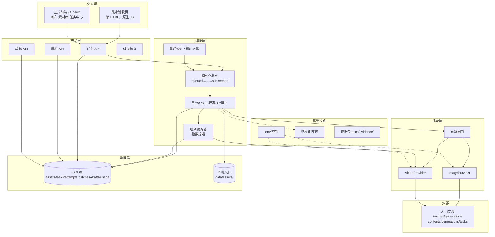
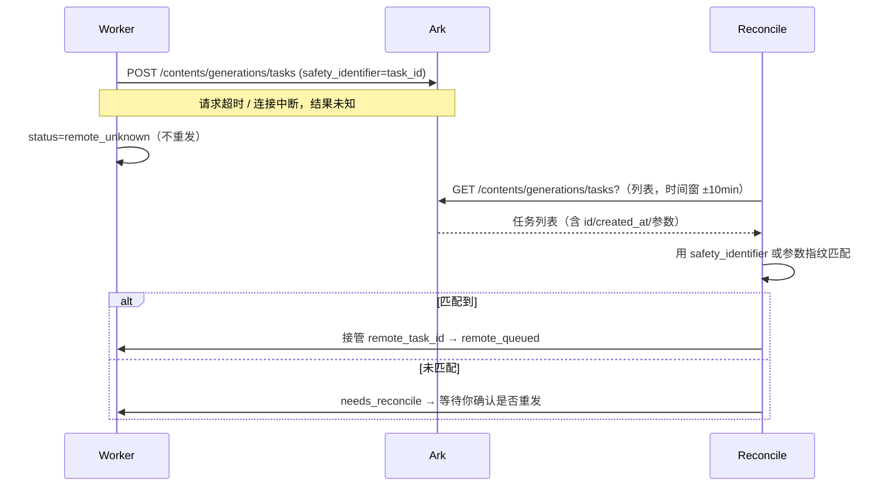

# 架构方案 · 电商 AIGC 工作平台（v1，待审阅）

> 对应 PRD v0.3｜2026-10-22｜状态：**待产品经理审阅，确认后才开始写后端代码**
> 范围：本阶段（今日）的架构。画布正式前端、视频批量生产不在本方案实现范围内（PRD §7.3）。

---

## 1. 五要素清单（领域骨架）

| 要素 | 内容 |
| --- | --- |
| **工具** | `image.generate`（云端图片生成）、`video.create`（云端视频任务创建）、`video.query`（查询）、`video.cancel`（仅排队中）、`asset.download`（结果落地）、`ffprobe`（规格校验） |
| **知识** | 提示词模板与风格预设、各模型参数约束（档位/时长/尺寸）、官方价格表（版本化）、电商素材规范（尺寸/卖点留白） |
| **观察** | 云端任务状态、usage（token/张数）、端到端耗时、失败错误码、本地文件校验值 |
| **行动** | 本地 HTTP API（供最小页与 Codex 前端）、本地文件写入、SQLite 事务 |
| **权限** | 预算闸门（硬上限）、真实调用需显式提交、删除/覆盖需确认、Key 仅后端读取 |

---

## 2. 组件选型表

| 组件 | 选/不选 | 理由（「没有它会怎样」） |
| --- | --- | --- |
| 本地 HTTP 服务（FastAPI） | ✅ | 没有它，前端无法接入、无法验收 |
| 持久化任务表（SQLite） | ✅ | 没有它，重启即丢任务与云端任务 ID，无法恢复 |
| Worker + 轮询器 | ✅ | 没有它，视频任务无法拿到结果 |
| 模型适配层（Provider） | ✅ | 没有它，云端差异散落在业务代码，换模型/换供应商要改业务 |
| 预算闸门 | ✅ | 没有它，批量提交可能瞬间产生不可控费用 |
| 用量台账 | ✅ | 没有它，无法核对费用、无法评测成本 |
| 素材库（内容寻址） | ✅ | 没有它，结果互相覆盖、无法追溯 |
| 草稿持久化 | ✅ | 没有它，「编辑内容不丢失」无法满足 |
| SSE | ⚠️ 可选 | 只有前端需要实时进度时才用；本期默认轮询查询足够，若用必须 done/error 收尾 |
| Redis/Celery | ❌ | 单用户单机、任务量小，引入后运维成本 > 收益 |
| 用户/登录 | ❌ | 单机单用户（PRD Q3） |
| 本地模型推理（diffusers/MLX） | ❌ | 形态已改为云端（PRD §0.1）；按你的指令不装本地推理依赖 |

---

## 3. 分层架构



**数据流（一次视频任务）**

1. 前端 `POST /api/tasks`（kind=video）→ 写入 `tasks`（status=queued，params 快照）。
2. Worker 取任务 → 预算闸门校验 → `POST /contents/generations/tasks` 创建云端任务 → 回写 `remote_task_id`、status=`remote_queued`，并写 `task_attempts`。
3. 轮询器按退避间隔 `GET /contents/generations/tasks/{id}` → 更新 status/进度；`succeeded` 后进入 `downloading`。
4. 下载 `content.video_url` → 校验（大小、可解码、ffprobe）→ 写入 `data/assets/`（内容寻址）→ `assets` 表登记 → 任务 `succeeded`，回写 usage 与实际费用估算。
5. 失败 → `failed` + 错误码 + 可读原因；可重试错误进 `retry` 排队。

---

## 4. 目录结构（本阶段）

```text
电商工作平台/
├── backend/
│   ├── app/
│   │   ├── main.py                 # FastAPI 入口、静态挂载、生命周期（启动恢复）
│   │   ├── config.py               # 环境变量与配置（含预算、并发度、模型 ID）
│   │   ├── api/
│   │   │   ├── health.py
│   │   │   ├── assets.py
│   │   │   ├── tasks.py
│   │   │   ├── batches.py
│   │   │   └── drafts.py
│   │   ├── errors.py               # 统一错误结构 + 错误码映射
│   │   ├── models.py               # SQLAlchemy 模型
│   │   ├── schemas.py              # Pydantic 请求/响应
│   │   ├── db.py                   # 引擎、会话、迁移入口
│   │   ├── storage.py              # 内容寻址文件存储、下载校验
│   │   ├── queue.py                # 队列、租约、状态机
│   │   ├── worker.py               # 执行循环
│   │   ├── poller.py               # 视频轮询 + 退避
│   │   ├── reconcile.py            # 重启恢复 + 创建超时对账
│   │   ├── budget.py               # 预算闸门 + 用量台账
│   │   ├── observability.py        # 结构化日志、脱敏
│   │   └── providers/
│   │       ├── base.py             # ImageProvider / VideoProvider 协议
│   │       ├── ark_image.py        # 火山图片实现
│   │       ├── ark_video.py        # 火山视频实现
│   │       └── fake.py             # 测试用假实现（仅测试，不用于验收）
│   ├── static/index.html           # 最小验收页
│   ├── tests/
│   └── pyproject.toml
├── data/                           # 运行时产物（.gitignore）
│   ├── app.db
│   └── assets/<sha2 前缀>/...
├── docs/                           # PRD、架构、接口、证据、交付文档
├── .env.example                    # 只有占位符
├── .gitignore                      # .env / data / __pycache__ 等
└── README.md                       # 一条命令启动 + 验收步骤
```

---

## 5. 数据模型（SQLite）

```sql
-- 素材（原件与产物统一）
assets(
  id TEXT PK,            -- asset_<ulid>
  sha256 TEXT UNIQUE,    -- 内容寻址
  kind TEXT,             -- image|video|other
  mime TEXT, size INTEGER, width INTEGER, height INTEGER, duration_ms INTEGER,
  rel_path TEXT,         -- data/assets/xx/yy/<sha256>.<ext>
  source TEXT,           -- upload|cloud_result|derived
  meta_json TEXT,        -- ffprobe 摘要、云端参数等
  created_at, owner TEXT -- owner 预留（单机单用户默认 'local'）
)

-- 任务（统一图片/视频）
tasks(
  id TEXT PK,            -- task_<ulid>（同时作为 safety_identifier 写入云端）
  kind TEXT,             -- image|video
  batch_id TEXT NULL,
  status TEXT,           -- queued|dispatching|remote_queued|remote_running|downloading|
                         -- succeeded|failed|cancel_requested|canceled_local|remote_unknown|needs_reconcile|expired_unknown
  params_json TEXT,      -- 提交时参数快照（含 model_id、prompt、size/duration/ratio...）
  provider TEXT,         -- ark
  remote_task_id TEXT,   -- ★ 云端任务 ID，必须持久化
  remote_status TEXT,    -- 云端原始 status
  input_asset_id TEXT NULL,
  output_asset_id TEXT NULL,
  estimated_cost_cny REAL, actual_usage_json TEXT,
  attempts INTEGER DEFAULT 0,
  error_code TEXT, error_message TEXT,
  lease_owner TEXT, lease_until INTEGER,   -- 租约，避免重复执行
  created_at, updated_at, finished_at
)

task_attempts(
  id TEXT PK, task_id TEXT, attempt_no INTEGER,
  started_at, finished_at, result TEXT, error_code TEXT, error_message TEXT,
  request_id TEXT, remote_task_id TEXT, usage_json TEXT
)

batches(id TEXT PK, name TEXT, created_at, params_json TEXT)

drafts(
  id TEXT PK, name TEXT, content_json TEXT, version INTEGER, created_at, updated_at
)
draft_versions(id TEXT PK, draft_id TEXT, version INTEGER, content_json TEXT, created_at)

usage_ledger(   -- 用量台账（费用核对）
  id TEXT PK, task_id TEXT, day TEXT, kind TEXT, model_id TEXT,
  quantity REAL,        -- 图片张数 / 视频 tokens
  unit TEXT,            -- 张 | token
  unit_price_cny REAL, price_source_date TEXT,
  estimated_cost_cny REAL, is_actual INTEGER, created_at
)

api_calls(      -- 云端调用审计（不含 Key、不含图片内容）
  id TEXT PK, task_id TEXT, endpoint TEXT, http_status INTEGER,
  request_id TEXT, latency_ms INTEGER, retry_no INTEGER, created_at
)
```

索引：`tasks(status, created_at)`、`tasks(remote_task_id)`、`usage_ledger(day)`、`assets(sha256)`。

---

## 6. 模型适配接口

```python
# providers/base.py
class ImageGenRequest(BaseModel):
    model_id: str
    prompt: str
    image: list[str] | None = None        # base64 或 URL（PRD §4.1）
    size: str | None = None               # 官方支持 "2K"/"2048x2048" 等
    watermark: bool = False
    response_format: Literal["url", "b64_json"] = "url"
    extra: dict = {}

class ImageGenResult(BaseModel):
    images: list[bytes] = []               # 已落地/已解码
    usage: dict | None = None
    request_id: str | None = None
    raw: dict = {}

class ImageProvider(Protocol):
    async def generate(self, req: ImageGenRequest) -> ImageGenResult: ...

class VideoCreateRequest(BaseModel):
    model_id: str
    content: list[dict]        # 原始 content：text / image_url(+role)
    duration: int | None = None
    ratio: str | None = None
    resolution: str | None = None
    generate_audio: bool = False
    watermark: bool = False
    output_format: str = "mp4"
    seed: int = -1
    safety_identifier: str | None = None   # ★ 填本地 task_id，用于超时对账
    execution_expires_after: int | None = None

class VideoTaskState(BaseModel):
    remote_task_id: str
    status: str                  # 云端原始值：queued/running/succeeded/failed/...
    video_url: str | None = None
    error: dict | None = None
    usage: dict | None = None
    meta: dict = {}              # duration/ratio/resolution/fps/seed

class VideoProvider(Protocol):
    async def create(self, req: VideoCreateRequest) -> str: ...              # 返回 remote_task_id
    async def query(self, remote_task_id: str) -> VideoTaskState: ...
    async def cancel(self, remote_task_id: str) -> bool: ...                 # 仅排队中有效
    async def download(self, url: str) -> bytes: ...
```

### 6.1 火山上实现 ↔ 官方接口映射

| 我方方法 | 官方接口 | 关键字段 |
| --- | --- | --- |
| `ArkImageProvider.generate` | `POST https://ark.cn-beijing.volces.com/api/v3/images/generations` | `model`、`prompt`、`image`、`size`、`watermark`、`response_format`、`sequential_image_generation` |
| `ArkVideoProvider.create` | `POST .../api/v3/contents/generations/tasks` | `model`、`content[]`、`duration`、`ratio`、`resolution`、`generate_audio`、`watermark`、`output_format`、`seed`、`safety_identifier`、`execution_expires_after`；响应仅 `id` |
| `ArkVideoProvider.query` | `GET .../api/v3/contents/generations/tasks/{id}` | `status`、`content.video_url`、`usage`、`error`、`duration`、`ratio`、`resolution`、`framespersecond`；**仅最近 7 天** |
| `ArkVideoProvider.cancel` | `DELETE .../api/v3/contents/generations/tasks/{id}` | **仅排队中可取消**；成功返回 `{}` |
| 鉴权 | Header `Authorization: Bearer $ARK_API_KEY` | Key 仅从 `.env` 读取 |

**参数约束集中在一处**（`providers/ark_video.py` 的 `PARAM_SPECS`），实现前按官方文档补齐【待核对】项：`duration` 允许值、`resolution`/`ratio` 档位、`content[].role` 取值、模型是否支持 `generate_audio`。缺项时以真实调用的 400 报错为准并回写文档。

---

## 7. 任务队列与执行

### 7.1 状态机与转移

| 当前 | 事件 | 下一 |
| --- | --- | --- |
| queued | worker 取到 + 预算通过 | dispatching |
| dispatching | 创建成功拿到 id | remote_queued（图片任务直接 downloading/succeeded） |
| dispatching | 创建超时/网络异常（结果未知） | **remote_unknown → needs_reconcile**（不重发） |
| dispatching | 可重试错误（429/5xx） | queued（attempts+1，受限次数） |
| dispatching | 不可重试（400/审核/鉴权） | failed |
| remote_queued | 云端 running | remote_running |
| remote_queued / remote_running | 云端 succeeded | downloading |
| remote_queued | 用户取消 + DELETE 成功 | canceled_local |
| remote_running | 用户取消（云端无取消能力） | cancel_requested → canceled_local（提示可能仍计费） |
| downloading | 下载+校验成功 | succeeded |
| downloading | 下载失败 | downloading（重试下载，不重新生成） |
| 任意非终态 | 进程崩溃 | 重启后按 `reconcile` 规则恢复 |

**并发**：worker 数量可配置，默认 `1`；提高前必须核对账号限流（PRD C3）。同一任务靠 `lease_owner/lease_until` 防重复执行。

### 7.2 轮询策略

- 首次等待 3s，退避 3→5→10→20→30s（上限 30s），总预算默认 20 分钟（可配），超过则标记 `failed(TIMEOUT_LOCAL_POLL)` 并提示可用云端 ID 继续查询（不删云端任务）。
- 网络异常：计为「等待中」，连续 5 次失败后进入 60s 冷却，不判失败。
- 每次轮询写 `api_calls`（无 Key、无图片内容）。

### 7.3 取消（严格对齐官方能力）

见 PRD §10.3。实现要点：

| 本地状态 | 动作 | UI 文案 |
| --- | --- | --- |
| queued（未创建云端） | 直接置 canceled_local | 已取消 |
| remote_queued | `DELETE /tasks/{id}`；200 → canceled_local；失败 → 保留 remote_queued 并提示 | 云端任务已取消 / 取消失败原因 |
| remote_running | 不调 DELETE；置 cancel_requested → 停止轮询 → 不下载 → canceled_local | 已停止等待；云端可能仍在执行并计费 |
| succeeded | 拒绝取消 | 已完成 |

### 7.4 创建超时对账（防重复计费）



【待核对】列表接口是否支持按 `safety_identifier` 过滤及是否回显该字段；若不支持，退化为「时间窗 + 参数指纹」对账，并在文档中标注该限制。

### 7.5 重启恢复（`reconcile.py`）

启动时（FastAPI lifespan）：

1. `remote_queued` / `remote_running` → 保留 `remote_task_id`，重新入轮询。
2. `dispatching` → 置 `needs_reconcile`，执行 §7.4 对账。
3. `downloading` → 重新下载（URL 若已过期则标记 `failed(RESULT_URL_EXPIRED)`，提示重新生成）。
4. 清空过期租约（`lease_until < now`）。
5. 记录恢复摘要（恢复 N 个任务，其中 X 需人工确认），并在 `/api/health` 与页面展示。

---

## 8. HTTP 接口契约（后端 → 前端）

统一前缀 `/api`，仅监听 `127.0.0.1`。

| 方法 | 路径 | 用途 | 关键请求 | 关键响应 |
| --- | --- | --- | --- | --- |
| GET | `/api/health` | 健康检查 + 恢复摘要 + 预算余量 | — | `{status, version, recovery:{resumed,needs_reconcile}, budget:{limit_cny,used_cny}}` |
| GET | `/api/models` | 可用模型与参数档位 | — | `[{id, kind, display_name, params_spec, price}]` |
| POST | `/api/assets` | 上传素材（multipart） | `file` | `{asset_id, sha256, kind, width, height}` |
| GET | `/api/assets/{id}` | 元数据 | — | asset 对象 |
| GET | `/api/assets/{id}/file` | 二进制（图片/视频） | — | 文件流（支持 Range 便于视频预览） |
| POST | `/api/tasks` | 提交任务 | `{kind, model_id, params, input_asset_id?, batch_id?}` | `{task_id, status, estimated_cost_cny}` |
| GET | `/api/tasks` | 列表（筛选） | `status?, kind?, batch_id?, limit?, cursor?` | `{items:[...], next_cursor}` |
| GET | `/api/tasks/{id}` | 详情 | — | task 对象（含 remote_task_id、usage、error、进度阶段） |
| POST | `/api/tasks/{id}/cancel` | 取消 | — | `{status, cloud_canceled:bool, message}` |
| POST | `/api/tasks/{id}/retry` | 重试 | `{mode:"new_remote"}` | 新 task_id |
| POST | `/api/batches` | 批量提交 | `{name, items:[{kind, params...}]}` | `{batch_id, task_ids[]}` |
| GET | `/api/tasks/{id}/events` | SSE（可选） | — | `status` 事件流，**以 `done` 或 `error` 收尾** |
| POST | `/api/drafts` | 新建草稿 | `{name, content}` | `{draft_id, version}` |
| PATCH | `/api/drafts/{id}` | 保存草稿 | `{content, base_version}` | `{draft_id, version}`（版本冲突返回 409） |
| GET | `/api/drafts/{id}` | 读取草稿 | — | `{content, version}` |
| GET | `/api/usage` | 用量台账 | `day?` | `{day, items[], total_cny}` |

**幂等**：`POST /api/tasks` 支持可选 `client_request_id`；同值重复提交返回同一任务（不重复计费）。

---

## 9. 错误结构

**对外统一**（不含堆栈、不含 Key、不含云端原始敏感字段）：

```json
{
  "error": {
    "code": "PROVIDER_RATE_LIMITED",
    "message": "云端限流，已自动排队稍后重试",
    "task_id": "task_01J...",
    "request_id": "req_xxx",
    "retryable": true
  }
}
```

**错误码表（本地 → 语义 → 是否重试）**

| code | 触发 | HTTP | 重试 |
| --- | --- | --- | --- |
| `VALIDATION_FAILED` | 请求参数不合法 | 400 | 否 |
| `ASSET_NOT_FOUND` | asset_id 不存在 | 404 | 否 |
| `TASK_NOT_FOUND` | task_id 不存在 | 404 | 否 |
| `DRAFT_VERSION_CONFLICT` | 草稿版本冲突 | 409 | 否 |
| `AUTH_FAILED` | Key 缺失/无效（云端 401/403） | 502 | 否（提示检查 `.env`） |
| `PROVIDER_RATE_LIMITED` | 云端 429 | 429 | 是（退避） |
| `PROVIDER_UNAVAILABLE` | 云端 5xx/网络错误 | 502 | 是（有限次） |
| `PROVIDER_BAD_REQUEST` | 云端 400/InvalidParameter | 400 | 否（附字段原因） |
| `CONTENT_REJECTED` | 内容审核拒绝（SensitiveContentDetected） | 422 | 否 |
| `MODEL_NOT_OPENED` | 模型未开通/不可用 | 502 | 否（提示控制台开通） |
| `BUDGET_EXCEEDED` | 超出当日预算 | 402 | 否 |
| `CREATE_RESULT_UNKNOWN` | 创建超时，云端结果未知 | 202（任务态） | **不自动重发**，走对账 |
| `RESULT_URL_EXPIRED` | 结果 URL 过期/超次数 | 409 | 否（需重新生成） |
| `DOWNLOAD_FAILED` | 下载或校验失败 | 502 | 是（仅重试下载） |
| `TIMEOUT_LOCAL_POLL` | 本地轮询预算耗尽 | 504 | 可（继续查询同一 remote_task_id） |
| `INTERNAL_ERROR` | 未预期异常 | 500 | 视情况 |

---

## 10. 预算与用量

```python
# 提交时（不调用云端）
if day_estimated + task_estimate > budget.limit_cny: raise BudgetExceeded
# 调用后
usage_ledger.add(actual_or_estimated)
```

- 图片：单价直接取 PRD §8.3 表（按张，含像素档位）。
- 视频：`estimate = k(model, resolution) × duration_s`，`k` 由官方示例 token 反推（Seedance 2.0 720p ≈ 21,780 tokens/秒 → 46 元/百万 ≈ ¥1.00/秒）；**k 为估算系数，首次实测后校准并记录**。
- 价格表带 `price_source_date`，价格变动时可追溯。
- `/api/usage` 与页面显示「估算 vs 实际（usage tokens）」。

---

## 11. 安全与密钥

| 项 | 做法 |
| --- | --- |
| Key 存放 | `.env`（`ARK_API_KEY`），`.gitignore` 首条；`config.py` 只从环境读；不存在硬编码 |
| Key 暴露面 | 仅后端 → 云端；前端与静态页不接触；日志脱敏；错误信息不回显 Key |
| 监听 | `127.0.0.1` 默认；不开放 0.0.0.0 |
| 上传校验 | 扩展名 + magic bytes + 大小上限 + 安全文件名（重命名为 sha256） |
| 路径安全 | 所有文件路径由 sha256 派生，拒绝用户输入拼接路径 |
| 审计 | `api_calls` 记录 endpoint/状态码/request_id，不含请求体图片内容 |
| 删除 | 产物删除需显式接口 + 二次确认；不提供批量静默清理 |

---

## 12. 可观测

- 结构化日志字段：`ts, level, task_id, remote_task_id, stage, http_status, latency_ms, error_code, request_id`。
- 关键指标：队列长度、各状态任务数、端到端耗时、云端耗时、token/张数消耗、当日费用。
- 轨迹：`task_attempts` + `api_calls` 构成单任务可回放时间线（供证据包与排障）。

---

## 13. 测试策略

| 层 | 内容 | 是否可用于验收 |
| --- | --- | --- |
| 单测（mock provider） | 状态机转移、租约、退避、对账匹配、预算闸门、错误映射、上传校验 | 仅证明逻辑，**不算真实链路** |
| 集成（`fake` provider） | 提交→排队→完成→下载→元数据的全链路 | 不算真实 |
| 失败注入 | 400/429/5xx/创建超时/下载失败/重启 | 不算真实 |
| **真实云端冒烟** | 1 张图片 + 1 条视频（I2V），真实 Key、真实计费 | **本次验收证据** |
| 人工验收 | 你按最小页面走一遍 + 播放视频 + 打分 | 验收证据 |

---

## 14. 开工程序与今日时间盒（供你判断节奏）

| 顺序 | 事项 | 预估 | 门槛 |
| --- | --- | --- | --- |
| 0 | 你确认本方案 + PRD §14（Q6–Q10）+ 预算 | — | **未确认不动工** |
| 1 | 环境：venv(3.12) + 依赖 + `.env.example` + `.gitignore` + Git 初始化 | 15–20 分钟 | 不装本地推理依赖 |
| 2 | 骨架：config/db/schemas/errors/health + providers(base/ark_*) | 30–40 分钟 | — |
| 3 | 队列 + worker + 轮询 + 下载 + 素材落地 | 40–50 分钟 | — |
| 4 | 真实图片冒烟（1 张） | 5–10 分钟 | 预算已确认 |
| 5 | 真实视频冒烟（1 条 I2V） | 15–30 分钟 | 模型已开通 |
| 6 | 取消/失败/重启恢复 + 批量提交后端 + 最小验收页 | 40–50 分钟 | — |
| 7 | 接口契约 + 四份文档 + 证据包 | 剩余时间 | — |

> 如实说明风险：若第 4/5 步因账号未开通、Key 未配置、配额不足、参数不符而反复失败，第 6/7 步会被压缩。届时我会按 PRD §7.3 如实标注未完成项，不会用「单条链路跑通」代表场景 B 完成。

---

## 15. 待你确认（进入后端前）

1. 本架构方案是否通过（尤其 §7.3 取消语义、§7.4 超时不重发、§10 预算闸门）。
2. PRD §14：Q6（T2V 不验收）、Q7（预算 ≤¥35/上限 ¥50）、Q8（隐私变更）、Q9（视频默认 5s/720p/9:16/无声/Seedance 2.0）、Q10（账号开通 + Key）。
3. 是否同意「先图片、再视频、最后队列恢复与文档」的执行顺序（失败时可保住一条真实链路）。
