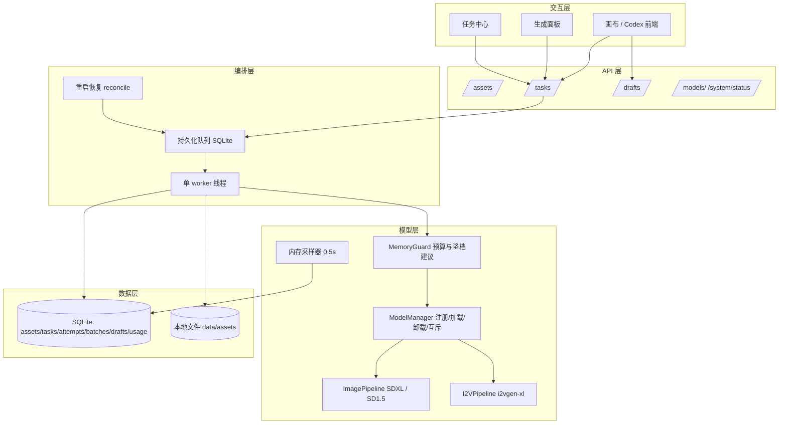

# 架构方案 · 电商 AIGC 工作平台（v2 本地推理，待确认）

> 对应 PRD v0.4｜2026-10-22｜状态：**待产品经理集中确认后开始写产品代码**
> v1（火山云端）已撤回，归档于 `docs/架构/架构方案-v1-云端（已撤回）.md`
> 本方案保留 v1 中被验证合理的部分：内容寻址素材库、持久化任务表、provider 抽象、统一错误结构、草稿版本化；替换掉云端相关的轮询/预算/远端任务 ID 设计。

---

## 1. 五要素清单

| 要素 | 内容 |
| --- | --- |
| **工具** | `model.load/unload`（本机模型生命周期）、`image.generate`、`video.generate_i2v`、`media.encode`（视频编码）、`asset.store`（内容寻址落盘）、`mem.sample`（内存采样） |
| **知识** | 模型参数规范（分辨率/步数/CFG/帧数/fps 上限）、风格预设与提示词模板、MPS 内存预算规则、降档策略表 |
| **观察** | 每任务耗时、MPS 分配/驱动内存峰值、系统内存、成功/失败与错误码、产物规格 |
| **行动** | 本地 HTTP API、写本地文件、SQLite 事务 |
| **权限** | 提交即占算力（显式点击）、删除/覆盖需确认、默认单并发、不关闭内存保护 |

---

## 2. 组件选型

| 组件 | 选 | 理由（没有它会怎样） |
| --- | --- | --- |
| FastAPI + Uvicorn | ✅ | 前端无法接入、无法验收 |
| SQLite + SQLAlchemy | ✅ | 重启丢任务、丢草稿、丢素材元数据 |
| 单 worker + 持久化队列 | ✅ | 多任务排队/取消/恢复全部落空 |
| 模型管理器（注册表 + 加载/卸载 + 互斥锁） | ✅ | 图片与视频模型无法共存于 11.45GB 预算，切换必然要卸载；无管理器必然 OOM |
| 内存护栏 | ✅ | 无它会在 16GB 机器上把系统拖入交换，任务成片失败且无证据 |
| 内容寻址素材库 | ✅ | 产物覆盖、无法追溯 |
| 草稿版本化 | ✅ | 「不丢稿」无法满足 |
| 任务轨迹（attempts + 指标采样） | ✅ | 无法写评测报告，也无法解释失败 |
| 多进程/多 worker | ❌ | 16GB 单机、默认单并发；多进程会重复加载权重，直接超预算 |
| Redis/Celery | ❌ | 规模不需要，且增加运维 |
| 用户/登录 | ❌ | 单机单用户 |
| 任何远程推理 | ❌ | PRD 红线 N2 |

---

## 3. 分层与数据流



**一次图片任务**：`POST /tasks` → 入队 → worker 取任务 → MemoryGuard 预算检查 → ModelManager 确保模型在场（必要时卸载另一模型/加载）→ 推理（步回调检查取消标志）→ 落盘+元数据 → 任务 succeeded。

**一次视频任务**：同上，但推理按「潜空间去噪 → VAE 解码成帧序列 → 编码 MP4」三段，**取消检查点**在每步与每帧之间；编码阶段不可中断（记录真实语义）。

---

## 4. 目录结构

```text
电商工作平台/
├── backend/
│   ├── app/
│   │   ├── main.py                # FastAPI + lifespan(启动恢复)
│   │   ├── config.py              # 模型 ID、分辨率上限、并发度、路径、内存预算
│   │   ├── api/{assets,tasks,batches,drafts,models,system}.py
│   │   ├── errors.py              # 统一错误结构 + 错误码
│   │   ├── db.py  models.py  schemas.py
│   │   ├── storage.py             # 内容寻址 + 校验
│   │   ├── queue.py  worker.py  reconcile.py
│   │   ├── cancel.py              # 取消令牌与回调
│   │   ├── memory.py              # MemoryGuard + 采样器
│   │   ├── models/
│   │   │   ├── registry.py        # 模型元数据（repo, revision, 许可证, 体积, 需求）
│   │   │   ├── manager.py         # 加载/卸载/驻留策略/互斥
│   │   │   ├── image_sdxl.py
│   │   │   ├── image_sd15.py
│   │   │   └── video_i2vgenxl.py
│   │   ├── media.py               # 帧序列 → MP4（imageio-ffmpeg）
│   │   ├── observability.py
│   │   └── providers/             # 兼容层：ImageProvider/VideoProvider 协议
│   ├── static/index.html          # 最小验收页（正式画布由 Codex 提供）
│   ├── tests/
│   └── pyproject.toml
├── data/{app.db, assets/, cache/}   # .gitignore
├── docs/  .env.example  .gitignore  README.md
```

---

## 5. 数据模型（相对 v1 的改动）

```sql
assets(  id PK, sha256 UNIQUE, kind, mime, size, width, height,
         duration_ms, fps, frames, rel_path, source, meta_json, created_at, owner )

tasks(   id PK, kind,                 -- image|video
         status,                      -- queued|loading|running|postprocess|succeeded|
                                      -- failed|cancel_requested|canceled|interrupted
         params_json,                 -- 提交时快照（含 model_id、分辨率、步数、种子…）
         model_id, model_revision,    -- ★ 版本可追溯（替换 v1 的 remote_task_id）
         input_asset_id, output_asset_id,
         latency_ms, load_ms, peak_mem_mb, frames, fps, width, height, duration_ms,
         error_code, error_message, attempts,
         lease_owner, lease_until,
         created_at, started_at, finished_at, updated_at )

task_attempts( id PK, task_id, attempt_no, started_at, finished_at,
               result, error_code, error_message, peak_mem_mb, latency_ms, params_json )

batches( id PK, name, created_at, params_json )
drafts(  id PK, name, content_json, version, created_at, updated_at )
draft_versions( id PK, draft_id, version, content_json, created_at )
mem_samples( id PK, task_id, ts, mps_alloc_mb, mps_driver_mb, sys_used_mb )
```

v1 中 `usage_ledger`、`api_calls`、`remote_task_id`、`estimated_cost_cny` **删除**（云端专用）。

---

## 6. 模型适配接口

```python
# providers/base.py —— 与 v1 同构，替换实现即可
class ImageGenRequest(BaseModel):
    model_id: str
    prompt: str
    negative_prompt: str = ""
    width: int; height: int
    steps: int = 25; guidance: float = 5.0
    seed: int | None = None
    init_image: str | None = None      # asset_id，用于图生图
    extra: dict = {}

class VideoGenRequest(BaseModel):
    model_id: str
    prompt: str
    first_frame_asset_id: str
    width: int; height: int
    num_frames: int; fps: int = 8
    steps: int = 25
    seed: int | None = None

class ImageProvider(Protocol):
    def generate(self, req: ImageGenRequest, cancel: CancelToken) -> ImageGenResult: ...
class VideoProvider(Protocol):
    def generate(self, req: VideoGenRequest, cancel: CancelToken) -> VideoGenResult: ...

# 本地模型的通用生命周期接口
class LocalModel(Protocol):
    model_id: str; revision: str; license: str; weights_bytes: int; est_peak_mb: int
    def load(self) -> None: ...
    def unload(self) -> None: ...
    def is_loaded(self) -> bool: ...
```

**本地实现映射**

| 实现 | 模型 | diffusers 类 | 关键 MPS 处理 |
| --- | --- | --- | --- |
| `image_sdxl.py` | `stabilityai/stable-diffusion-xl-base-1.0` @ 固定 revision，fp16 | `StableDiffusionXLPipeline` | `dtype=float16`、`enable_attention_slicing()`、`enable_vae_slicing()`；768px 起步 |
| `image_sd15.py` | `stable-diffusion-v1-5/stable-diffusion-v1-5` fp16 | `StableDiffusionPipeline` | 跳过 safety_checker 以省内存（需在 UI 说明）；512–768px |
| `video_i2vgenxl.py` | `ali-vilab/i2vgen-xl` fp16 | `I2VGenXLPipeline` | 分块解码/帧序列产出；输出帧写临时序列再编码 |

> 【待验证】`I2VGenXLPipeline` 在 torch 2.5.1 + diffusers 0.35.1 + MPS 下的算子覆盖；`I2VGenXL` 对 `num_frames` 的限制；SDXL 在 768px 下的峰值是否 <11.45GB。以 §8.5 实测为准。

---

## 7. 队列、并发与调度

| 项 | 设计 |
| --- | --- |
| 并发度 | `concurrency=1`（默认）；提高前必须先跑内存实测并由你决定 |
| 队列顺序 | FIFO；支持优先级字段（预留） |
| 租约 | `lease_owner/lease_until` 防重复执行；worker 崩溃后租约过期可被回收 |
| 任务粒度 | 一个任务 = 一次模型推理（图片 1 张 / 视频 1 段）；批量 = 多个任务 |
| 模型驻留 | 默认保留最近使用的模型；切换模型类型时卸载旧模型（**图片 6.95GB + 视频 4.98GB 无法共存**） |
| 冷启动 | 记录 `load_ms`，UI 显示「模型加载中」阶段，避免被误认为卡死 |

---

## 8. 内存护栏（本方案的核心安全件）

1. **预算**：`MPS_BUDGET_MB` 默认取 `torch.mps.recommended_max_memory()` 的 90%（本机 ≈ 10.3GB），留余量给系统与编码。
2. **准入检查**：任务开始前估算 `weights + activations`（激活按分辨率/帧数经验表 × 系数），超预算直接拒绝并给出**降档建议**（见下表），返回 `MEMORY_PREDICTED_OVER`。
3. **采样**：0.5s 采样 `torch.mps.current_allocated_memory()`、`driver_allocated_memory()`、系统已用内存，写 `mem_samples`，取峰值入任务。
4. **OOM 处理**：捕获异常 → 清理缓存 `torch.mps.empty_cache()` → 任务 `failed(MODEL_OOM)`，记录当时的参数与峰值 → **不自动重试**（重试不会成功）。
5. **不关闭内存保护**：不设置 `PYTORCH_MPS_HIGH_WATERMARK_RATIO=0`，不通过放宽水位线"骗过"OOM。

**降档建议表（由 MemoryGuard 给出，最终由你决定是否采用）**

| 档 | 图片 | 视频 |
| --- | --- | --- |
| 高（默认） | SDXL 768×768 / 25 步 | 512×896 / 16 帧 / 25 步 |
| 中 | SDXL 640×640 / 20 步 | 384×672 / 12 帧 / 20 步 |
| 低（探针） | SD1.5 512×512 / 20 步 | 320×512 / 8 帧 / 15 步 |

---

## 9. 取消语义（如实实现）

```python
class CancelToken:
    def __init__(self): self._flag = False
    def request(self): self._flag = True
    @property
    def canceled(self): return self._flag
```

| 阶段 | 行为 |
| --- | --- |
| queued | 直接移除 → `canceled`（未占算力） |
| loading（模型加载中） | 置 `cancel_requested`，加载完成后立即停止 → `canceled` |
| running（去噪循环） | diffusers `callback_on_step_end` 检查 token → 抛 `CancelRequested` → worker 捕获 → 释放/清缓存 → `canceled` |
| postprocess（VAE 解码/视频编码） | 在帧间检查；编码段不可中断 → 完成后置 `canceled` 并**保留**已生成文件但标记为取消产物（或按配置丢弃） |
| succeeded | 拒绝取消（可删产物，需确认） |

**诚实边界**：单次前向不可抢占，取消延迟 ≤ 1 个采样步或 1 帧；编码阶段不可中断。此条写入《多任务并发说明》。

---

## 10. 失败、重试、重启恢复

| 场景 | 处理 |
| --- | --- |
| 可重试（文件写入、编码失败、偶发进程错误） | 自动 1 次；仍失败 → `failed` |
| 不可重试（OOM、算子不支持、权重缺失、参数非法） | 直接 `failed`，附降档建议，不自动重试 |
| 进程崩溃/被 kill | 启动时 `loading/running/postprocess` → `interrupted`；**不自动重跑**，UI 提示「N 个任务被中断，可一键重试」 |
| 重启后的排队任务 | 继续执行（FIFO） |
| 断点续跑 | **本版不实现**（扩散中间态序列化成本高），文档中不得宣称支持 |
| 产物完整但状态未提交 | 启动时按文件校验（sha256 + 可解码）补登记为 succeeded |

---

## 11. HTTP 接口契约

统一前缀 `/api`，仅 `127.0.0.1`。

| 方法 | 路径 | 说明 |
| --- | --- | --- |
| GET | `/api/health` | 服务状态、恢复摘要、上次中断任务数 |
| GET | `/api/system/status` | MPS 预算/已用、已加载模型、队列长度、采样最近峰值 |
| GET | `/api/models` | 本地模型清单：id、名称、许可证、体积、是否已下载、是否已加载、参数上限 |
| POST | `/api/assets` | 上传素材（multipart）→ `{asset_id, sha256, width, height}` |
| GET | `/api/assets/{id}` / `/file` | 元数据 / 二进制（支持 Range 供视频预览） |
| POST | `/api/tasks` | 提交任务 `{kind, model_id, params, input_asset_id?, client_request_id?}` → `{task_id, status, queue_position}` |
| GET | `/api/tasks` | 列表（status/kind/batch_id/limit/cursor） |
| GET | `/api/tasks/{id}` | 详情（阶段、进度、耗时、内存峰值、错误） |
| POST | `/api/tasks/{id}/cancel` | `{result: "canceled"|"cancel_requested"|"rejected", phase: "queued"|"loading"|"running"|"postprocess"}` |
| POST | `/api/tasks/{id}/retry` | 从头重试（新 task，`retry_of` 记录） |
| POST | `/api/batches` | 批量提交 `{name, items[]}` → `{batch_id, task_ids[]}` |
| GET | `/api/tasks/{id}/events` | SSE 可选；**必须以 `done` 或 `error` 收尾** |
| POST/GET/PATCH | `/api/drafts[/{id}]` | 草稿创建/读取/保存（`base_version` 冲突返回 409） |

**状态枚举（对外）**：`queued | loading | running | postprocess | succeeded | failed | cancel_requested | canceled | interrupted`。

---

## 12. 统一错误结构

```json
{ "error": { "code": "MODEL_OOM", "message": "显存/内存不足：请在设置中降低分辨率或帧数", "task_id": "task_...", "detail": { "peak_mem_mb": 10980, "suggest": "512x896 / 12 帧" } } }
```

| code | 触发 | HTTP | 可重试 | 备注 |
| --- | --- | --- | --- | --- |
| `VALIDATION_FAILED` | 参数越界/缺失 | 400 | 否 | 附字段 |
| `ASSET_NOT_FOUND` / `TASK_NOT_FOUND` / `DRAFT_NOT_FOUND` | 资源不存在 | 404 | 否 | — |
| `DRAFT_VERSION_CONFLICT` | 草稿并发保存 | 409 | 否 | — |
| `MODEL_NOT_DOWNLOADED` | 权重缺失 | 409 | 否 | 提示下载命令 |
| `MODEL_LOAD_FAILED` | 权重损坏/版本不兼容 | 500 | 否 | 附异常摘要 |
| `MODEL_UNSUPPORTED_OP` | MPS 算子不支持 | 500 | 否 | 附算子名与回退建议 |
| `MODEL_OOM` | 内存不足（含 MPS OOM） | 507 | **否** | 附峰值与降档建议 |
| `MEMORY_PREDICTED_OVER` | 准入预估超预算 | 507 | 否 | 提交前即拒绝 |
| `CANCEL_REJECTED_PHASE` | 不可取消阶段 | 409 | 否 | 附当前阶段 |
| `MEDIA_ENCODE_FAILED` | 视频编码失败 | 502 | 是（1 次） | 附 ffmpeg 摘要 |
| `TASK_INTERRUPTED` | 进程中断 | 409 | 是（手动） | 重启后可见 |
| `INTERNAL_ERROR` | 未预期 | 500 | 视情况 | 不泄漏堆栈 |

---

## 13. 可观测与评测数据采集

- 日志字段：`ts, level, task_id, stage, model_id, width, height, frames, steps, latency_ms, load_ms, peak_mem_mb, error_code`。
- 指标落库：`tasks` + `mem_samples` + `task_attempts`，可直接生成评测报告的「客观指标」表。
- 每次生成固定记录：模型 ID + revision、全部参数、种子、输入/输出 asset_id、耗时、内存峰值、失败原因。

---

## 14. 测试策略

| 层 | 内容 | 可否作为验收证据 |
| --- | --- | --- |
| 单测 | 状态机、取消令牌、内存准入、错误映射、草稿版本冲突、上传校验 | 否 |
| 集成（假模型） | 提交→排队→完成→落盘→元数据 全链路（用一个极小假 pipeline 跑通流程） | 否（仅流程） |
| 真实本地模型 | 1 张图 + 1 条视频（含低规格探针） | **是**（须标注实际规格） |
| 断网 | 权重就位后断网生成 | 是 |
| 人工 | 你走查 + 播放 + 打分 | 是 |

---

## 15. 执行顺序与时间盒

| 序 | 事项 | 预估 | 依赖 |
| --- | --- | --- | --- |
| 0 | **你集中确认本方案 + PRD §14（Q11–Q15）** | — | 未确认不动工 |
| 1 | 环境核对补全（pipeline 可导入、numpy/torch 兼容） | 10 min | 复用探针 venv |
| 2 | 下载 SDXL fp16 子集（≈6.95GB） | 依网速 | Q13 |
| 3 | **V2 单张真实出图**（768px）+ 指标记录 | 10–20 min | 2 |
| 4 | 下载 i2vgen-xl（≈4.98GB）→ **V5 视频探针**（320×512/8 帧） | 20–40 min | 3 |
| 5 | 后端骨架：config/db/queue/worker/memory/models 注册表 + 接口 | 45–60 min | 可与 2–4 并行 |
| 6 | 接口交给 Codex（前端并行开发） | 尽早 | 5 |
| 7 | 批量/取消/失败/重启恢复 + 最小验收页 | 至 16:30 | 5 |
| 8 | 16:30 冻结 → 联调、断网验证、文档核对、未完成登记 | 30 min | 全部 |

---

## 16. 待你确认（集中一次）

1. 本方案是否通过（重点：§8 内存护栏与降档策略、§9 取消语义、§10 不承诺断点续跑、§7 单并发默认）。
2. PRD §14：Q11 图片模型（SDXL 首选 / SD1.5 兜底）、Q12 视频模型（i2vgen-xl）、Q13 下载 ≈11.93GB、Q14 T2V 非必验、Q15 探针最低规格。
3. 是否同意「先下载图片模型跑通单图，再下载视频模型」的串行顺序（避免一次性占满磁盘且便于失败止损）。
