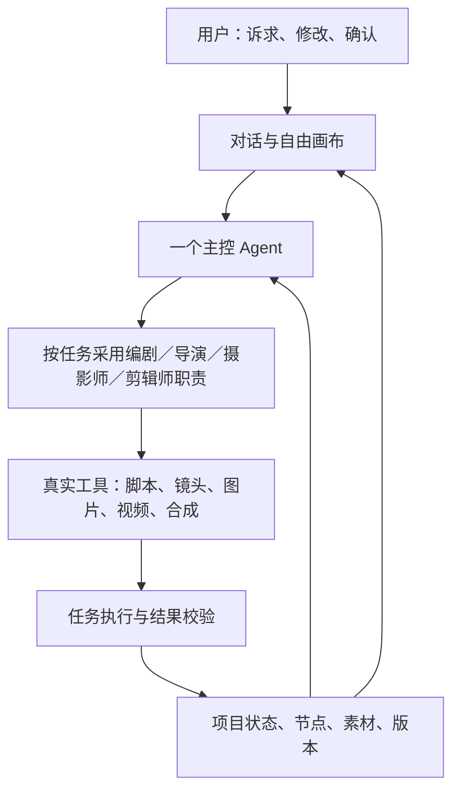

# 对话创作与自由画布：需求核对和架构讨论

日期：2026-10-26。核对基线：主仓 `62b6640`、用户本轮六条批注及此前两轮界面批注、项目实际对话回执。

**本轮只做只读调查和需求整理，不修改产品代码，不调用付费模型，不重启服务，不执行 REA。** 本文是评审记录，不是完成报告，也不替代现有 PRD。用户明确要求先沟通；文中的架构和交互细节建议尚未冻结。

## 1. 用户要的产品

整个创作工作区是一张自由画布。用户可以与左侧 Agent 对话，把想法逐步变成脚本、分镜图片、镜头视频和成片；也可以自己创建文本、图片生成、视频生成节点，导入已有素材，从任何适合的环节继续。对话和节点编辑操作同一份真实项目内容。

用户负责提出诉求、补充关键细节、提出修改意见、确认当前阶段。Agent 负责梳理、实际执行、把产物放进画布、解释结果并主动提出下一步。不能以“我准备生成”作为生成结束，也不能要求用户到隐藏表单里再次点击相同操作。

| 对话角色 | 本阶段沟通 | 确认后的实际动作 | 画布结果 |
| --- | --- | --- | --- |
| AI 编剧 | 想法、商品事实、表达目的、风格和必要约束 | 生成并保存可阅读、可编辑的脚本 | 脚本文本节点 |
| AI 导演 | 基于已选脚本讨论镜头、画面、参考素材和图片规格 | 给出镜头方案，按本次确认范围生成分镜图 | 每个镜头独立图片节点，逐张显示进度和结果 |
| AI 摄影师 | 运镜、动作、每镜时长、视频规格和输出方式 | 使用选定的分镜图生成镜头视频 | 每个镜头独立视频节点 |
| AI 剪辑师／自动合成 | 镜头选择、顺序及交付方式 | 将选定且已完成的视频合成为成片 | 可播放、可下载的成片节点 |

这是一条常见路径，不是强迫用户依次走完的向导。已有脚本可直接讨论分镜；已有图片可直接生成视频；已有视频可直接讨论合成。没有输入依赖的节点可以独立生成。

“直接出成片”的建议解释：用户在视频阶段选择“完整视频”，本次确认覆盖镜头生成及成功后的合成，后端自动衔接，不再强制用户切换到剪辑师并重复确认。选择“独立分镜视频”则先交付片段，后续需要时再合成。这两种输出方式沿用既有产品范围；不因此承诺自动配乐、复杂剪辑或调色。

## 2. 本次真实故障和当前能力

### 2.1 为什么说写脚本，却没有产物

对项目 `prj_72da42765b534776b7b0` 的只读回执核对结果：

- 22:55 用户询问“写好了吗”，请求 `d1c97ac6-54cd-4145-83ec-815d4f7b102e` 回复“稍等，我这就把脚本草案落库。”
- 请求回执状态是 `completed`，但 `artifacts=[]`、`actions=[]`，当时没有脚本。
- `propose_script` 两次失败，分别是“脚本草案缺少 summary”和“第 1 个镜头缺少 hint”。这不是还在后台执行。
- 后来 23:07:11 通过独立脚本生成路径保存了脚本，23:08:13 已确认。本次检查时该项目镜头数仍为 0。不能把早先的失败说成项目现在始终没有脚本。

代码中可确认的原因：

1. 脚本工具声明只把镜头描述成一般对象，没有声明执行校验要求的 `hint` 字段；见 `backend/app/director_chat.py:32` 与 `:143`。
2. 执行最多两轮模型调用，工具出错后记录错误但没有可靠地完成修复或返回失败；见 `director_chat.py:358`、`:393`。
3. 两轮结束仍会返回 `completed`，沿用模型的回复，没有验证这次写脚本的目标是否实际完成；见 `director_chat.py:377`、`:409`。
4. 工具失败详情未完整进入后续对话上下文；见 `director_chat.py:297`。

另有截断风险：相关输出两次恰好达到 400 tokens，代码默认上限也是 400，非法参数 JSON 又会被转成空对象。但本次没有持久化完整原始参数和结束原因，**不能认定截断就是这次失败的已证实原因**。

### 2.2 当前导演的能力边界

`director_chat.py:24` 只提供读取项目、查询模型、保存需求草案、保存脚本草案、保存镜头计划草案五类工具；`:47` 的提示词明确限制为草案助手，`:224` 禁止确认、提交、生成和应用提案。前端 `DirectorChat.tsx:66` 的生成操作只会选中生成设置节点。

因此，目前实现是对话草案助手加手动执行入口，尚未完成用户要求的全阶段对话创作。图片、视频、拼接接口本身已有，缺少的是将确认、工具执行、任务进度和真实产物接到同一段对话中。

已有生成底座可增量复用：脚本与版本（`projects.py`）、分镜图和审核（`shots.py`）、片段／完整视频的范围及提交（`scope.py`）、成功后合成（`pipeline.py`、`assembly.py`）。复用不等于这些接口已经适配自由节点；仍需统一输入契约、预算检查、执行范围和失败反馈。

### 2.3 当前画布的能力边界

- 前端仍以固定左侧对话栏加右侧画布布局，顶部还有独立项目标题行；见 `DirectorStudio.css:12`、`:19`。
- 隐藏的“创作资料与手动调整”表单仍在；见 `DirectorChat.tsx:96`、`CreativeSpace.tsx:267`。
- 脚本、分镜图和视频节点会随已有业务数据出现，但缺少用户自由新建节点、画布内上传导入及绕过无关阶段的入口。
- 节点设置随画布缩放、平移和节点拖动已有实现，应保留。
- 前端画布同步主要保存位置和视口，未完整接入节点业务配置；视频参数仍有整组共享限制。后端有部分节点配置存储，尚未形成独立节点生成闭环。

之前固定回复的隔离测试只验证接口连接和界面操作，不足以证明真实模型能稳定生成脚本，更不代表完整对话制作流程验收通过。

## 3. 单 Agent 还是多 Agent

**建议：一个主控 Agent，按当前任务切换专业职责，配合真实工具、持久化项目状态和后台任务。** 单 Agent 不等于一次模型调用，也不要求所有任务都用同一个模型。界面的四个角色可以共享一个对话入口；每个阶段加载相应的专业指令、输入资料和工具。

| 方案 | 能否支持目标 | 取舍 |
| --- | --- | --- |
| 仅改现有聊天提示词或角色名称 | 不足 | 仍缺工具、完成判断和自由节点执行 |
| 单主控 Agent＋分阶段职责＋真实工具 | 可以作为实现方案，推荐先做 | 统一项目上下文，定位故障和控制重复执行较直接；需用真实流程验证可靠性 |
| 主控 Agent＋独立编剧／导演／摄影师／剪辑师 Agent | 可以，暂不必直接采用 | 适合独立上下文、并行创意探索和专门质量审查；额外增加交接、状态同步、调用成本及排错工作 |

图片和视频模型调用是生成工具，不因模型数量多就成为多 Agent。多个镜头并行或排队生成也不要求多个推理 Agent。

后续只有在真实评测显示单主控难以管理长上下文、需要并行独立创意方案，或独立审查确实改善质量时，再拆专业子 Agent。保留统一节点、任务和产物接口，便于届时拆分；不用现在先上复杂团队架构。

上述为针对本项目的工程判断。参考的一手方法论：[Anthropic — Building effective agents](https://www.anthropic.com/research/building-effective-agents)，支持先用简单可组合方案、依据实际效果再增加复杂度，并用工具返回的真实结果判断进度；并非 OiiOii 或 LibTV 内部架构证据。

## 4. 全部需求清单

标记说明：“待补齐”为代码或交互仍有缺口；“已有基础”不代表用户验收；“保留回归”为已有实现及既定要求，不得在改造中丢失。“建议”是本轮建议，不能冒充用户新增要求。

### A. 画布和空间（前端主责，节点能力需后端）

| 编号 | 要求 | 当前判断 |
| --- | --- | --- |
| A1 | 主导航下方整个工作区作为自由画布，不再只给右边一块小画布 | 待补齐；本轮批注 3 |
| A2 | 删掉独立“项目名／创作项目”大标题条，项目名只在一处紧凑展示；压缩重复标题和留白 | 待补齐；本轮批注 1、此前项目名重复批注 |
| A3 | 保留左侧对话；建议做可收起的浮动或停靠面板，使画布延伸到其下方；收起不丢会话 | 待补齐；具体面板宽度和停靠方式未冻结 |
| A4 | 节点自由拖动，画布自由平移、放大缩小和适配全图，刷新恢复位置 | 已有基础，保留回归 |
| A5 | 点节点后在其下方展开设置；设置随该节点移动，并随画布同比例缩放 | 已有基础，保留回归；不能退回固定大小覆盖层 |
| A6 | 对话和画布同步：生成有真实进度，成功有实际内容，失败有可操作提示 | 待补齐全阶段联动 |
| A7 | 窄窗口也尽量保留创作空间，不能因上下堆叠让画布被表单挤走 | 随 A1–A3 重新验收 |
| A8 | 初始展示当前实际内容，后续节点随创建和执行逐步出现，已完成内容可以回看；不预铺满未来空步骤 | 保留渐进展示原则；用户主动新建空节点不受此限制 |

### B. 对话创作（前后端共同）

| 编号 | 要求 | 当前判断 |
| --- | --- | --- |
| B1 | 初始询问创作想法，按需要澄清关键细节，用户确认后直接生成脚本 | 当前真实失败，需修执行链 |
| B2 | 删除整个“创作资料与手动调整”面板；商品、卖点、风格、时长等通过对话整理 | 当前只是折叠，待删除并迁移能力 |
| B3 | 不再隐藏“生成／重新起草脚本”按钮；用户在对话中提出生成或修改即可推进 | 待补齐；本轮批注 2、5、6 |
| B4 | 显示当前专业职责：编剧 → 导演 → 摄影师 → 剪辑师；交接保留需求、素材和已选版本 | 待补齐；不要求四个聊天窗口 |
| B5 | 生成脚本后自动保存、显示脚本节点并引导审核；内容写完直接确认，不先保存再确认 | 节点内“确认脚本并继续”已合并保存和确认，保留回归；真实对话起稿和确认后的执行仍待补齐 |
| B6 | 确认脚本后，Agent 主动讨论镜头并列出方案；确认当前图片生成范围后实际生成分镜图 | 当前只到镜头提案，待接生成 |
| B7 | 分镜图确认后讨论运镜、动作、时长和输出方式；确认后实际生成视频 | 待接入对话执行 |
| B8 | 支持完整视频与独立分镜视频；完整视频模式成功后自动合成，不强制重复操作 | 底座已有，对话链待接 |
| B9 | 失败不能回复成“稍等”后停止；说明真实失败，允许修正或恢复，不伪造成功 | 本次明确后端缺陷 |
| B10 | 同一动作只确认一次；同意当前脚本不自动等于同意所有后续付费生成 | 需统一确认语义 |
| B11 | 对话可指向某个节点修改，如“第二张改成近景”；只影响指定范围，其他成功素材保留 | 与单节点编辑一起补齐 |

### C. 真正可创作的节点（前后端共同）

| 编号 | 要求 | 当前判断 |
| --- | --- | --- |
| C1 | 可主动创建文本／脚本节点、图片生成节点、视频生成节点 | 缺少入口和完整执行连接 |
| C2 | 画布内可上传、拖入或引用已有图片和视频，作为实际素材使用 | 待补齐，不再要求先去快捷工作台上传 |
| C3 | 支持中途开始：脚本到分镜、图片到视频、已有视频到合成；不强制补齐无关前置步骤 | 需改全项目阶段门槛，按实际输入依赖判断 |
| C4 | 每张分镜图、每条镜头视频是可选中、有独立内容和状态的节点 | 已有显示基础，自主操作待补齐 |
| C5 | 每个节点独立调整模型、提示词、参考素材、比例、清晰度、时长等适用参数 | 图片部分已有，视频整组配置及持久化仍有缺口 |
| C6 | 修改或重做指定节点，能用新结果继续生成或重新合成；保留已有可用素材 | 待完善范围和依赖处理 |
| C7 | 参数、素材引用、任务和结果都持久化；不能只有坐标保存了，刷新却丢生成配置 | 待接业务配置 |
| C8 | 保留文生图、图生图、文生视频、图生视频四种明确输入方式；只展示模型支持的选项 | 快捷工作台已有基础，自由节点需复用 |
| C9 | 手工编辑脚本归入脚本／文本节点，不能因删除左侧表单而丢失直接编辑能力 | 迁移时保留 |

自由节点不自动等同于通用工作流编辑器。任意循环执行、条件分支、多人协作、复杂时间线剪辑不在本轮用户已明确要求内；不自行扩展。素材引用关系和合成顺序需要明确，但具体用连线还是其他选择方式可以继续讨论。

### D. 之前的界面和项目要求（保留并复核）

| 编号 | 要求 | 当前判断 |
| --- | --- | --- |
| D1 | 使用 C 版 UI，支持深浅主题；画布能力借鉴 A 版和用户提供的 OiiOii／LibTV 示例 | C 版顶部导航和主题已有，不重新退回绿色侧栏；空间结构仍按本轮调整 |
| D2 | 导演台先进入项目创建／选择界面，再进入项目画布；不能一进入就自动弹项目抽屉或强开旧项目 | 已有修复，保留回归 |
| D3 | 画布的返回按钮回导演台创建／项目选择界面，不跳快捷工作台 | 已有修复，保留回归 |
| D4 | 项目首页和导演台项目列表都能删除项目；项目不存在、已删除、暂时读取失败要正确处理 | 已有实现，保留回归，不能误删素材或伪造恢复 |
| D5 | 首页能够正常下滑、查看全部内容 | 已有修复，保留回归 |
| D6 | 首页介绍快捷工作台和导演台的区别及优势，不铺四个生成模式入口卡片；四模式留在实际创作入口 | 已有调整，保留回归 |
| D7 | 删除首页“目标明确时，快速生成素材；需要梳理想法时，与 AI 一起完成创作。” | 保留删除要求 |
| D8 | 删除“每次保存会新增版本…”、独立版本历史大面板、服务端确认解释等开发说明 | 保留删除要求；历史数据不因此删除，可按需查看 |
| D9 | 快捷生成底部主要保留生成按钮，去掉“上传不收费”“今日估算／非实际账单”等说明；积分展示后续再做 | 已有调整，保留回归；真实费用确认和后端预算不因此移除 |
| D10 | 比例用横版 16:9、竖版 9:16、方形 1:1 等易懂标签，清晰度单独表达；不堆长像素数字 | 已有基础，节点新设置也须遵循；具体规格依据模型能力 |
| D11 | 项目名称只展示一次；脚本只需一次明确确认，不出现重复“保存为新版本／确认”操作 | 项目标题待压缩；节点单次确认已实现，保留回归并扩展到对话 |
| D12 | 快捷工作台继续适合直接生成单素材，导演台负责对话引导和多素材创作，两者保持明确区别 | 后续改造不得互相替代 |
| D13 | 保存、查看和套用既有节奏结构模板；不复制商品事实，套用后重新绑定素材并校验规格 | 原入口位于要删除的隐藏面板，需迁移可发现入口，不能随面板一起丢失 |

## 5. 前后端工作划分与建议顺序

用户已把前后端交由当前 Codex 承接。本轮不启动开发，下列用于后续范围对齐。

| 顺序 | 前端工作 | 后端工作 | 可见验收 |
| --- | --- | --- | --- |
| 1 对话脚本闭环 | 删除隐藏操作依赖，显示真实进行中／失败／产物 | 对齐工具字段；处理截断与工具错误；按目标判断完成；确认后执行并持久化 | 正常对话确认后直接出现可读脚本；失败不谎称继续执行 |
| 2 画布与节点基础 | 全工作区画布、紧凑信息、对话面板、新建／导入／选中设置 | 独立节点实体和配置、素材绑定、输入依赖、版本和任务关联 | 刷新后节点及参数完整；已有视频可进入合成 |
| 3 对话贯穿图片和视频 | 当前角色、镜头提案、单节点修改、确认和任务反馈统一在对话与画布 | 接入已有报价、审核、生成、任务查询和合成；不再要求不相关的前置脚本 | 一次明确确认后执行对应范围，每镜出现真实图片／视频 |
| 4 完整使用验证 | 深浅主题、窄窗口、项目入口删除、异常恢复、四模式回归 | 防重复提交、部分失败、恢复、依赖更新和真实产物检查 | 从想法到成片及从导入视频到成片两条路径均能实际完成 |

实现建议：每个待确认动作绑定具体节点／版本／生成范围与必要费用信息；点击确认和无歧义的文字确认应指向同一动作，服务端校验后执行。修改了输入才更新待确认内容，不为同一动作再要求“保存→确认→去设置页再生成”。这个确认控件的具体样式尚未冻结。

建议执行状态区分：需要澄清、等待确认、真实执行中、产物就绪、执行失败、结果待核对。普通聊天回复可以正常结束；生成请求必须有真实产物或明确失败／等待状态，不能仅凭一条模型回复算成功。慢生成进入可恢复的后台任务，页面关闭和模型回复结束不应使任务悄然丢失。

验收至少覆盖：

1. 完整对话起稿，无需隐藏表单；脚本实际保存并显示节点。
2. 脚本确认后，镜头方案与生成范围在对话中完成；每镜得到真实图片。
3. 单独修改第二张图片，不重做其他成功图片；节点设置随缩放，刷新可恢复。
4. 分镜图进入视频生成，选择完整视频则自动合成；选择片段则保留独立视频。
5. 导入现有图片可直接生成视频；导入现有视频可直接合成，不被脚本阶段阻挡。
6. 工具字段错误、超时、失败、部分成功、结果未知都显示真实状态；恢复不会重复付费提交。
7. 实际模型测试与固定回复测试分开记录；完整验收要包含真实脚本、图片、视频及成片，不以页面卡片或单测替代。

## 6. 小云雀源码、REA 和参考资料

用户提出可提供小云雀源码，或由其他人执行 REA 分析 LibTV／OiiOii。**当前不执行逆向、不代为委派。**

优先参考有版本和可运行说明的完整源码，尤其是 Agent 编排、工具契约、节点数据结构、素材引用、任务恢复和确认机制。若只提供前端，仍能帮助交互设计，但不能据此确认真实后台的 Agent 数量或实现方式。

网页侧分析通常能提供界面结构、用户操作路径、浏览器实际请求与响应和前端资源；不能仅凭界面四个角色，推断服务端存在四个独立 Agent。源码和参考材料是辅助，当前已确认的工具失败与能力缺口不依赖这些材料才能理解。

可交给执行人员的资料清单（供用户转交，当前未发送给任何人）：

- 源码：仓库／版本、来源与复用许可、运行说明、Agent 入口及工具定义、节点和任务数据结构、完整执行轨迹示例。去除密钥与个人账号数据。
- 产品走查：需求到脚本、脚本到分镜图、分镜图到视频、片段到成片；分别记录用户确认的位置和产物出现时机。
- 自由节点：新建文本／图片／视频、导入已有素材、中途开始、修改单节点、缩放时设置面板的表现。
- 恢复与修改：刷新恢复、生成失败、单镜重做、旧结果保留、改动后下游如何更新。
- 结论分级：实际看见的行为、源码确认的机制、仅从网络或界面推测的内容，分开写。

## 7. 文档冲突和未冻结部分

现有 `docs/PRD/PRD.md:605` 仍描述手动生成按钮流程，`:610` 仍是固定八阶段画布。与用户本轮明确的对话执行、自由建节点、素材导入、中途开始存在冲突；后续开发以用户最新要求为准，在方案对齐后修订相应条目，不能拿旧文档把新要求排除。

尚未冻结的实现细节：对话面板浮动还是停靠及宽度；节点引用采用连线或选择器；角色交接的具体视觉；动作确认卡的样式；专业子 Agent 何时值得引入。它们不影响“先说明能否做到、记录完整要求”的本轮结论，也不构成本轮开始写代码的授权。
