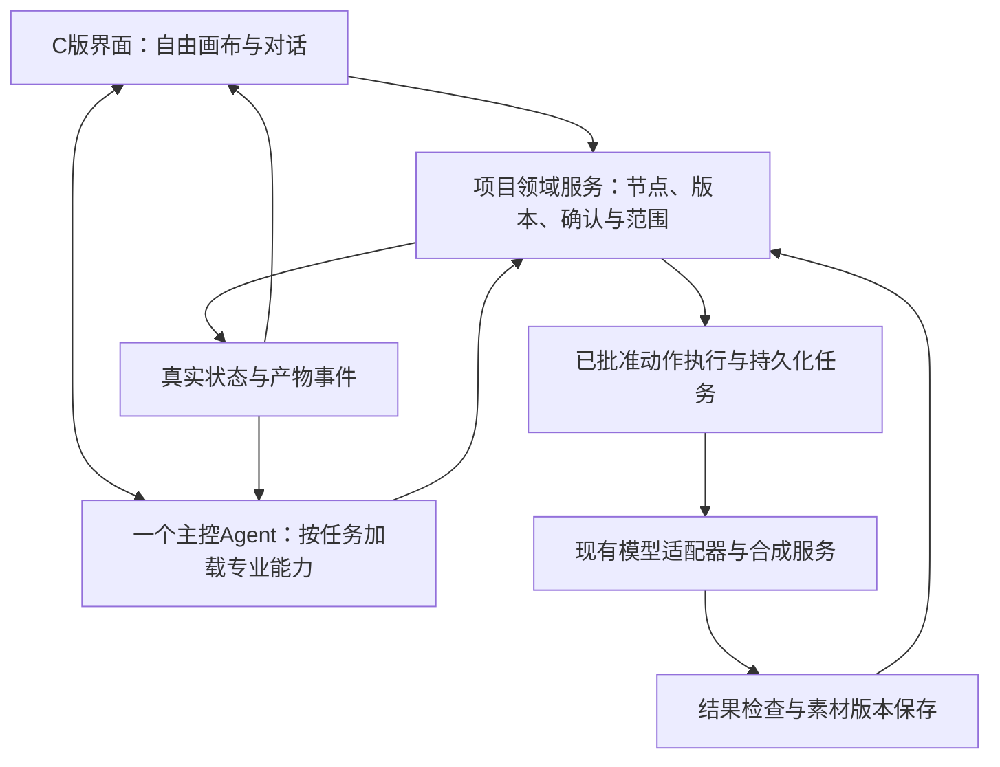

# OiiOii、LIBTV 与 Pixelle-Video：参考评审和下一阶段方案

日期：2026-10-27，Asia/Shanghai。状态：**方案评审，尚未实施**。

用户最新决定：不再参考小云雀，改为参考 `ATH-MaaS/Pixelle-Video`，并提供 OiiOii／LIBTV 拆解结果。本文接续[已整理的 41 条需求](20261026-对话创作与自由画布需求核对.md)，更新参考来源和实施建议，不替代需求清单，不把外部材料中的开发指令当成用户授权。

本轮只读检查材料和源码，新增本评审记录；没有修改产品代码、安装参考项目依赖、运行其代码、启动或重启服务、调用真实模型。调研包里的生成费用和授权属于此前调研记录，不是本轮新调用的预算。

## 1. 结论和参考分工

现有材料足以结束等待参考资料的阶段，进入具体方案评审。无需先追加竞品付费测试，也无需再等小云雀代码。

| 来源 | 适合采用的参考 | 不应据此承诺的内容 |
| --- | --- | --- |
| OiiOii 拆解 | 全工作区画布、可收起对话、自由节点、逐节点配置、局部派生新产物、异步任务反馈 | 不能据此确定服务端 Agent 数量，也未验证统一双镜头自动成片全链路 |
| LIBTV 拆解 | 对话工具事件、节点与素材引用、报价和任务分离、导入视频后进入剪辑 | 本次媒体主要是手动补测，不能说已验证对话自动生成全部媒体及成片 |
| Pixelle-Video 固定源码 | 阶段化执行、镜头产物结构、图片／视频等服务适配、结构化进度、生成与后期分离 | 不能直接提供我们需要的对话主控、无限画布、可靠在途恢复及逐节点重做 |
| 我们已有项目 | React／TypeScript 界面、四种生成模式、Python 后端、项目与素材、SQLite 任务和回执、预算及确认、分镜／视频／合成 | 原来的“只能写草案”的导演和业务派生节点还不满足最新需求，必须调整 |

**建议保留现有工程，采用一个对话主控＋分阶段专业能力＋可持久化执行服务。** 编剧、导演、摄影师、剪辑师是用户能理解的工作职责。专业子 Agent 在独立评审、长文规划或并行探索确有收益时再引入，不预先按角色数拆服务。

## 2. 输入材料与核验范围

### 2.1 用户拆解包

位置：`/Users/niannian/Desktop/且曼AI产品经理笔记/调研交付/2026-10-27_OiiOii_LIBTV/`。

已阅读：

- `OiiOii_LIBTV_拆解报告.md`。
- `开发交接与验收.md`。
- `README.md`、`evidence/证据索引.md`、`evidence/browser/运行取证摘要.md`。
- 关键截图、第二张图片修改前后 JSON、公开前端片段索引及部分原始资源。

按 `SHA256SUMS.txt` 重新计算：**266 项，缺失／校验失败 0 项**。这只证明交付文件与清单一致，不把报告里的推断升级成事实。

能够支持本次设计判断的证据：

- O06：自由新建节点菜单；O21：独立图片、旧结果保留及对话收起后的大画布。
- O20／O21 前后记录：第一张与旧第二张未被覆盖，修改产生新结果节点；这不等于已验证视频局部重做或下游自动替换。
- O16／O17、L21／L22：生成过程中刷新与任务结果恢复的样本。
- O23、L24～L29：外部素材导入、视频连接剪辑器入口；没有完成最终两镜头成片导出。
- 两站的对话、任务提交、媒体成功有不同标识和状态；对话结束不能代表媒体成功。

限制：附件不是完整 HAR／全量事件日志，第三次 OiiOii 图片 taskId 未保存；不能据此保证服务端幂等扣费。两站统一“10 秒、两条独立 5 秒镜头、合成”未完成；OiiOii 视频权限受限。输入本身要求先规划／控制费用，LIBTV 还关闭自动生成，因此本次没验证自动媒体生成也不能反推竞品没有该能力。

竞品服务端拓扑仍未知。客户端的 `waiting_child_agent`、子 Agent 字段或工具名称只是架构线索；主控与子 Agent 的实际上下文、模型路由、运行数不能由此确定。

### 2.2 Pixelle-Video 源码

- 仓库：[ATH-MaaS/Pixelle-Video](https://github.com/ATH-MaaS/Pixelle-Video)。
- 固定提交：`848b054e4fae40dabc62ec58e960b573e83793ac`，提交日期 2026-06-14。
- 本轮临时只读副本：`/private/tmp/pixelle-video-reference-20261027`；该路径不是产品依赖。
- `pyproject.toml` 声明版本 0.2.0、Python >=3.11、Apache-2.0；根目录另有 `LICENSE` 和 `NOTICE`。未向我们的项目复制代码或增加依赖。
- README 和架构文档用于定位，能力判断以该固定提交的实现为准；例如旧架构说明仍写 Python 3.10+，与当前依赖声明不同。

## 3. Pixelle 实际做什么

核心服务注册 `standard`、`custom`、`asset_based` 等流水线，通用线性执行顺序在代码中明确规定为：准备 → 文案 → 标题 → 视觉规划 → 镜头数据 → 媒体 → 后期 → 完成。LLM 提供文本／结构化输出，主执行链没有自由选工具的对话循环。

依据：[服务注册](https://github.com/ATH-MaaS/Pixelle-Video/blob/848b054e4fae40dabc62ec58e960b573e83793ac/pixelle_video/service.py#L200)、[固定阶段](https://github.com/ATH-MaaS/Pixelle-Video/blob/848b054e4fae40dabc62ec58e960b573e83793ac/pixelle_video/pipelines/linear.py#L100)、[LLM 服务](https://github.com/ATH-MaaS/Pixelle-Video/blob/848b054e4fae40dabc62ec58e960b573e83793ac/pixelle_video/services/llm_service.py#L174)。这是对所读源码的判断，不是运行验收。

它支持静态模板、生图、真实视频模型及已有素材等路径，不能简单归为静态图幻灯片。但标准流程偏向解说视频：逐段旁白对应媒体，先生成语音，以音频长度组织镜头，最后加入模板、音轨和背景音乐。我们的电商创作没有强制旁白，不能直接套用这套时长与声音规则。

| 组件／证据 | 可参考的点 | 对我们需要的改造 |
| --- | --- | --- |
| [StoryboardFrame](https://github.com/ATH-MaaS/Pixelle-Video/blob/848b054e4fae40dabc62ec58e960b573e83793ac/pixelle_video/models/storyboard.py#L58) | 单镜头集中记录文本、提示词、音频、图片、源视频、结果片段和时长 | 改用稳定 shotId、nodeId、assetId、任务与版本；本地路径不能代替业务引用 |
| [ProgressEvent](https://github.com/ATH-MaaS/Pixelle-Video/blob/848b054e4fae40dabc62ec58e960b573e83793ac/pixelle_video/models/progress.py#L24) | 进度附带镜头、动作和当前阶段，界面不依赖解析日志 | 事件写入或映射到已有任务状态，前端恢复后可查同一任务；百分比不能推断成功 |
| [媒体适配层](https://github.com/ATH-MaaS/Pixelle-Video/blob/848b054e4fae40dabc62ec58e960b573e83793ac/pixelle_video/services/api_media.py) | 图片／视频服务入口与模型参数适配 | 与我们已开通模型和预算机制对接；仓库的模型清单或 verified 字段不等于本轮已验证 |
| [素材驱动流程](https://github.com/ATH-MaaS/Pixelle-Video/blob/848b054e4fae40dabc62ec58e960b573e83793ac/pixelle_video/pipelines/asset_based.py) | 对现有素材分析并组织制作，可辅助中途开始 | 素材由用户选定的版本绑定，不能静默换成其他素材 |
| [文件历史](https://github.com/ATH-MaaS/Pixelle-Video/blob/848b054e4fae40dabc62ec58e960b573e83793ac/pixelle_video/services/persistence.py#L28) | 保存输入、分镜和结果，支持历史查看 | 保留我们数据库主记录；历史文件不等于运行任务可恢复 |

不宜直接替换我们现有模块的具体原因：

1. **任务运行状态主要在内存。** [TaskManager](https://github.com/ATH-MaaS/Pixelle-Video/blob/848b054e4fae40dabc62ec58e960b573e83793ac/api/tasks/manager.py#L40) 使用字典保存任务／Future，停机取消并清空；启动未加载历史恢复。每次 create 生成新 UUID，未在此层实现客户端幂等键。不能拿它替换现有 SQLite 回执、任务和未知结果核对机制。
2. **有产物历史，不能说完全不持久化。** `PersistenceService` 写 metadata.json／storyboard.json，但标准线在末尾才保存。任务 API 和历史目录的 taskId 还需显式关联，不能把历史列表说成断点续跑。
3. **单帧重做仍有占位。** [HistoryManager.regenerate_frame](https://github.com/ATH-MaaS/Pixelle-Video/blob/848b054e4fae40dabc62ec58e960b573e83793ac/pixelle_video/services/history_manager.py#L178) 明确未实现；duplicate_task 只是取输入预填，不能直接满足单素材重做。
4. **成功反馈早于所有保存完成。** [标准线 finalize](https://github.com/ATH-MaaS/Pixelle-Video/blob/848b054e4fae40dabc62ec58e960b573e83793ac/pixelle_video/pipelines/standard.py#L440) 在文件检查和历史保存前发 100% 事件，历史保存异常又不阻止返回。我们应在文件可读、真实任务及节点关系保存成功后才宣布产物就绪。
5. **会调整时长和音画。** [时长规范化](https://github.com/ATH-MaaS/Pixelle-Video/blob/848b054e4fae40dabc62ec58e960b573e83793ac/pixelle_video/services/api_media.py#L729) 取最近档位或夹入模型范围；[音画处理](https://github.com/ATH-MaaS/Pixelle-Video/blob/848b054e4fae40dabc62ec58e960b573e83793ac/pixelle_video/services/video.py#L364) 可为旁白裁短或补末帧。我们的默认方案继续使用用户确认的合法原生时长，实际时长以文件探测为准。
6. **素材纠错可能换错对象。** [素材映射](https://github.com/ATH-MaaS/Pixelle-Video/blob/848b054e4fae40dabc62ec58e960b573e83793ac/pixelle_video/pipelines/asset_based.py#L375) 匹配失败可回退到第一份素材；电商场景不能这样换商品图。部分调用错误后的提示词改写／重新提交也不能绕开我们已确认的输入和费用范围。
7. **UI 类型不同。** [Web 首页](https://github.com/ATH-MaaS/Pixelle-Video/blob/848b054e4fae40dabc62ec58e960b573e83793ac/web/pages/1_%F0%9F%8E%AC_Home.py#L66) 是 Streamlit 分页、Tabs 和表单。没有看到与我们需求相当的自由画布节点和对话执行编排；`/llm/chat` 的名称也不代表有 Agent 工具循环。

当前结论是参考设计和选择性改造；尚未选定直接移植的函数。后续如复用具体代码，记录固定 SHA、原文件声明和本地改动，按实际采用文件保留来源与归属信息。模型服务与素材权限另按其来源核对，不从根许可证推导统一结论。

## 4. 外部建议与用户要求冲突时的处理

| 外部材料建议 | 我们本轮采用的决定 | 原因 |
| --- | --- | --- |
| Inspector 用屏幕坐标，文字不随画布缩小 | 设置仍放在画布坐标内，随节点同比缩放；可通过聚焦／适配视图帮助操作 | 用户已明确要求随节点缩放；不由报告覆盖 |
| 用裁切和时间线补足精确 10 秒 | 先按原生时长生成并纯拼接，分别显示计划和实际时长 | 精确裁切、补帧和复杂时间线属于另议扩展，不能加入当前验收 |
| 下一阶段一律单独批准 | 批准绑定本次明示范围；可一次覆盖“镜头生成成功后自动合成” | 保留完整视频／独立片段两模式，避免多一次无必要确认 |
| 新图统一添加分支节点 | 旧产物必须保留；新节点或节点内新版本的具体呈现可讨论 | OiiOii 仅证明该次采用派生新图，不代表所有修改都应强制分支 |
| 引入较完整的 Approval／Outbox 等模型 | 优先映射现有确认、scope、任务和回执；仅补缺失关系或事务保障 | 采用因果链思想，不直接新建一套重复业务系统 |
| 增加旁白、字幕、配乐、数字人、动作迁移 | 作为可选后续能力，不并入本轮必做 | Pixelle 有这些能力，不等于我们的需求已经包含 |

## 5. 具体产品与技术方案

### 5.1 用户看到的过程

整个创作工作区是画布，保留 C 版视觉和深浅主题。项目名只占一个紧凑位置；左侧对话可收起，不用表单挤占画布。文本、图片和视频可以由用户自由创建、导入或由 Agent 自动创建。未创建的未来步骤不预铺空节点。

常见对话过程：

1. 编剧听取想法；只询问影响结果的缺失信息。需求明确或用户明确要求起稿后生成实际脚本，保存并关联可编辑文本节点。
2. 用户审核脚本，修改直接作用于指定内容；一次确认同时保存当前编辑和确认相应版本。导演提出镜头方案，沟通画面与参考素材。
3. 确认本次图片生成范围与参数后，建立对应节点和真实任务；每镜展示进度、图片或失败。用户可在单节点设置中修改，也可对话说“只改第二张”。
4. 图片通过后，摄影师沟通动作、运镜、时长和输出方式；确认后生成视频。选择完整视频时，已批准的范围可以包含全部镜头成功后的自动合成。
5. 独立片段先交付，用户需要时再合成；导入已有视频则可直接与剪辑职责对话并选择合成输入。拖动节点只改位置，不改合成顺序。

各阶段是职责，不是强制串行入口。已知输入满足目标工具要求就可执行，不要求导入视频的用户补写脚本；生成图片或视频也不强制先使用 Agent。

### 5.2 架构与对象

| 层 | 本项目的具体职责 |
| --- | --- |
| 交互 | C 版、全工作区画布、可收起对话、节点内设置、易懂的比例与状态 |
| 产品领域 | 项目、脚本与镜头、自由节点、素材引用、输出方式、确认范围 |
| Agent 编排 | 理解诉求、选择当前任务、澄清、调用工具、根据实际结果继续；专业职责按需加载 |
| 模型 | 使用现有已配置文本、图片和视频模型；角色数量不决定模型或 Agent 数量 |
| 能力集成 | 保存脚本、创建节点、生成图／视频、查询任务、合成，复用现有适配器 |
| 数据 | SQLite 保存节点配置版本、输入快照、确认、任务、产物和关联；本地缓存辅助恢复 |
| 基础设施 | 沿用当前服务、worker 与媒体存储；依据需要增加任务事件，不先扩成微服务群 |

核心关系必须可追溯：**用户确认 → 动作／工具执行 → 节点配置版本 → 任务／尝试 → 产物版本**。脚本正文只有一个业务来源，画布节点引用它；聊天预览不能另存一份互不关联的正文。

节点最少区分身份／类型、逻辑位置、配置版本、明确输入引用、选中产物和任务关联。依赖指向用户选定的产物版本；替换上游后标记下游有更新，不静默重新扣费。合成单独保存有序片段引用。

前端手工操作和 Agent 调用必须经过同一领域服务。前端创建一个图片节点与 Agent 创建图片节点，应得到相同类型的持久化对象；不能各用一个数据来源。

### 5.3 工具、授权与完成判断

最小工具能力：读取项目、保存／修改脚本、创建／修改节点、规划镜头、查询报价、执行已批准图片／视频动作、查询任务、合成指定片段。名称和 URL 在接口设计中再对齐现有接口，不直接照抄竞品或新增平行路由。

读状态不需要媒体批准；可逆编辑按用户意图执行；付费媒体动作只执行用户本次明确确认的范围，服务端校验输入版本、模型能力和预算。清晰的文字确认与按钮确认指向同一个当前动作，不增加“保存→确认→去另一个表单再生成”的重复步骤。

工具输出由实际执行生成，至少区分：保存了什么、受理了什么、任务 ID、产物 ID、真实状态及错误。普通对话可以结束；生成目标必须有就绪产物、真实执行中的任务或明确失败／待核对状态。不能根据模型回复、聊天 completed、队列受理或 100% 进度直接宣布产物成功。

优先修复当前缺陷：工具 schema 与执行校验不一致；固定两轮后未按目标检查结果；失败仍显示完成；不能识别截断与无效参数。增加可控的错误纠正和终态检查，达到预算／尝试上限时给真实可恢复失败，不无限重试，不暗改输入重新付费。

## 6. 前后端拆分与第一批范围

材料已齐，建议先评审本文和节点／工具契约，再开始代码。第一批形成可独立验收的小闭环：**自由节点基础＋真实对话起稿＋脚本上画布**。两块可以在稳定的数据契约下并行，不需要先开发全部视频功能。

| 批次 | 前端工作 | 后端工作 | 完成标准 |
| --- | --- | --- | --- |
| 0 契约和交互确认 | 明确全画布、对话收起、新建节点、选中设置及确认的对应状态 | 映射现有节点／脚本／任务／确认字段，补齐版本和工具输出约束 | 文本、图片、视频、导入素材及脚本执行的输入输出可以逐项核对 |
| 1 自由节点与脚本 | 删除占地标题和隐藏表单；迁移结构模板保存／查看／套用入口；自由文本／图／视频节点、素材导入、配置持久化；对话脚本自动定位节点 | 修复真实脚本工具；统一正文／节点；建立独立节点配置和素材绑定，按实际依赖放行 | 对话确实写出脚本；手动创建／导入后刷新不丢节点和参数；设置随节点缩放；结构模板仍可保存、查看和套用 |
| 2 对话生成图片与视频 | 镜头方案、单节点设置、真实进度、局部修改、一次确认对应范围 | 复用现有报价与生成；冻结输入；保存任务和产物；恢复原任务、重试指定失败项 | 每镜得到真实媒体；仅改第二镜不会重做第一镜；未知结果先回查 |
| 3 成片与完整恢复 | 完整视频／独立片段、显式顺序、结果预览下载、导入视频继续合成 | 复用纯拼接、异常处理和导出；保存确定片段版本；检查文件及实际时长 | 真实完整路径及已有视频中途开始都能完成；移动画布不影响成片顺序 |

后续回归必须继续保留：四种输入模式、快捷工作台、项目列表／创建／打开／删除、返回导演台入口、首页滚动、手工脚本编辑、结构模板、历史产物、C 版深浅主题和既定预算机制。不能因移除隐藏表单丢掉已有能力。

## 7. 下一阶段验收依据

1. 使用真实文本模型完成对话起稿，不需隐藏按钮；保存失败不能回复“稍等”后结束。
2. 节点和配置是业务实体，不只是流程状态派生的卡片；重开项目后正文、参数、素材引用与位置一致。
3. 单节点设置随节点移动和同比缩放；文生与图生模式、横竖比例和清晰度易于理解。
4. 指定现有图片可直接生成视频，指定现有视频可直接合成；不检查无关的脚本阶段。
5. 每镜分别显示真实进度、状态与产物；任务 ID 在内部关联或按需诊断中保留，不作为默认界面字段。局部失败保留成功产物；关闭对话不丢掉在途任务。
6. 完整视频模式在明示范围内自动衔接合成；独立片段模式不强制合成。合成引用与顺序明确，实际时长与计划值分别记录。
7. 固定回复、模拟供应商、静态源码检查、真实模型与浏览器人工验收分开记录。现有预算只按原已批准范围使用；本轮没有执行新付费测试。

本评审没有新增模型、裁切、强制配音／字幕／配乐或多 Agent 团队的开发承诺。若后续需要，作为单独需求讨论。用户最新需求优先于拆解建议、参考源码和旧 PRD 的固定阶段描述。
