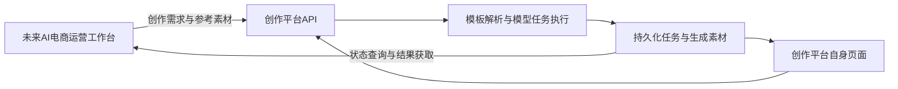

# 下一轮MVP讨论与跨项目接口预留

日期：2026-10-23。状态：需求讨论记录与设计草案，尚未形成下一版正式PRD，尚未同步给后端开发。

用户要求先留存设计；由用户向后端同步，完成后再告知Codex。当前只保存文档，不启动功能开发、不调用新模型、不代发消息。AI电商运营工作台尚未开始开发。

## 1. 已确认的产品方向

| 事项 | 本轮确认内容 | 目前实现状态 |
| --- | --- | --- |
| 用户范围 | 电商内容创作者、个人、小商家与团队，不限定To B/To C | 当前仅本机单人原型；外部用户与团队能力待开发 |
| 阶段目标 | 下一轮做完整可用的MVP，完善用户独立完成任务的流程 | 当前基线PRD v0.6.1，已有真实图像/视频链路 |
| 多模型 | 图片、视频均希望提供多个模型选择 | 当前各一个已验证模型；新增数量、型号、供应商范围未定 |
| 模板 | 增加工作模板/热点模板功能；用户明确选择“单次创作模板” | 当前仅白底/氛围等提示词预设，不是完整模板系统 |
| 模板流程 | 选模板→上传素材/填写信息→选择兼容模型→参数→生成→预览/修改/下载 | 待细化交互、数据和验收条件 |
| 画布 | 先做用户调研，再判断是否增加无限节点画布 | 原有固定排版工具继续存在；新增节点画布未确定开发 |
| 两个项目 | 电商创作平台与AI电商运营工作台分开开发，未来通过接口协作 | 运营工作台未开发；跨项目集成未实现 |

工作模板优先、热点模板首版人工维护、先接同一供应商等，是此前助手提出的建议，尚未全部得到用户确认。不能当作已冻结范围。

## 2. 两个项目的分工与连接意图

电商AIGC创作平台：保留独立用户界面，同时提供内容生产接口，负责模板与模型能力、图片/视频生成、任务状态、素材保存和结果返回。

AI电商运营工作台：未来组织商品与运营需求，通过接口提交创作任务，接收生成结果并进入其自己的审核/运营流程。运营工作台的具体模块、自动化程度、发布能力、平台接入和权限均未定义，本记录不替另一个项目立项。

这是规划结构，不是已部署架构。两个项目不依靠模拟点击对方页面连接，也不要求共享数据库；正式数据交换方式待接口设计时确定。

## 3. 建议预留的接口设计

下列是候选契约要求，不是新增接口已完成，也不直接冻结URL和字段。优先复用现有素材、任务、批量、状态与结果接口，明确增量后再开发。

| 能力 | 候选设计内容 | 验收意图 |
| --- | --- | --- |
| 能力发现 | 可用模型、支持任务、输入要求、参数范围、模板兼容性 | 运营工作台可按能力构造任务，不复制各家模型参数规则 |
| 模板引用 | 稳定template_id、template_version、填写字段与输入校验 | 模板更新后，历史任务仍能追溯其实际使用内容 |
| 素材交接 | 上传/引用方式、访问权限、有效期与归属 | 两个独立部署的项目都能取得合法输入，不传本机绝对路径当远程素材 |
| 异步生成 | 提交后立即取得任务ID；查询状态、错误与结果 | 运营工作台不需保持一个长HTTP请求等待整条视频 |
| 外部任务关联 | 运营端external_request_id与创作端task_id关联 | 跨项目定位需求、输入、产物和失败原因 |
| 幂等 | 同一调用方的重复提交识别、返回已有任务的条件 | 网络重试不意外创建多条生成任务；当前client_request_id作为基础核查 |
| 结果契约 | asset_id、可访问文件方式、规格、实际模型/模板版本、用量与费用口径 | 调用方可消费真实文件，区分估算与结算 |
| 权限与额度 | 调用方身份、用户/项目归属、允许能力、限流和额度 | 权限由创作平台后端校验，费用可归因；不把供应商Key交给运营页面 |
| 错误与停止 | 错误码、可重试性、创建结果不明、取消的真实语义 | 调用方能正确提示与处理，不把停止本地等待描述成云端不计费 |
| 完成通知 | 首版候选采用轮询；后续按需要补Webhook及验签/重试 | 轮询和Webhook二者不是都要首版完成，仍待设计确认 |
| 版本兼容 | 接口版本、字段兼容规则及变更记录 | 两个项目可以独立发布，不因一次改名同时失效 |

首轮验收可以由测试调用方模拟运营工作台完成“上传/引用素材→提交→查状态→取文件→重复请求核查”。这证明接口契约可用，不能称为两个真实产品已联调；真实联调需等运营工作台具备调用能力。

## 4. 下一版需要先完善的用户流程

| 环节 | 当前基础 | 下一版候选完善项 |
| --- | --- | --- |
| 开始任务 | 生图/生视频、用途预设 | 自由创作与模板入口关系清楚；模板有示例、适用条件、必填字段 |
| 准备输入 | 单参考图、提示词、参数 | 用商品信息与修改目标帮助填写；明确需要保留的商品特征 |
| 选择模型 | 各一个固定可用模型 | 按任务/模板过滤兼容模型；切换保留可复用输入，明确不兼容参数 |
| 提交确认 | 数量与付费确认 | 明确本次任务、模型、规格、数量及费用估算/估算范围，后台同样校验 |
| 执行反馈 | 任务队列与状态 | 结果与本次任务关联；失败原因、下一步操作和取消语义清楚 |
| 查看与修改 | 预览、复用参考图、重试 | 找回原输入与参数、对照原图、修改后新建版本；不要求首版就有局部重绘 |
| 保存与交付 | 草稿、素材库、下载/ZIP | 产物关联模型、模板、原图、参数和任务；能找到并继续使用 |

这些是待讨论的改进清单，未全部确定为首版必做。先用一条真实用户任务走查，确认阻断闭环的项，再形成PRD；不直接接入大量模型来替代流程梳理。

## 5. 用户告知后端已同步后的推进顺序

1. **确认共同基线。** 读取后端反馈及当前文件，列出同意项、技术约束、待定项；不重复讨论已明确的单次模板与画布调研原则。
2. **收回竞品研究与真实任务样例。** 用户已取得可交给其他Agent的调研指令；是否已执行和何时返回报告尚未确认。报告回来后核对来源，再挑可借鉴流程，不把竞品宣传当实测。
3. **共同走完一个典型创作任务。** 例如商品原图换场景，再将选中图片作为短视频首帧；图片、视频各是一项可单独完成的创作任务，不自动升级为复杂多步骤模板编排。
4. **冻结下一版PRD。** 确定首批模板、填写字段、多模型范围、必要流程修复、跨项目接口做到什么程度、非目标及验收标准。版本号待定，保留当前v0.6.1。
5. **确认技术与接口契约。** 后端给出模板/模型能力与任务数据增量；前端按契约定义输入、切换、结果与错误状态。形成可供未来运营项目使用的接口说明。
6. **按小闭环实施和验收。** 先打通一个模板与现有模型，再验证新增模型及参数兼容、结果追溯和失败路径；前后端可在接口明确后协同推进。新付费验证的范围和预算另定。
7. **同步交付文档。** 更新操作手册、评测、接口、项目状态与变更记录。运营项目未开发期间只验证API调用方，不宣称两产品已连通。

## 6. 后端同步交接摘要

用户会亲自同步，以下供读取与转述，不代表已送达后端：

> 当前已交付本机工作台及真实文生图/图生图/首帧视频。下一版目标为完整MVP，讨论方向是多模型选择和单次创作模板；无限节点画布先调研。新增架构要求：创作平台保留独立页面，同时为未来独立开发的AI电商运营工作台提供内容生产API。运营项目尚未开发，请先理解边界与反馈约束；下一版仍按需求/PRD→契约→开发→实测推进。型号、供应商、模板清单、预算、接口具体实现尚未冻结，当前不是立即开发指令。

## 7. 当前停留点

- 后端同步：**待用户完成并通知**。
- 下一版正式PRD：未开始升版；当前v0.6.1继续作为已实现基线。
- 功能开发：未开始本轮新增开发。
- 竞品研究：已向用户提供调研指令，后续结果待用户提供。
- 运营工作台：尚未开发；只留存连接意图和接口候选设计。
- 下一次恢复：先确认后端反馈，再引导用户逐项明确下一版MVP的流程与范围。
